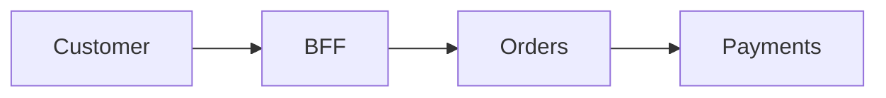
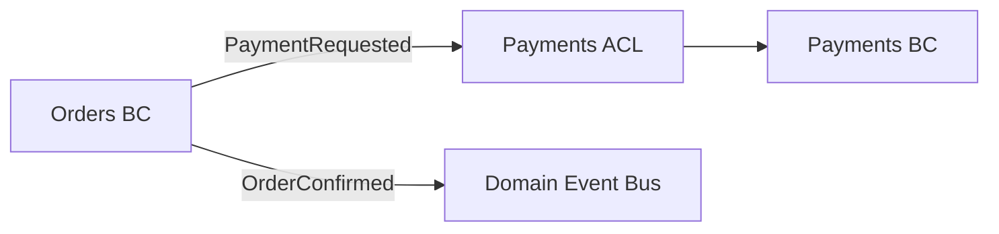

# Threat Modeling as Code in 2026: A Git-First, AI-Assisted Architecture for DFDs, Attack Forests and IAM Automation

## Executive assessment

The ecosystem has moved materially during 2025–2026. There is now enough tooling to build a credible **threat-model-as-code platform**, but there is still no single mature, universally adopted format that covers everything you want: DFDs, DDD bounded contexts/context maps, trust boundaries, threats, attack trees/forests, assets, mitigations, IAM intent, PAM/JIT/JEA, policy enforcement and evidence. The most important architectural decision is therefore **not to choose Mermaid, draw.io, Threat Composer JSON, ThreatCL HCL, OTM or an IriusRisk project as the universal truth**. Instead, use a **semantic security graph as the canonical model** and generate those formats as projections/adapters. The standards landscape is moving in this direction, but it is not finished: the OWASP Threat Model Library released its v1 schema in 2025, while the CycloneDX Threat Model BOM work is still described by OWASP as pending and intended for inclusion in the ECMA-424/CycloneDX ecosystem. citeturn18search0turn18search4

My strongest current recommendation is:

```text
                         GIT
                          │
             ┌────────────┴────────────┐
             │                         │
        Deterministic               AI-assisted
        extraction                  enrichment
             │                         │
     Terraform / Bicep             Source code
     Helm / Kubernetes             ADRs / docs
     Argo CD                       OpenAPI
     OpenAPI / AsyncAPI            DDD hints
     Kafka definitions             domain language
     IAM exports                   threat intel
             │                         │
             └────────────┬────────────┘
                          ▼
              CANONICAL SECURITY GRAPH
                    JSON/YAML/HCL
                          │
        ┌─────────────────┼──────────────────┐
        │                 │                  │
        ▼                 ▼                  ▼
      DFDs            Context maps       Attack graph
     Mermaid             Mermaid         trees/forest
        │                                    │
        └─────────────────┬──────────────────┘
                          ▼
                   THREAT ENGINE
            STRIDE / rules / RAG / ATT&CK
                          │
                          ▼
                    CONTROL GRAPH
                          │
                          ▼
                SECURITY-INTENT MODEL
                          │
          ┌───────────────┼───────────────────┐
          ▼               ▼                   ▼
         IAM             PAM/JIT          Policy-as-Code
     Entra/Azure RBAC      PIM/JEA        OPA/OpenFGA/Cedar
     K8s/Kafka/etc.
          │               │                   │
          └───────────────┼───────────────────┘
                          ▼
                  GENERATED PLANS
                          │
                          ▼
                   Pull Request
                          │
                  policy validation
                  authorization tests
                  privilege diff
                  threat-model diff
                          │
                          ▼
                   HUMAN APPROVAL
                          │
                          ▼
                       APPLY
```

The best current open-source pieces for that architecture are **ThreatCL** for a practical Git-native threat-model source and deterministic validation, **AWS Threat Composer** and **STRIDE GPT** for AI-assisted discovery, **ThreatForest** for agentic attack-tree/ATT&CK generation, **OPA** for policy gates, and **OpenFGA or Cedar** for machine-testable application authorization models. For a richer collaborative UI/API layer, **Precogly** is especially interesting but still young; **IriusRisk + OTM + StartLeft** remains the stronger commercial/governance route. citeturn16view0turn15search7turn19search0turn21view0turn13search0turn14search0turn20view0turn18search12

There is also one correction to the premise in the question. **OWASP Threat Dragon is not currently abandoned.** GitHub shows a 2.6.2 release dated May 10, 2026, and the OWASP organisation page showed repository activity in June 2026. citeturn15search4turn15search6 I still would **not** choose it for the architecture you are describing, because your requirement is code-first, graph-oriented, automatable and AI/CI-driven rather than primarily interactive diagram authoring. But it should be excluded for architectural-fit reasons, not because it has had no recent development.

The really important conclusion from this research is:

> **The emerging unit of automation is not the diagram. It is the typed security graph.**

A DFD is one projection of that graph. A DDD context map is another. An attack tree is another. An IAM model is another. A PIM policy is another. Once you model the relationships semantically, you can start deriving one from another instead of maintaining six independent pictures.

## Current tooling that is actually worth considering

I checked current repositories, documentation, releases and 2026 activity rather than relying on older threat-model-tool lists.

### The strongest candidates

| Tool | Role I would give it | Format / interface | AI | 2026 health | Verdict |
|---|---|---|---:|---|---|
| **ThreatCL** | Canonical TM-as-code authoring / validation | HCL + JSON; GraphQL; MCP | MCP-enabled | Very active | **Top choice** |
| **AWS Threat Composer** | AI-assisted threat-model authoring | `.tc.json`, UI, CLI, MCP | Strong | Multiple 2026 releases | **Top choice for AI enrichment** |
| **ThreatForest** | Attack trees / attack forest / TTP mapping | Graph/tree pipeline | Strong multi-agent | New and very active | **Top attack-path research/tool** |
| **STRIDE GPT** | Codebase → DFD + threats + trees | JSON, SARIF, Markdown, Mermaid | Strong | Active v0.19-generation codebase | **Excellent enrichment engine** |
| **pytm** | Python-defined architecture/TM | Python → DFD/report/JSON | Limited/native logic | Revived and active | **Good Python-first alternative** |
| **Threagile** | Deterministic architecture/risk rules | YAML | Mostly rules, not LLM-first | Core still maintained | **Useful deterministic engine** |
| **Precogly** | OSS collaborative TM platform / API | REST/OpenAPI + TM-BOM-style JSON | AI-agent-oriented | v0.3.0, active | **Very interesting, still early** |
| **TMDD** | Lightweight AI-assisted TM-as-code | YAML + JSON Schema | Agent instructions | Very new | **Pilot/experimental** |
| **IriusRisk + StartLeft** | Enterprise governance and interoperability | OTM JSON/YAML + API | Commercial AI | Current | **Strong commercial layer** |
| **MSTICPy** | CTI/data enrichment, not canonical TM | Python/notebooks | Adjacent | Maintained | **Complement, not core** |

### ThreatCL is currently the most compelling code-first foundation

ThreatCL explicitly positions itself as a DevOps-first threat-model format with simple text files, a CLI and VCS integration. Its HCL model already supports information assets, threats, controls and DFDs. More importantly for your intended platform, the current CLI includes validation, organisational invariants, native JSON/OTM export, Terraform-plan parsing, a GraphQL query/server interface, an MCP server, an LSP and Mermaid handling. The repository also documents SLSA provenance and Sigstore-backed attestations for releases. citeturn16view0

That combination is unusually close to what you need:

```text
ThreatCL HCL
    │
    ├── semantic model
    ├── validate
    ├── organisational invariants
    ├── DFD
    ├── JSON
    ├── OTM
    ├── Terraform ingestion
    ├── GraphQL
    ├── MCP
    └── GitHub Actions
```

ThreatCL is therefore much more interesting today than a simple “write threats in HCL” tool. The current repository even shows an invariant mechanism capable of expressing organisational rules such as requiring implemented controls for threats or requiring security attributes on exposed components. citeturn16view0

There is also a maintained GitHub Action. The action was updated in May 2026 and wraps validation, dashboard, DFD and export operations. The example README still contains an old `actions/checkout@v2` example, so I would modernise the surrounding workflow rather than copy it verbatim; the underlying ThreatCL action itself received 2026 updates. fileciteturn2file0L1-L7

I would, however, **extend ThreatCL rather than treat its current schema as the final ontology**. Your eventual graph needs concepts such as bounded contexts, identities, authorization intents, privileged activation, attack preconditions/postconditions and evidence provenance that go beyond ordinary threat-model objects.

### AWS Threat Composer has become significantly more interesting

Threat Composer is no longer merely a browser threat-model worksheet. Its recent releases added **agentic AI through a CLI and MCP server**, and it uses structured `.tc.json` models that can live in Git. The release history shows continued work through 2026, including AI-specific bug fixes and features following the addition of the agentic CLI/MCP capability in December 2025. citeturn15search7

That makes it useful as:

```text
repository
    ↓
Threat Composer AI
    ↓
starter model
    ↓
human review
    ↓
.tc.json
    ↓
adapter
    ↓
your canonical security graph
```

I would **not** make `.tc.json` your organisation-wide standard, because it is an AWS-tool-specific representation. But it is now a credible input/output adapter and AI authoring environment.

### ThreatForest is probably the most relevant new 2026 project for your attack-forest ambition

AWS's ThreatForest is specifically an **agentic threat-modeling and attack-tree generator**. It runs a pipeline containing repository scanning, threat identification, attack-tree generation, TTP mapping and mitigation generation; it maps attack steps to MITRE ATT&CK with semantic embeddings. The current repository has hundreds of commits and links to a July 2026 research paper describing the approach. citeturn21view0

Its conceptual architecture is directly aligned with your goal:

```text
Code repository
      ↓
Scanner agent
      ↓
Threat identifier
      ↓
Attack tree agent
      ↓
TTP mapper
      ↓
Mitigation advisor
      ↓
Attack forest
```

The important part is that ThreatForest is **not simply asking an LLM “please give me an attack tree.”** Its research design moves toward structured multi-stage generation and TTP grounding. That is the correct direction for serious automation. citeturn21view0

I would treat it as a **specialist attack-graph generator plugged into the canonical graph**, rather than as the owner of the whole threat model.

There is an important operational warning: ThreatForest's documentation explicitly notes that project context is sent to the configured LLM provider. That means repository classification, code sensitivity and provider boundary need to be part of the threat model of your threat-modeling platform itself. citeturn21view0

### STRIDE GPT has evolved into a serious code-analysis experiment

The current STRIDE GPT is substantially more capable than the early Streamlit tool many people remember. Its repository now describes autonomous codebase analysis, subsystem discovery, DFD generation, editable Mermaid, attack trees, MITRE ATT&CK/ATLAS references, JSON/SARIF output, run manifests, Git SHA/provenance data and structured intermediate files. citeturn19search0

Particularly interesting for your architecture are these outputs:

```text
<model>.plan.json
<model>.findings.json
<model>.run.json
<model>.sarif
```

That is exactly the sort of intermediate evidence you should preserve when an LLM participates in threat generation. STRIDE GPT's run manifest records contextual information such as the selected models, configuration hashes, loaded references, Git SHA and timing, making it substantially easier to reason about reproducibility than an unrecorded chat conversation. citeturn19search0

Its DFD workflow also supports editing Mermaid and feeding the confirmed diagram back into subsequent threat and attack-tree generation. citeturn19search0

I would use STRIDE GPT as an **AI reviewer/enricher**, not as the canonical model owner.

### pytm is no longer something I would dismiss as stale

pytm remains conceptually elegant because the architecture itself is Python:

```python
user = Actor(...)
api = Server(...)
database = Datastore(...)

Dataflow(user, api, ...)
Dataflow(api, database, ...)
```

and then the same executable model generates a DFD, sequence diagram and relevant threats. The current repository supports JSON output, freshness checking, boundaries and newer elements including `LLM` and `Agent`. citeturn21view1

This makes pytm attractive when:

```text
your platform engineers
        already think in Python
                +
you want model generation/logic
                +
you don't mind executable models
```

I still prefer declarative YAML/HCL for a broad enterprise platform because it is easier to inspect, validate, transform and feed into LLM structured-output pipelines.

### Threagile remains useful for deterministic rule evaluation

Threagile's enduring strength is the ability to define architecture and assets in YAML and run **standard plus custom risk rules** against that model. It can generate DFDs, asset diagrams, risk JSON and reports, and custom risk rules can themselves be expressed as YAML scripts. citeturn21view2

That makes Threagile valuable as a second opinion:

```text
Canonical graph
     ↓ adapter
Threagile YAML
     ↓
deterministic rules
     ↓
findings
```

I would not use it as the principal AI/agent platform, but deterministic rule engines are exactly what you need **next to** LLM reasoning. An LLM might suggest that an internet-facing privileged endpoint is risky; a deterministic rule should be able to say that such an endpoint without phishing-resistant authentication is simply forbidden.

### Precogly is one of the most interesting emerging projects

Precogly is a newer open-source project, currently around the v0.3 generation, with an advanced DFD editor, nested trust zones, library packs and a REST/OpenAPI backend explicitly intended to be usable by AI agents. Its current documentation emphasises structured packs linked to MITRE ATT&CK, CAPEC, CWE, STRIDE and compliance requirements rather than unconstrained LLM brainstorming. citeturn20view0

That philosophy is exactly right:

> Let AI operate over curated structured objects, rather than allowing the model to invent the security universe from memory.

Precogly is also now describing TM-BOM-style import/export and an AI-agent-ready API. citeturn20view0

I would **pilot it**, but I would not yet put it at the centre of a large enterprise architecture without accepting that it is still young.

### TMDD is worth watching precisely because it is small

TMDD models actors, components, flows, threats and mitigations in YAML, validates references with `tmdd lint`, produces AI prompts and gives Cursor/Claude-style coding agents instructions to first inspect the real codebase and then update the structured threat model. citeturn20view1

That is a very good pattern:

```text
Feature request
      ↓
Threat-model prompt
      ↓
AI analyzes code / architecture
      ↓
structured YAML
      ↓
schema/lint validation
      ↓
secure implementation prompt
      ↓
implementation
```

The project is currently tiny compared with ThreatCL or pytm, so I would treat it as an **idea source or experimental component**, not a standard.

### IriusRisk still makes sense, but as a governance layer

The Open Threat Model format used around the IriusRisk ecosystem is a platform-independent JSON/YAML representation for threat models, and StartLeft converts sources including Terraform, CloudFormation, draw.io, Visio and other threat-model formats into OTM. StartLeft explicitly targets automated TM generation from IaC and CI/CD integration. citeturn18search2turn18search12

For your design:

```text
Git canonical graph
      │
      ├── OTM export
      │
      ▼
   IriusRisk
      │
      ├── governance
      ├── workflows
      ├── risk tracking
      ├── reporting
      └── enterprise programme
```

is considerably healthier than:

```text
IriusRisk diagram
      =
entire architectural source of truth
```

Draw.io should similarly be treated as an **editable visual projection/import format**, not the canonical machine-readable security ontology.

### MSTICPy belongs elsewhere in the architecture

MSTICPy is primarily a security-data-analysis and threat-intelligence toolkit: notebooks, telemetry enrichment, threat-intelligence lookup and investigation visualisation. It can be useful for validating whether your modeled adversary behaviour corresponds to real telemetry or for enriching an attack graph, but it is not a replacement for ThreatCL/OTM/TM-BOM or a threat-model schema. citeturn4search6

I would put it here:

```text
Threat model
    ↓
ATT&CK hypotheses
    ↓
Detection requirements
    ↓
MSTICPy / SIEM / telemetry analysis
    ↓
validation evidence
    ↓
Threat model
```

That closes an interesting **design → detection → evidence → design** loop.

## The format problem and the architecture I recommend

### Mermaid should be a view, not the source of truth

You were right to want Mermaid. It is excellent for Git because a diagram can be represented as readable text:



But that tells a security engine almost nothing.

It does not inherently say:

```text
Orders:
  bounded_context = true
  identity = workload:orders
  classification = internal
  owner = team:commerce

Payments:
  bounded_context = true
  pci_scope = true
  identity = workload:payments
  privilege = high

Orders -> Payments:
  protocol = HTTPS
  authn = mTLS
  authz = workload-identity
  data = payment-request
  trust_boundary = true
  replay_protection = required
```

The diagram and the semantic model solve different problems.

This is also why the various tools have invented HCL, YAML, JSON and Python schemas around their diagrams: ThreatCL uses HCL and JSON, OTM uses JSON/YAML, Threagile uses YAML, AWS Threat Composer has its structured JSON, pytm uses executable Python, and the OWASP Threat Model Library has a structured schema. citeturn16view0turn18search2turn21view2turn21view1turn18search4

My recommendation is therefore:

> **Canonical semantics in YAML/JSON/HCL; generated Mermaid for humans.**

### There is an emerging standard, but it is not finished

The most strategically important standardisation effort is the **Threat Model BOM / TM-BOM** work around CycloneDX. OWASP's current Threat Model Library documentation says the TM-BOM work is being defined by a CycloneDX working group toward ECMA-424, while the OWASP project page still describes the official TM-BOM release as pending. citeturn18search0turn18search4

The OWASP Threat Model Library itself released v1.0 of its schema alongside Global AppSec Barcelona in May 2025. citeturn18search4

Therefore I would design for:

```text
NOW
 ├── your normalized YAML/JSON graph
 ├── ThreatCL adapter
 ├── OTM adapter
 └── Threat Composer adapter

NEAR FUTURE
 └── CycloneDX TM-BOM adapter
```

rather than waiting for the entire industry to converge.

### The canonical model should actually be a graph

I would create something roughly like this.

```yaml
schema_version: "security-graph/0.1"

system:
  id: cooking-platform
  name: Cooking Platform
  repository: cooking-platform
  owner: team-platform

bounded_contexts:
  - id: bc-orders
    name: Orders
    owner: team-commerce

  - id: bc-payments
    name: Payments
    owner: team-payments
    classification: high

context_relationships:
  - from: bc-orders
    to: bc-payments
    pattern: anti-corruption-layer
    integration: api

components:
  - id: svc-orders
    type: workload
    bounded_context: bc-orders
    runtime: kubernetes

  - id: svc-payments
    type: workload
    bounded_context: bc-payments
    runtime: kubernetes

identities:
  - id: wi-orders
    type: workload
    component: svc-orders

  - id: wi-payments
    type: workload
    component: svc-payments

assets:
  - id: payment-data
    type: data
    confidentiality: restricted
    integrity: critical

flows:
  - id: flow-orders-payments
    from: svc-orders
    to: svc-payments
    protocol: https
    assets:
      - payment-data

    trust:
      crosses_boundary: true

    authentication:
      mechanisms:
        - mtls
        - workload-identity

    authorization:
      required_permissions:
        - payments.create

boundaries:
  - id: payment-context-boundary
    type: trust
    contains:
      - svc-payments

threats:
  - id: THR-PAY-001
    title: Compromised Orders invokes unauthorized payment operation
    applies_to:
      - flow-orders-payments
    categories:
      - elevation-of-privilege
    attack_refs:
      - attack:T1078

controls:
  - id: CTL-PAY-001
    type: authorization
    title: Scope Orders to payment creation only

attack_graphs:
  - id: AG-PAY-001
    goal: unauthorized-refund

    nodes:
      - id: compromise-orders
        type: step

      - id: obtain-orders-workload-identity
        type: step
        requires:
          - compromise-orders

      - id: invoke-refund-api
        type: step
        requires:
          - obtain-orders-workload-identity

authorization_intent:
  - subject: wi-orders
    resource: svc-payments
    permissions:
      allow:
        - payments.create
      deny:
        - payments.refund
        - payments.reconcile

evidence:
  - id: evidence-001
    kind: source
    path: services/orders/src/payment-client.ts
    git_sha: "${GIT_SHA}"
```

That one graph can generate:

```text
DFD
Context Map
Trust Boundary diagram
Attack Tree
Attack Forest
IAM matrix
Control matrix
Data classification map
Architecture report
PAM model
Security tests
```

### DDD belongs directly in that ontology

Based on the discussion we had earlier, I would explicitly model:

```text
bounded_context
aggregate
domain_service
context_relationship
upstream
downstream
anti_corruption_layer
open_host_service
published_language
domain_event
```

Then a Context Map becomes a projection:



Now your threat model can ask:

```text
Does a bounded-context crossing exist?
        ↓
Does model/schema meaning change?
        ↓
Is there an ACL?
        ↓
Is source authenticated?
        ↓
Is source authorized?
        ↓
Is the message schema validated?
        ↓
Is replay handled?
        ↓
Can compromise propagate?
```

This turns DDD from documentation into security metadata.

### Attack trees should also be semantic, not Mermaid strings

The 2026 research direction is particularly interesting here. One recent paper on automatically extracting reachable attack chains models an attack step with **preconditions, behaviour and postconditions**, then compiles those into Datalog-style rules for reachability analysis. In its evaluation, the resulting reasoning reached specified attack goals in 19 of 20 reports. citeturn18academia48

That suggests a better attack-tree model than:

```text
AND
 ├── compromise service
 └── steal credential
```

Instead:

```yaml
attack_step:
  id: use-orders-identity

  preconditions:
    - attacker.controls(svc-orders)
    - credential.exists(wi-orders)

  action:
    - use_identity(wi-orders)

  postconditions:
    - attacker.authenticated_as(wi-orders)
```

Then:

```yaml
attack_step:
  id: call-payments-refund

  preconditions:
    - attacker.authenticated_as(wi-orders)
    - reachable(svc-orders, svc-payments)

  action:
    - invoke(payments.refund)

  postconditions:
    - refund_issued
```

That enables:

```text
Attack Tree
       +
Reachability
       +
IAM graph
       +
Network graph
       +
Control graph
       =
actual Attack Graph
```

That is the direction I would invest in.

## From threat graph to IAM, PAM, JIT and JEA

This is where your idea becomes much more powerful than conventional threat modeling.

I would **not generate Azure RBAC/PIM/Kubernetes roles directly from an LLM-generated threat model**.

Insert another model:

```text
Threat Model
      ↓
Security Requirements
      ↓
AUTHORIZATION INTENT
      ↓
Deterministic compiler
      ↓
Provider-specific policy
```

That prevents this:

```text
LLM
 ↓
"looks reasonable"
 ↓
Global Administrator
```

which is not quite the autonomous-security future we are aiming for.

### Model capabilities before roles

Do not begin with:

```text
GRP-Payments-Operators
GRP-Payments-Admins
GRP-Payments-Support
```

Begin with:

```text
payment.read
payment.create
payment.refund
payment.reconcile

payment-config.read
payment-config.write

payment-secret.read
payment-key.rotate

payment-prod.deploy
payment-prod.restart
```

Then model constraints:

```yaml
capability: payment.refund

allowed_principals:
  - workload:refund-service
  - human-role:payment-operator

conditions:
  environment: production

privilege:
  standing_access: false
  jit: true
  maximum_duration: PT1H
  approval_required: true
  approver_role: payment-security-approver
  justification_required: true

separation_of_duties:
  incompatible_with:
    - payment.reconcile

evidence:
  audit_required: true
```

Your compiler can then derive:

```text
Entra groups
Azure RBAC assignments
Entra PIM eligibility
PIM activation settings
Kubernetes RBAC
Kafka ACLs
database grants
API scopes/app roles
OpenFGA/Cedar authorization
JEA role capabilities
```

### Entra PIM is automatable enough to make this realistic

Microsoft Graph exposes role eligibility and assignment schedule requests, and current Microsoft documentation shows programmatic creation of role eligibility, activation duration and justification. Microsoft also documents management of PIM role policy settings through the `unifiedRoleManagementPolicy` resources. citeturn12search0turn12search1turn12search15

That makes the following derivation feasible:

```yaml
privilege:
  type: human
  mode: eligible
  max_duration: PT2H
  approval: true
  mfa: true
```

to:

```text
Microsoft Graph
       ↓
PIM eligible assignment
       +
activation policy
       +
expiration
       +
approval requirement
       +
justification requirement
```

PIM for Groups also exposes role-management-policy functionality through Microsoft Graph, although some APIs remain beta depending on the operation. citeturn14search14

The threat model therefore can legitimately become an **input into PAM design**.

### JEA can also be generated from capability intent

PowerShell JEA limits privileged administration to specified commands, parameters and variables and controls which users may connect to JEA endpoints. Microsoft still provides current JEA training and documentation around role capabilities and session configurations. citeturn13search3

This:

```yaml
admin_capability: restart-payment-service

commands:
  allow:
    - Restart-Service

parameters:
  Name:
    allowed_values:
      - thermomix-payment-api
```

can be compiled into a JEA Role Capability.

Again, the LLM may **suggest** the capability. A deterministic generator should create and validate the PowerShell configuration.

### Application authorization should not end at Entra roles

For your 25-microservice architecture, something like **OpenFGA** becomes interesting after the threat model has identified domain authorization relationships.

OpenFGA currently supports authorization models as code, conditions/time-based access, role/permission patterns and `.fga.yaml` model tests; its current documentation explicitly provides a GitHub Actions testing flow. citeturn14search0turn14search5turn14search8

For example:

```text
type service
type payment

type payment
  relations
    define creator: [service]
    define refunder: [service]
```

and:

```text
orders-service
     │
     └── creator → payments

refund-service
     │
     └── refunder → payments
```

The authorization test can assert:

```text
orders-service CAN create payment
orders-service CANNOT refund payment
refund-service CAN refund payment
```

This is substantially stronger than saying:

> "We have an `Api.User` role."

OpenFGA's July 2026 documentation also specifically discusses authorization of MCP servers and agent principals, which is notable given how rapidly agent tooling is becoming part of the software supply chain. citeturn14search6

Cedar is another good target where ABAC-style policy and explicit schemas are attractive; current Cedar documentation strongly recommends schema-based validation before policies are used for authorization decisions. citeturn14search1

### OPA is the glue for invariants

OPA remains particularly well suited to rules such as:

```text
Every public flow requires authentication.
Every privileged operation requires authorization.
Every restricted data store requires encryption.
Every production admin capability must be JIT.
No workload receives wildcard permissions.
Every bounded-context crossing must identify a protocol.
Every trust-boundary crossing must specify authentication.
Every high-impact threat must have an implemented control.
```

OPA is a CNCF-graduated general policy engine and its current documentation explicitly covers use in microservices, Kubernetes, CI/CD and API gateways. Its CI/CD guidance includes GitHub Actions examples. citeturn13search0turn13search10

For example:

```rego
package threatmodel

deny contains msg if {
    flow := input.flows[_]
    flow.trust.crosses_boundary
    count(flow.authentication.mechanisms) == 0

    msg := sprintf(
        "Flow %s crosses a trust boundary without authentication",
        [flow.id]
    )
}
```

That is the point where threat modeling becomes **enforceable architecture**.

### Build a privilege graph and test blast radius

Once identities and capabilities are in the same graph as services, you can do something particularly valuable:

```text
Assume principal X compromised
              ↓
which permissions?
              ↓
which resources?
              ↓
which identities can it impersonate?
              ↓
which services can it reach?
              ↓
which data can it influence?
              ↓
which attack preconditions become true?
              ↓
new reachable attack paths
```

For example:

```text
Compromise Orders
      ↓
orders-workload-identity
      ↓
payments.create
      ↓
Payments API
      ↓
NO payments.refund
      ↓
attack path terminates
```

Compare:

```text
Compromise Orders
      ↓
shared-platform-service-principal
      ↓
payments.*
      ↓
Refund
      ↓
Key Vault read
      ↓
Payment DB contributor
      ↓
CRITICAL ATTACK PATH
```

This creates a quantitative reason to separate workload identities and App Registrations instead of arguing about the number of microservices.

## A practical GitHub Actions architecture

The workflow should be split into **deterministic validation**, **AI enrichment**, **authorization compilation**, and **privilege-changing deployment**.

Do not give the LLM stage authority to directly deploy security changes.

### Repository structure

I would use approximately:

```text
repo/
│
├── architecture/
│   ├── contexts.yaml
│   ├── adr/
│   ├── openapi/
│   └── asyncapi/
│
├── threat-model/
│   ├── model.yaml
│   ├── threats/
│   ├── attack-graphs/
│   ├── assumptions/
│   ├── evidence/
│   └── generated/
│       ├── dfd.mmd
│       ├── context-map.mmd
│       ├── attack-forest.mmd
│       └── report.md
│
├── security-intent/
│   ├── capabilities.yaml
│   ├── identities.yaml
│   ├── privileged-access.yaml
│   └── sod.yaml
│
├── policy/
│   ├── rego/
│   ├── openfga/
│   └── cedar/
│
├── generated/
│   ├── azure-rbac/
│   ├── entra-pim/
│   ├── kubernetes-rbac/
│   ├── kafka-acls/
│   └── jea/
│
├── infra/
│   └── terraform/
│
└── .github/
    └── workflows/
        ├── threat-model-pr.yml
        ├── threat-model-ai.yml
        └── security-intent-apply.yml
```

### The deterministic PR workflow

ThreatCL already supports GitHub Actions and current ThreatCL can validate models, enforce invariants and export structured formats. citeturn16view0 OPA also provides official CI/CD guidance for policy gates. citeturn13search10

An illustrative workflow could therefore look like:

```yaml
name: Threat Model PR

on:
  pull_request:
    paths:
      - "src/**"
      - "services/**"
      - "architecture/**"
      - "infra/**"
      - "helm/**"
      - "k8s/**"
      - "threat-model/**"
      - "security-intent/**"
      - "policy/**"

permissions:
  contents: read

jobs:
  validate-threat-model:
    runs-on: ubuntu-latest

    steps:
      - name: Checkout
        uses: actions/checkout@v6

      - name: Validate ThreatCL models
        uses: threatcl/threatcl-action@v0.0.7
        with:
          command: validate
          files: "./threat-model/**/*.hcl"

      - name: Export normalized representation
        uses: threatcl/threatcl-action@v0.0.7
        with:
          command: export
          files: "./threat-model/**/*.hcl"
          export-format: json
          export-output: "./build/threat-model.json"

      - name: Validate semantic graph
        run: |
          python tools/validate_security_graph.py \
            build/threat-model.json

      - name: Generate Mermaid projections
        run: |
          python tools/render_views.py \
            build/threat-model.json \
            --output threat-model/generated/

      - name: Check architecture invariants
        run: |
          opa eval \
            --fail-defined \
            --data policy/rego \
            --input build/threat-model.json \
            'data.threatmodel.deny[_]'

      - name: Compile authorization intent
        run: |
          python tools/compile_authorization.py \
            --model build/threat-model.json \
            --intent security-intent/ \
            --out build/authz/

      - name: Test application authorization
        run: |
          fga model test \
            --tests policy/openfga/model.fga.yaml

      - name: Detect semantic security changes
        run: |
          python tools/security_diff.py \
            --model build/threat-model.json \
            --fail-on unreviewed-privilege-increase
```

This specific orchestration is my proposed architecture rather than an existing off-the-shelf project, but every major primitive exists today: ThreatCL supports validation/export and GitHub integration, OPA supports CI policy gates, and OpenFGA supports authorization-model testing in GitHub workflows. citeturn16view0turn13search10turn14search0

### Semantic diff matters more than text diff

A PR should say:

```text
SECURITY MODEL DIFF

+ New external actor:
    partner-payment-provider

+ New trust-boundary crossing:
    payments → partner-payment-provider

+ New sensitive asset:
    payment-token

+ Identity privilege increased:
    orders-service
      OLD: payments.create
      NEW: payments.create, payments.refund

! New reachable attack path:
    compromise-orders
      → use-orders-identity
      → refund-payment

RISK CHANGE:
    Medium → Critical
```

rather than:

```diff
+ role = "Contributor"
```

The latter is a syntax diff.

The former is an **architectural security diff**.

That is one of the pieces I found missing from virtually all of today's tools, and I think it is one of the best areas for you to build.

### AI should run in a separate enrichment workflow

Current STRIDE GPT can autonomously analyse a codebase and emit JSON, SARIF and structured run artifacts. citeturn19search0 ThreatForest can independently derive attack trees and ATT&CK mappings from repository context. citeturn21view0

I would therefore have:

```yaml
name: AI Threat Model Enrichment

on:
  workflow_dispatch:

permissions:
  contents: read

jobs:
  ai-review:
    runs-on: ubuntu-latest

    steps:
      - uses: actions/checkout@v6

      - name: Analyse repository
        run: |
          stride-gpt analyze . \
            -o build/stride-analysis.json \
            -f json \
            --max-llm-calls 60

      - name: Normalize AI findings
        run: |
          python tools/import_stride.py \
            build/stride-analysis.json \
            --existing threat-model/model.yaml \
            --output build/proposed-model.yaml

      - name: Validate AI proposal
        run: |
          python tools/validate_security_graph.py \
            build/proposed-model.yaml

      - name: Reject unsupported ATT&CK identifiers
        run: |
          python tools/validate_attack_refs.py \
            build/proposed-model.yaml

      - name: Produce human-reviewable proposal
        run: |
          python tools/security_diff.py \
            --base threat-model/model.yaml \
            --candidate build/proposed-model.yaml \
            > build/security-proposal.md
```

Then the model does **not** write to production.

It produces:

```text
AI proposal
     ↓
schema validation
     ↓
taxonomy validation
     ↓
semantic diff
     ↓
PR
     ↓
security/domain owner review
```

ThreatForest's 2026 research direction reinforces this design: structured agent pipelines, grounding, deterministic verification and human-validation checkpoints are preferable to trusting a single free-form model response. citeturn4academia26turn21view0

### Make architecture drift a first-class failure

The best pipeline will ingest:

```text
Terraform plan JSON
Kubernetes manifests
Helm rendered manifests
Argo CD Applications
OpenAPI
AsyncAPI
Kafka topics/ACLs
Microsoft Graph IAM state
Azure role assignments
PIM policies
application authorization model
```

and compare them with:

```text
threat-model/model.yaml
security-intent/*.yaml
```

Then detect:

```text
model says:
Orders cannot access Refund API

runtime says:
Orders has payments.refund

         ↓

DRIFT
         ↓
FAIL
```

That is where threat modeling stops being compliance documentation and becomes a real control plane.

### CI/CD identities should themselves be generated from the model

GitHub Actions supports OIDC-based access to Azure without persistent cloud secrets. GitHub's current documentation also notes an important 2026 change: repositories created after July 15, 2026, and repository renames/transfers after that date, use an immutable default OIDC subject format containing owner and repository IDs; existing repositories can opt in. citeturn12search5turn12search7

Therefore your graph can contain:

```yaml
identity:
  id: gha-prod-deployer
  type: cicd-workload

federation:
  issuer: github-actions
  repository: thermomix/cooking-platform
  environment: production
  immutable_subject: true

permissions:
  - deployment.create

constraints:
  protected_environment: production
  branch: main
```

and derive the Entra federated credential and Azure role assignment from that.

That closes another circle:

```text
Threat model
    ↓
CI/CD trust requirements
    ↓
federated workload identity
    ↓
deployment permissions
    ↓
runtime evidence
    ↓
threat-model validation
```

## AI, attack-graph and research trends worth following

There is a distinct shift in the 2025–2026 research and tooling from **“LLM writes a STRIDE table”** toward structured, multi-stage reasoning.

### Multi-agent attack-tree generation

ThreatForest's July 2026 work is directly relevant because it decomposes the problem into specialised stages and grounds attack steps against TTP frameworks instead of relying entirely on generative recall. citeturn21view0turn4academia26

The practical lesson is:

```text
BAD

Architecture
   ↓
one enormous prompt
   ↓
"Give me all threats and mitigations"


BETTER

Architecture extraction
   ↓
asset analysis
   ↓
trust-boundary analysis
   ↓
threat hypothesis generation
   ↓
attack path generation
   ↓
ATT&CK retrieval
   ↓
control retrieval
   ↓
deterministic validation
   ↓
human review
```

### Attack paths are becoming executable logic

The July 2026 reachable-attack-chain paper is perhaps even more strategically important for your idea. By giving attack actions explicit preconditions and postconditions and compiling them to Datalog-like reasoning rules, it transforms an attack tree from a picture into something closer to an executable model. citeturn18academia48

That can eventually let you ask:

```text
Given:

network policy
+
IAM
+
workload identities
+
PIM eligibility
+
service APIs
+
data classification
+
current controls

Can attacker goal G be reached?
```

And after changing IAM:

```text
Does this PR introduce a new path to goal G?
```

That is much more compelling than DREAD scores.

### DFD-grounded RAG is showing up in research

PriMod4AI, published in February 2026, combines DFD-derived system metadata with retrieval over structured privacy-threat knowledge bases and LLM reasoning. The point is not that you should adopt that exact privacy framework; the interesting pattern is **DFD → retrieve applicable structured knowledge → LLM explanation/classification**, rather than asking an LLM to reason from memory. citeturn18academia51

That pattern generalises beautifully:

```text
DFD element
   ↓
component type
   ↓
trust boundary
   ↓
data classification
   ↓
retrieve:
  ATT&CK
  CAPEC
  CWE
  ASVS
  cloud controls
  internal patterns
   ↓
LLM reasoning
   ↓
structured candidates
```

### Agentic systems are pushing attack trees back into relevance

MATRA, published in May 2026 and presented in the EuroS&P ecosystem, uses asset-based impact assessment plus attack-tree analysis for agentic AI systems and examines how controls such as sandboxing and least privilege reduce blast radius. citeturn18academia49

This is useful even outside AI because it reinforces an important modelling principle:

> Do not merely enumerate vulnerabilities. Start with assets and undesirable outcomes, then reason backwards through attack paths.

That maps naturally to your IAM compiler:

```text
GOAL
Unauthorized production payment refund
        ↑
attack paths
        ↑
required capabilities
        ↑
identities
        ↑
permissions
        ↑
controls
```

### Hugging Face is useful, but I would not make an HF model authoritative

There are now 2025–2026 Hugging Face models and datasets aimed at cyber reasoning, threat classification and ATT&CK mapping; examples include Foundation-Sec-8B-Reasoning and CIRCL's security-oriented Hugging Face activity. citeturn5search17turn5search21

I would use these for:

```text
embedding
ranking
classification
candidate generation
retrieval
similarity
```

not:

```text
final IAM policy
final PIM assignment
final ATT&CK identifier
final risk acceptance
```

ThreatForest's approach is instructive: semantic embeddings help map steps to ATT&CK, but the taxonomy itself remains an external reference. citeturn21view0

For a security control plane, prefer:

```text
LLM:
    "I think this is credential abuse."

        ↓ retrieval/validation

MITRE data:
    technique identifier exists?
    technique semantics match?

        ↓

accepted mapping
```

over:

```text
LLM:
    "T9999.42 is definitely the right technique."

        ↓

production database
```

The second architecture is an efficient ATT&CK hallucination factory.

### MCP is emerging as an important integration mechanism

ThreatCL now exposes an MCP server, Threat Composer added agentic AI/MCP functionality, and AWS has invested heavily in MCP-based infrastructure tooling. citeturn16view0turn15search7turn15search2

This lets an IDE agent interact with the security model through **tools** rather than copying giant documents into prompts:

```text
Coding Agent
      │
      ├── get_component("payments")
      ├── get_flows("payments")
      ├── get_threats("payments")
      ├── get_allowed_permissions("orders")
      ├── propose_threat(...)
      ├── validate_model(...)
      └── calculate_security_diff(...)
```

That is substantially more scalable than injecting the entire threat model into every prompt.

I would build your security graph service with:

```text
REST/OpenAPI
GraphQL
MCP
```

all backed by the same semantic model.

### Provenance is becoming essential

STRIDE GPT's current structured run manifests and ThreatCL's release provenance are both signals of a broader requirement: once an AI system modifies threat models, you need to know **which model, which source revision, which threat knowledge and which configuration produced the result**. citeturn19search0turn16view0

Every AI-created object in your model should therefore include something like:

```yaml
provenance:
  generated_by:
    type: llm-agent

  model_family: "${MODEL_ID}"

  source_git_sha: "8fa4..."

  prompt_template:
    version: "tm-agent-17"

  retrieved_sources:
    - mitre-attack-enterprise
    - internal-control-library-v31

  confidence: 0.82

  human_review:
    status: approved
    reviewer: security-architecture
```

The human-reviewed version then becomes authoritative.

## The recent learning material I would actually spend time on

A lot of threat-model content online still teaches a 2018 workflow. These are more aligned with where the field is now.

| Resource | Date | Why it is relevant |
|---|---:|---|
| **AWS re:Invent – Threat-Modeling-As-Code / ThreatForest** | 2025 | Directly addresses code-driven threat statements → attack trees |
| **SecAppDev – Threat Modeling with AI** | 2026 | Full-day AI-assisted DFD/threat/control workshop |
| **IEEE Software / STRIDE GPT discussion** | 2025 | LLM-assisted practical TM discussion |
| **CMU SEI threat-modeling podcast** | 2025 | Strong systems-engineering view |
| **AppSec Village – AI-enhanced TM / Precogly** | 2026 | Structured libraries + agents |
| **Black Hat AI-augmented threat-model training** | 2026 | Current practitioner material |
| **ThreatForest paper + repository** | 2026 | Most directly relevant attack-tree research |
| **PriMod4AI** | 2026 | DFD + retrieval + LLM methodology |
| **Reachable Attack Chains paper** | 2026 | Attack path → logic/reachability |
| **MATRA** | 2026 | Asset/risk/attack-tree thinking for agentic systems |

The AWS re:Invent 2025 Threat-Modeling-As-Code material specifically demonstrates converting application context, architecture and threat statements into attack trees and mitigations, which is exceptionally close to your desired direction. citeturn22search9

SecAppDev's June 2026 “Threat modeling with AI” workshop explicitly covers AI-generated DFDs, STRIDE threat identification and countermeasure mapping while stressing that AI supports rather than replaces human judgment. citeturn22search0turn22search1

The STRIDE GPT discussion was subsequently published in IEEE Software in 2025 and covers practical LLM-assisted threat modeling and the STRIDE GPT project. citeturn22search8

CMU SEI's September 2025 threat-modeling podcast is less tool-specific but useful for keeping the engineering purpose clear: models should influence requirements, architecture and operational decisions, not merely produce security reports. citeturn22search17

For hands-on current AI/security engineering, SecAppDev 2026 also pairs its threat-modeling session with professional AI coding workflows built around machine-readable requirements, architecture/security constraints and GitHub governance, which is highly relevant to how I would operationalise your programme. citeturn22search10

On the research side, I would read the **ThreatForest**, **reachable attack chains**, **PriMod4AI** and **MATRA** papers in that order. Together they show four pieces of what I think the next-generation platform will become: multi-agent decomposition, executable attack-path reasoning, architecture-grounded RAG and asset-driven attack-tree analysis. citeturn4academia26turn18academia48turn18academia51turn18academia49

## Recommended target stack

After reviewing the current ecosystem, I would build around the following division of responsibility rather than waiting for a single product to solve everything.

### Canonical authoring

**First choice: ThreatCL HCL plus extensions/adapters.**

Reasons:

```text
Git-native             ✓
machine parseable      ✓
human readable         ✓
DFD semantics          ✓
assets/threats         ✓
controls               ✓
invariants             ✓
JSON                   ✓
OTM export             ✓
Terraform ingestion    ✓
GraphQL                 ✓
MCP                     ✓
LSP                     ✓
GitHub Action           ✓
current development    ✓
```

ThreatCL's current feature set makes it the strongest practical foundation I found for the specific “threat model as source code” requirement. citeturn16view0

But add your own extension layer for:

```text
DDD bounded contexts
context relationships
identities
capabilities
authorization intent
PAM/JIT
attack pre/postconditions
attack graph
control evidence
provenance
```

Alternatively, define that superset as YAML/JSON Schema and use ThreatCL as one authoring adapter.

### Interchange

Support all three:

```text
OWASP TML / future CycloneDX TM-BOM
             ↑
        long-term standard

OTM
             ↑
        IriusRisk bridge

native ThreatCL JSON/HCL
             ↑
        operational format
```

The key is **adapter architecture**, because TM-BOM is still settling. citeturn18search0turn18search4turn18search2

### Visualization

Use generated:

```text
Mermaid
  ├── C4-ish landscape
  ├── DFD
  ├── DDD context map
  ├── identity map
  ├── trust-boundary view
  ├── attack tree
  └── IAM relationship view

Graphviz
  └── very large graphs / automated layout

draw.io
  └── optional human editing/import/export
```

Do **not** store security meaning solely in Mermaid styling or draw.io XML.

### AI analysis

Use at least two independent modes:

```text
STRIDE GPT
    ↓
architecture/threat review

ThreatForest
    ↓
attack-path/TTP review
```

with:

```text
structured output
schema validation
taxonomy validation
semantic diff
human approval
```

AWS Threat Composer can be another excellent authoring/review front-end, particularly if AWS tooling is already prevalent. citeturn19search0turn21view0turn15search7

### Knowledge grounding

Build a curated RAG layer from:

```text
MITRE ATT&CK
MITRE ATLAS
CAPEC
CWE
OWASP ASVS
OWASP API Security
OWASP LLM / Agentic material
CIS
NIST controls
Azure/AWS/GCP control libraries
your internal standards
your previous reviewed threat models
security incidents
penetration-test findings
```

AI should retrieve from these sources and create **referenced candidate relationships**, not fabricate taxonomy links from memory.

### Threat and attack reasoning

I would move beyond classical attack-tree-only representation toward:

```text
Attack Graph

node
  goal
  step
  state
  identity
  resource
  vulnerability

edge
  requires
  enables
  reaches
  authenticates_as
  can_call
  can_assume
  can_read
  can_write
```

plus:

```text
preconditions
postconditions
AND/OR semantics
cost
likelihood
required privilege
required network reachability
required identity
blocked_by controls
```

The 2026 reachable-chain research suggests this can eventually support machine reachability rather than merely visualisation. citeturn18academia48

### Authorization and policy

Use different policy technologies for different jobs:

```text
ThreatCL invariants
        ↓
threat-model consistency

OPA / Rego
        ↓
architecture/IaC/CI invariants

OpenFGA
        ↓
relationship/domain authorization

Cedar
        ↓
schema-backed ABAC-style application policy

Azure RBAC / Entra
        ↓
cloud resource authorization

Microsoft Graph PIM
        ↓
privileged JIT eligibility/activation

PowerShell JEA
        ↓
Windows administrative capability restriction

Kubernetes RBAC
        ↓
cluster permissions

Kafka ACL
        ↓
topic-level service permissions
```

OPA currently supports the CI/CD and infrastructure-policy role directly; OpenFGA has current model-testing and GitHub Actions support; Cedar provides schema-based policy validation; Microsoft Graph supports PIM policy and schedule operations; and JEA remains a supported mechanism for restricting PowerShell administrative capability. citeturn13search0turn13search10turn14search0turn14search1turn12search1turn13search3

### The final architecture

The system I would actually build is:

```text
                         ┌──────────────────┐
                         │ Product / DDD    │
                         │ Context Map      │
                         └────────┬─────────┘
                                  │
                                  ▼
┌───────────┐   ┌─────────┐   ┌──────────────────┐   ┌────────────┐
│ Terraform │   │ OpenAPI │   │ Semantic Security│   │ Source Code│
│ Helm/K8s  │──▶│AsyncAPI │──▶│      Graph       │◀──│ ADRs/Docs  │
│ Argo CD   │   │ Kafka   │   │                  │   │ CODEOWNERS │
└───────────┘   └─────────┘   └────────┬─────────┘   └────────────┘
                                       │
             ┌─────────────────────────┼─────────────────────────┐
             │                         │                         │
             ▼                         ▼                         ▼
        Mermaid DFD               Context Map             Identity Graph
             │                         │                         │
             └─────────────┬───────────┴───────────┬─────────────┘
                           ▼                       ▼
                    AI Threat Agents         Rules Engine
                  STRIDE / RAG / MCP       ThreatCL / OPA
                           │                       │
                           └──────────┬────────────┘
                                      ▼
                               Threat Graph
                                      │
                               ThreatForest
                                      │
                                      ▼
                               Attack Graph
                                      │
               ┌──────────────────────┼──────────────────────┐
               │                      │                      │
               ▼                      ▼                      ▼
         Control Intent         Detection Intent      Authorization Intent
               │                                             │
               │                       ┌─────────────────────┼───────────────┐
               │                       ▼                     ▼               ▼
               │                    Human IAM            Workload IAM     App AuthZ
               │                       │                     │               │
               │                   Entra/PIM           Azure/K8s/Kafka   OpenFGA
               │                       │                     │             Cedar
               │                       │                     │
               └───────────────────────┴──────────┬──────────┘
                                                  ▼
                                          GENERATED CHANGES
                                                  │
                                           semantic diff
                                                  │
                                             Pull Request
                                                  │
                                       ┌──────────┴─────────┐
                                       ▼                    ▼
                                  policy tests        attack-path tests
                                       │                    │
                                       └──────────┬─────────┘
                                                  ▼
                                           Human approval
                                                  │
                                                  ▼
                                               deploy
                                                  │
                                                  ▼
                                          runtime discovery
                                                  │
                                                  ▼
                                            DRIFT CHECK
                                                  │
                                                  └──────► Security Graph
```

That is, in my view, the important 2026 opportunity:

> **Threat Modeling as Code → Security Architecture as Code → Authorization Intent as Code → Policy as Code → Continuous attack-path validation.**

The threat model becomes the **semantic bridge between architecture and enforcement**.

And critically, I would not ask an LLM to decide:

```text
"Which role should Alice have?"
```

I would ask it to help discover:

```text
What capability does the business operation require?
What asset does it affect?
Which context owns it?
What attack paths does it enable?
What separation-of-duty constraint exists?
Should access be standing or eligible?
What conditions should constrain it?
```

Then let a deterministic compiler derive:

```text
group
role
scope
permission
PIM eligibility
activation duration
approval
JEA capability
Kafka ACL
K8s RBAC
API authorization
```

and let CI prove that the generated state still satisfies the threat model.

That is significantly more ambitious than today's mainstream threat-modeling products, but **the individual building blocks are now present**. ThreatCL gives you a credible Git-native semantic starting point; Threat Composer and STRIDE GPT provide code/AI-assisted discovery; ThreatForest provides the beginning of attack-graph automation; OTM and the emerging TM-BOM provide interoperability paths; OPA/OpenFGA/Cedar provide executable policy models; and Microsoft Graph gives you enough PIM automation to carry security intent into privileged-access configuration. citeturn16view0turn15search7turn19search0turn21view0turn18search2turn18search4turn13search0turn14search0turn14search1turn12search0turn12search1

The missing product is essentially the **typed graph and compiler layer in the middle**. That is also, in my assessment, the most valuable part to build rather than trying to invent another DFD editor.