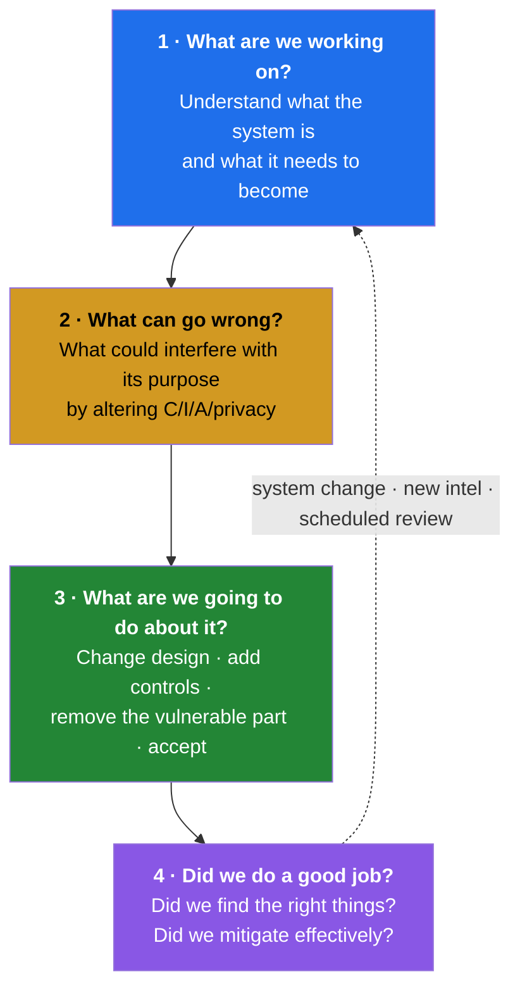

[← 00 Glossary](00-glossary.md) · [Contents](README.md) · [02 Business Context →](02-business-context.md)

# 01 · Foundations

---

## 1.1 What Threat Modeling Is

> 📘 **Theory.** Threat modeling is a structured way to identify security requirements, find the threats and weaknesses a system faces, rank them, and prioritize fixes — **before** an attacker finds them for you. It is a *design-time* discipline: you analyze an abstraction of the system rather than the running system, which is exactly why it can find problems that no scanner will ever report.

The measure of success is blunt and worth memorizing:

> **A good threat model is one that produces valid findings.** — Adam Shostack

A *valid finding* is a conclusion about the security state of your system that is timely, relevant, and translatable into action: mitigate a vulnerability, document a piece of system knowledge, or consciously accept a risk.

---

## 1.2 The Four-Question Framework

> 📘 **Theory.** Shostack's framework, formalized in the OWASP Threat Modeling Cheat Sheet. It is deliberately methodology-agnostic — STRIDE, LINDDUN, PASTA, FAIR, attack trees are all *techniques you plug into one of the four questions*.

> 📘 **Use it as a test.** If the methodology you've chosen doesn't answer all four questions to your satisfaction, consider a different one. Q4 in particular is what most programs skip — and skipping it is what turns a threat model into archaeology.

---

## 1.3 The Six Generalized Steps

> 📘 **Theory.** Underneath every methodology is the same sequence. Experienced modelers run these in parallel and largely automatically:
>
> 1. **Identify objects** in the system — elements, data stores, external entities, actors — and their metadata. Note security capabilities each provides, and obvious deficiencies.
> 2. **Identify flows** between them — protocol, classification, directionality.
> 3. **Identify assets of interest** held by objects or carried by flows.
> 4. **Identify weaknesses and vulnerabilities** — how confidentiality, integrity, availability, privacy, safety of those assets can be impacted.
> 5. **Identify threats** — associate vulnerabilities with threat actors to understand likelihood.
> 6. **Determine exploitability** — the actual paths an attacker would take.

Steps 1–3 are [04 · DFD Library](04-dfd-library.md). Steps 4–5 are [06 · STRIDE](06-stride.md), [07 · LINDDUN](07-linddun-privacy.md), [08 · Attack Trees](08-attack-trees-capec.md). Step 6 is [09 · Risk Scoring](09-risk-scoring.md).

---

## 1.4 What You're Actually Looking For: Means, Motive, Opportunity

> 📘 **Theory.**
> - **Means** — does the system present a vector for attack?
> - **Opportunity** — does its deployment create a path a motivated attacker could use?
> - **Motive** — does anyone have a reason to attack you?
>
> **Means + opportunity = a threat.** Motive is the piece you can only estimate with confidence rather than know — which is precisely why *risk* exists as a concept, and why risk can rarely be quantified with true precision except under specific circumstances.

---

## 1.5 Core Terminology (get these right)

> 📘 **Theory.**
>
> | Term | Meaning |
> |---|---|
> | **Weakness** | A defect that could lead to an impact on assets |
> | **Vulnerability** | An *exploitable* weakness — by definition at least as severe as the underlying defect |
> | **Impact** | The result if exploited: broken functionality, exposed data |
> | **Actor** | Anyone associated with the system; a malicious one is an **adversary** |
> | **Threat** | A non-zero probability of an attacker exploiting a vulnerability to negatively impact the system |
> | **Threat event** | An actual attempt (successful or not) to exploit |
> | **Loss** | Impact realized: confidentiality subverted, data/behavior modified, access prevented |
> | **Severity** | Damage potential + blast radius of a defect |
> | **Risk** | Value of the target × likelihood the impact is realized. Drives *priority* |

---

## 1.6 Severity ≠ Risk

> 📕 **Correction — this trips up almost everyone.**
>
> **CVSS measures severity**, not risk. It tells you how likely an attacker is to *succeed* if they try, and how much damage results. It explicitly **cannot** tell you:
> - *when or whether* an attacker will attempt it
> - how much the impacted resource is **worth**
> - how expensive it is to **fix**
>
> Those three are the risk inputs. Relying on raw severity is a good way to *communicate about a defect* and a poor way to *manage risk*.

| Tool | Measures | Answers | Audience |
|---|---|---|---|
| **CVSS** | Severity (0–10) | "How bad is this technically, on a standard scale?" | Patch queues, vendor comms |
| **DREAD** | Risk (coarse) | "Which of these should we look at first?" | Internal triage |
| **FAIR** | Risk (in $) | "What is this costing us, and is the fix worth it?" | Board, CFO, budget |

Full treatment in [09 · Risk Scoring](09-risk-scoring.md).

---

## 1.7 What Threat Modeling Will *Not* Find

> 📘 **Theory — and this is a credibility point, not a caveat.** Threat modeling works on abstractions, early. It will not find implementation-level flaws: whether the RNG is seeded correctly during key generation, or which three of two hundred APIs have exploitable stack overflows. You can *predict* concern and simulate impact, but the finding stays theoretical and therefore non-actionable.
>
> The warning is to avoid becoming the person who **cries wolf**. Stay with actionable, defensible results and let other activities cover the rest.

| Threat modeling finds | Something else finds |
|---|---|
| Missing authentication on a flow | A buffer overflow in the auth handler → SAST/fuzzing |
| Wrong crypto *choice* for the use case | Bad RNG seeding at runtime → code review |
| Public bucket by design or by drift | A CVE in a dependency → SCA |
| Trust boundary with no control on it | Whether an exploit actually works → pen test |
| Insecure *design* | Insecure *implementation* |

---

## 1.8 Threat Modeling vs. Vulnerability Management

> 📘 **Theory.** These are complements, constantly confused.

| | Threat Modeling | Vulnerability Management |
|---|---|---|
| **When** | Design time, and continuously | After code/infra exists |
| **Input** | Diagrams, design docs, conversation | Running systems, code, dependencies |
| **Finds** | Design flaws, missing controls | Known defects with known signatures |
| **Output** | Security requirements | Patch tickets |
| **Bounded by** | The team's imagination and knowledge | The scanner's signature database |
| **Fixes cost** | Cheap (nothing built yet) | Expensive (rework) |

A perfect implementation cannot rescue an insecure design — the needed controls were never designed in the first place. That's OWASP's **A06:2025 Insecure Design** in one sentence, and it is the argument for threat modeling in one sentence too.

---

## 1.9 Three Lenses on the Same System

> 📘 **Theory.** Three complementary approaches — most real exercises use more than one:
>
> | Approach | You start from | Typical model | Also called |
> |---|---|---|---|
> | **System-centric** | The system's functional decomposition | DFD | architecture-/design-centric |
> | **Attacker-centric** | The adversary's motivation and goals | Attack trees, threat catalogs | — |
> | **Asset-centric** | What must be defended | Asset inventory + accessibility analysis | — |

This guide uses all three: system-centric in [04](04-dfd-library.md), attacker-centric in [08](08-attack-trees-capec.md), asset-centric in the per-asset security requirements in [04 §4.x](04-dfd-library.md) and the register in [A](A-findings-register.md).

---

## 1.10 Identification ≠ A Complete Methodology

> 📕 **Correction.** A method that only *finds* threats is a **threat identification** method. A method that only *ranks* them is a **risk classification** method.
>
> **Threat identification + risk classification = a complete threat modeling methodology.**
>
> STRIDE and LINDDUN are identification frameworks. CVSS, DREAD, and FAIR are classification. Neither half alone is a methodology, and conflating the two is why teams end up with a list of threats nobody prioritizes, or a spreadsheet of scores nobody can trace to a system.

A complete methodology needs six things:

1. **System modeling** — translate the system into a manipulable representation
2. **Risk identification** — traverse the model, find how risks become vulnerabilities
3. **Risk classification and ranking** — decide what's urgent and why
4. **Follow-up** — reach a state where threats are solved, mitigated, or formally accepted
5. **Knowledge sharing** — the exercise itself improves the team
6. **Data collection on results** — measure finding quality, criticality, and recurring patterns so you can drive training and design standards

If your approach delivers all six, you've found your way to do it.

---

## 1.11 Why This Feels Complicated (and what to do)

> 📘 **Theory.** Threat modeling has a real accessibility problem, and naming the causes helps:
> - It's a broad term covering wildly different practices — one whiteboard session or a formal multi-week program
> - Many competing methodologies, each with a different approach
> - Heavy jargon that alienates non-security stakeholders
> - It's a niche within a niche; most security professionals don't practice it
> - Regulations increasingly require it without defining it
> - Tools vary enormously in approach

**The practical fix:** align threat modeling with security practices people already recognize, and strip unnecessary jargon. See the translation table and the seven-topic framework in [10 · Security Requirements](10-security-requirements.md) — it is the single most adoptable idea in this guide for a DevOps audience.

---

[← 00 Glossary](00-glossary.md) · [Contents](README.md) · [02 Business Context →](02-business-context.md)
