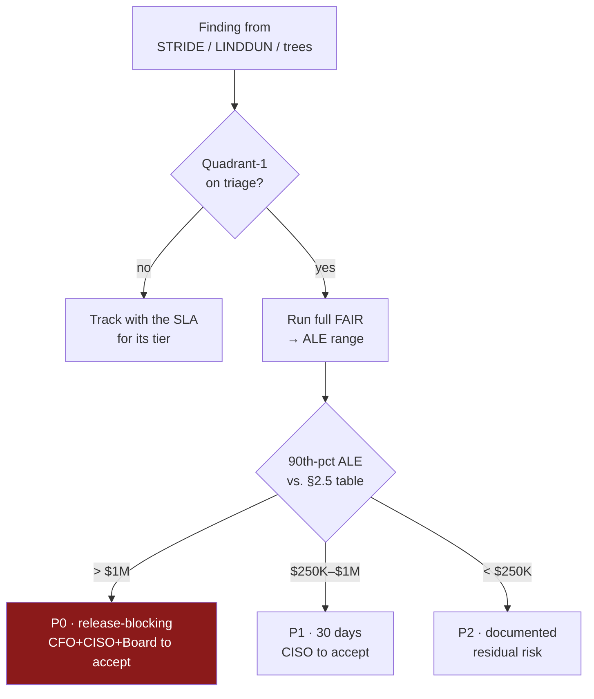

[← 01 Foundations](01-foundations.md) · [Contents](README.md) · [03 Session Facilitation →](03-session-facilitation.md)

# 02 · Business Context, Goals & Risk Appetite

> 🏢 **Everything in this file is invented** for the worked case, built from common real-world patterns. It is the scenario's foundation. The *structure* generalizes; the specific numbers don't.

---

## 2.1 Why Start Here

> 📘 **Theory.** This is PASTA Stage 1 — *Define Business Objectives* — and it exists to set the **risk context**. Understanding what the business is trying to achieve is what lets you understand the *impact* variable in risk. Without it you produce technically correct findings that nobody can prioritize, because "how bad is this?" has no anchor.
>
> The stage needs people most security exercises forget to invite: product owners, business owners, project managers, sometimes C-level. Its outputs are a business impact analysis, a list of business objectives, and a risk profile.

---

## 2.2 The Company

**Meridian Retail Co.** — mid-market direct-to-consumer e-commerce.

| Attribute | Value |
|---|---|
| Revenue | ~$180M annually |
| Customers | ~3M accounts |
| Industry | Retail / e-commerce, with a health & wellness subscription line |
| Cloud | AWS primary; Microsoft Entra ID for corporate identity |
| Team | Several DevOps teams; no dedicated appsec function yet |
| In scope | One S3 bucket holding public marketing assets, customer analytics exports, and (discovered mid-session) user-uploaded avatars |
| Out of scope | The e-commerce application itself; payment processing (tokenized, separate PCI scope) |

**Why the data classification is "worst case":** the wellness line means some records are HIPAA-adjacent. Legacy analytics exports occasionally carry order metadata that may fall into PCI scope. Nobody could confirm either way during the session — which is itself a finding, and the reason we size controls to the strictest plausible regime.

---

## 2.3 Business Objectives

| # | Objective | What it implies for the threat model |
|---|---|---|
| 1 | **Protect customer trust and brand** | A PII breach is treated as existential-tier, not a routine incident. This sets the top of the impact scale |
| 2 | **Maintain regulatory standing** | GDPR, CCPA/CPRA, PCI-DSS (SAQ), HIPAA-adjacent. Drives [11 · Compliance Mapping](11-compliance-mapping.md) |
| 3 | **Preserve engineering velocity** | Controls must be automatable guardrails, not manual security sign-off per deploy. This is *why* [10](10-security-requirements.md) favors Config rules and SCPs over process controls |
| 4 | **Optimize security spend (ROI)** | The CFO has explicitly asked for risk in dollars, not adjectives. **This is the direct business reason this guide uses FAIR** ([09](09-risk-scoring.md)) |
| 5 | **Maintain public-asset global performance** | Why CloudFront is not optional for the public path |

> 💡 **Bridge.** Objective 4 is the single most consequential line in this file. It's what forces the methodology to include a *quantitative* risk classification rather than stopping at High/Medium/Low — and per [01 §1.10](01-foundations.md), that's the difference between a threat identification exercise and a complete methodology.

---

## 2.4 Security & Compliance Requirements

- Highest security expectations for any record touching health data
- NIST CSF used as the organization's overall security measurement framework — this project must fit that program
- Existing security policies, baselines, and standards apply; the project must adhere to them
- GDPR Art. 17 (erasure) must be satisfiable across **all copies**, including versions, replicas, and log entries containing customer identifiers

---

## 2.5 Risk Appetite Statement

> 📘 **Theory.** A risk appetite statement has two halves: a **qualitative statement** of posture (ISO 31000 / COSO ERM style) and **quantitative tolerance thresholds** that make it actionable. Without the second half you have a poster, not a control.

> *"Meridian Retail accepts routine, low-consequence operational risk in pursuit of engineering velocity, but has near-zero appetite for risk that could result in unauthorized disclosure of customer personal or regulated data. Risk-acceptance authority scales with the financial magnitude of the exposure."*

### Quantitative tolerance thresholds

Reviewed annually by the Board Risk Committee. **ALE** = Annualized Loss Expectancy ([09](09-risk-scoring.md)); the 90th-percentile figure is the conservative end of the modeled range.

| Tier | Single-threat ALE (90th pct) | Aggregate estate ALE | Authority to **accept** | Mitigation SLA |
|---|---|---|---|---|
| **Low** | < $50K | < $150K | Engineering team; track only | Best-effort |
| **Medium** | $50K – $250K | $150K – $500K | Eng Manager + Security, documented | 1 quarter |
| **High** | $250K – $1M | $500K – $2M | **CISO sign-off** required to accept | 30 days |
| **Critical** | > $1M | > $2M | **CFO + CISO + Board Risk Committee** | Immediate / pre-release; release-blocking by default |

---

## 2.6 How the Threshold Actually Gets Used

**Two rules that make this honest:**

1. **Set the threshold before you see the numbers.** If the appetite table is written after FAIR results are in, it inevitably gets anchored to whatever makes the current backlog look acceptable.
2. **Consistency over precision.** For every criticality rank, set a service-level objective and apply it uniformly. If you commit externally to fixing critical reported vulnerabilities in N days, use N days internally too.

> 📘 **Theory: valid vs. invalid exceptions.** A legitimate exception looks like *a design flaw in the core of the application requiring change across most components* — there you mitigate indirectly with additional obstacles while the real fix is scheduled. An invalid exception is **"we don't have time right now."** That just creates documented security debt — and if time is short now, consider how much shorter it will be when the vulnerability is exploited and you have to fix it anyway, under incident conditions.

---

## 2.7 Applied: Where Our Findings Land

| Finding | 90th-pct ALE | Tier | Consequence |
|---|---|---|---|
| F-01 Public bucket policy on PII | $6M+ | **Critical** | Release-blocking; Board must sign off to accept |
| F-02 Block Public Access disabled | ~$4M | **Critical** | Release-blocking |
| **ENC-3 Over-permissive KMS key policy** *(v8)* | ~$3M | **Critical** | Release-blocking — F-01's loss via the *second* access plane |
| **F-13 SSRF → IMDS credential theft** *(v8)* | ~$2.5M | **Critical** | Release-blocking — the SSRF side door (A01:2025) |
| F-11 Ransomware / mass deletion | ~$2.1M | **Critical** | Release-blocking |
| **ENC-6 Re-encryption ransomware (SSE-C)** *(v8)* | ~$1.8M | **Critical** | Release-blocking — resilience, not prevention |
| **F-17 Supply-chain deploy compromise** *(v8)* | ~$1.6M | **Critical** | Release-blocking |
| **ENC-7 KMS crypto-shred** *(v8)* | ~$1.5M | **Critical** | Release-blocking |
| F-12 Steganographic staging via UGC | ~$1.4M | **Critical** | Release-blocking (downstream-victim liability dominates) |
| **F-18 Agent excessive agency + injection** *(v8)* | ~$1.2M | **Critical** | Release-blocking if the agent can write/decrypt |
| F-03 Public ListBucket enumeration | ~$1.2M | **Critical** | Release-blocking |
| **F-14 Partner cross-account confused deputy** *(v8)* | ~$1.1M | **Critical** | Release-blocking (cross-prefix PII) |
| F-09 Deploy-role over-permission | ~$900K | **High** | 30 days; CISO sign-off to accept |
| F-07 TOCTOU on export read | ~$400K | **High** | 30 days |

Full narratives in [A · Findings Register](A-findings-register.md). *(High-tier v8 findings F-15, F-16, F-19, ENC-4/5/8 omitted here for brevity.)*

> 💡 **Bridge (v8) — the risk moved off the bucket.** In v7 the entire top of this table was the object store. After the v8 pass, five of the top dozen findings are the **identity layer and the encryption control plane** (ENC-3, F-13, ENC-6, ENC-7, F-14). The single most consequential line in §2.3 — Objective 4, *risk in dollars* — is what surfaces this: had we stayed with High/Medium/Low, "lots of Criticals" would have said nothing, whereas the ALE column shows the *center of gravity* shifting from the bucket policy to the key policy and the roles. That shift is the headline a CFO can act on: the next control dollar buys more on the key policy and IMDSv2 than on the bucket policy, which is already near its residual floor.

> 💡 **Bridge.** Note F-12 versus F-07: F-07 has the *higher CVSS severity story* in some readings, yet F-12 carries 3.5× the ALE. The difference is Secondary Loss — third-party victim liability that no severity score can express. This is exactly the gap [01 §1.6](01-foundations.md) warns about, made concrete.

---

[← 01 Foundations](01-foundations.md) · [Contents](README.md) · [03 Session Facilitation →](03-session-facilitation.md)
