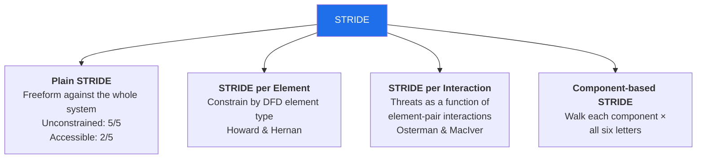
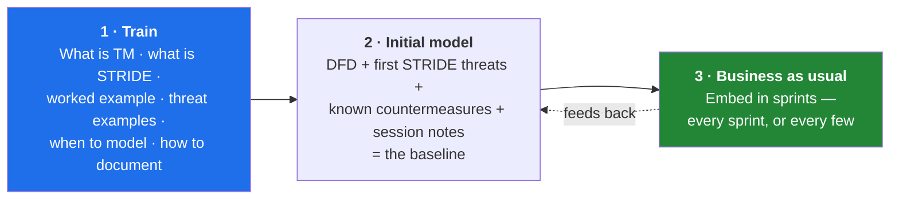
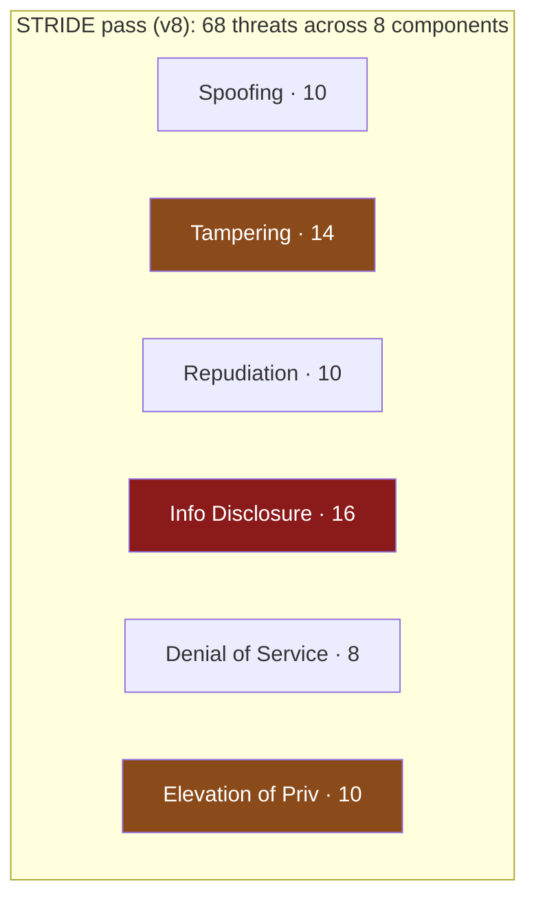

[← 05 Other Model Types](05-other-model-types.md) · [Contents](README.md) · [07 LINDDUN →](07-linddun-privacy.md)

# 06 · STRIDE

---

## 6.1 What STRIDE Is

> 📘 **Theory.** Formalized at Microsoft in 1999 by Loren Kohnfelder and Praerit Garg. It's a mnemonic for six threat categories, each mapping to a security property that gets violated. Strictly speaking it's a threat *analysis and classification* framework rather than a full methodology (see [01 §1.10](01-foundations.md)) — increasingly people call it a *framework* for that reason.

| Letter | Threat | Property violated | Plain-English version |
|---|---|---|---|
| **S** | Spoofing | Authentication | Pretending to be someone/something else, and assuming their privileges |
| **T** | Tampering | Integrity | Modifying data or functionality that shouldn't be modifiable |
| **R** | Repudiation | Non-repudiation | Being able to deny an action took place, or that you took it |
| **I** | Information Disclosure | Confidentiality | Restricted information leaking outside its trust boundary |
| **D** | Denial of Service | Availability | Making the system unavailable or degraded enough to interfere with use |
| **E** | Elevation of Privilege | Authorization | Gaining a higher privilege level than you should have |

> 📘 **Known weakness.** The categories don't perfectly partition threat space — you can't always force-fit a threat into exactly one letter. That ambiguity matters less for *finding* threats than for *formally assessing risk* on them. Memory corruption, for example, is simultaneously Elevation of Privilege (arbitrary code), Tampering (arbitrary memory writes), and Denial of Service (if it merely crashes).

> 📘 **The bigger weakness.** To use STRIDE well you must already know what *can* be a threat. If a developer has never heard of a buffer overflow, they cannot classify "memory corruption" as anything. STRIDE offers no guiding framework for that knowledge — which is why threat example libraries (§6.6) and the CTM subject list ([14](14-continuous-threat-modeling.md)) exist.

---

## 6.2 The Four Ways to Apply STRIDE

### Plain STRIDE
Freeform. Maximum coverage, minimum guidance. Teams get bogged down in "have I considered everything?" and never reach done.

### STRIDE per Element
> 📘 Constrains the set of threats by DFD element type, on the observation that some elements are more susceptible to some threats. An external entity is far more prone to being spoofed than a data flow is; a data flow is far more prone to tampering than an external entity is.

| DFD element type | Applicable | Why the others don't apply |
|---|---|---|
| **External entity / Interactor** | S, R | You don't control its code; you verify *who it claims to be* and retain proof of what it did |
| **Process** | S, T, R, I, D, E | Active code with an identity — nothing is naturally excluded |
| **Data store** | T, R, I, D | Passive. Spoofing/EoP apply to whoever *acts on* it, not the store itself |
| **Data flow** | T, I, D | Data in transit. S/R/E are properties of the *endpoints*, not the wire |

> 📘 **Trade-off.** More tractable, more scalable, more Agile-friendly — but *less unconstrained*, and it carries a specific danger below.

### STRIDE per Interaction
Threats derived from *pairs*. "Client sends data to server" might be subject to spoofing, repudiation, and information disclosure but not elevation of privilege; "client receives data from server" might be subject only to spoofing (a man-in-the-middle impersonating the server). This is what the Microsoft Threat Modeling Tool implements.

### Component-based STRIDE
Pick a component, walk all six letters, record what applies. Two sub-approaches, and using both is common:
1. Think of threats per component freely, then *assign* a letter afterward
2. Per component, go letter by letter and ask what fits

§6.7 uses approach 2.

---

## 6.3 Two Warnings That Matter

> 📘 **Warning 1 — one technique, many elements.** Finding one instance of spoofing does not mean you've found the only one. The same technique may apply against multiple elements, via the same vector or a different one. Treating a single finding as closing out a category is a serious mistake.

> 📘 **Warning 2 — threat models are not additive.** You cannot smash together per-element mini-models and call the result a model of the whole system. STRIDE per Element's narrow focus is exactly what risks losing the holistic view. Deliberately step back and look at the system as a whole after the per-element pass.

---

## 6.4 The Usual Suspects — Recognition Checklist

> 📘 **Theory.** A short, high-yield list of things to flag on sight in any model. Not a substitute for analysis — a way to train recognition.
>
> - **Any non-secure protocol** — http, ftp, telnet, ntp, snmpv1, wep, sslv3. Many protocols come in secure and insecure flavors, often distinguished by an "s". Flag immediately if assets of interest transit them.
> - **Any process or data store without authentication** — look for compensating controls, and note that source IP is a weak identity a smart attacker will spoof
> - **Any process that fails to authorize** — same privileges for everyone, or excessive privileges per individual
> - **Any process with missing logging** — without traceability, defenders operate in the "fog of war"
> - **Sensitive assets in plain text**
> - **Sensitive assets without integrity controls** — note tamper *evidence* (logging, hashes, signatures) and tamper *resistance* are different things
> - **Incorrect cryptography** — hashing what must be read back · symmetric encryption with the key on the same component as the data · non-cryptographic RNG · home-grown algorithms
> - **Communication paths transiting a trust boundary**

### 🏢 Applied to our bucket

| Suspect | Status | Note |
|---|---|---|
| Non-secure protocol | ✅ | TLS throughout — but is it *enforced by policy* or merely used by convention? (ENC-1) |
| No authentication | ⚠️ | Anonymous read on `/public/` is by design; `ListBucket` must be explicitly denied |
| No authorization | ❌ | No role separation exists at all (S6) — AWS is root-only |
| Missing logging | ❌ | CloudTrail **data** events unconfirmed; only management events certain |
| Plain-text assets | ⚠️ | SSE present, but AWS-managed key = no controllable key policy (S5 → ENC-2) |
| No integrity controls | ❌ | No object integrity verification — the enabling condition for both F-07 and T18 |
| Bad crypto | ⚠️ | The *choice* is fine; **control over who can decrypt is a second, un-drawn access plane** — see the four v8 rows below |
| Boundary-crossing flows | ⚠️ | Now **seven-plus** flows cross a trust boundary once the compute, partner, agent, and KMS planes are drawn ([04 §4.16a–d](04-dfd-library.md)); each needs a control at the crossing |
| **Symmetric key co-located with the data** *(v8)* | ⚠️ | The classic Usual Suspect, applied to cloud: an over-broad KMS key policy means the decrypt authority effectively travels *with* the objects — anyone who reaches the bucket's account can also reach the key (**ENC-3**) |
| **Crypto that fails open** *(v8)* | ❌ | No write-time enforcement of `aws:kms` + expected key ARN → objects can be written unencrypted or under an attacker's key (**ENC-5/ENC-6**) |
| **A metadata/SSRF endpoint reachable from app code** *(v8)* | ❌ | IMDS holds live role credentials; any URL-fetching feature is a candidate sink (**F-13**; SSRF is **A01:2025**, consolidated there in the 2025 list — [11 §11.2](11-compliance-mapping.md)) |
| **Long-lived credentials / no deprovisioning** *(v8)* | ❌ | IAM users + no JML process = a departed employee keeps working access (**F-15**); federation retires this |
| **Untrusted input reaching a component that *acts*** *(v8)* | ⚠️ | The agent consumes UGC/exports and holds tools — indirect prompt injection turns data into commands (**F-18**) |

---

## 6.5 STRIDE in DevOps

> 📘 **Theory: why STRIDE fits DevSecOps specifically.** Shift-left makes DevOps teams responsible for their own security — a dramatic change most teams aren't trained for. STRIDE helps because:
> - It lets teams **proactively** think about security rather than react to audits and incidents
> - It's a **team activity**, spreading knowledge from the security-literate members to everyone else
> - It surfaces threats **in the design phase**, when fixes are cheap
> - It produces **security requirements**, which is a deliverable developers already know how to consume

**Three-step rollout:**

The mechanism for step 3 is in [14 · Continuous Threat Modeling](14-continuous-threat-modeling.md).

---

## 6.6 A Threat Example Library

> 📘 **Theory: why examples matter more than the acronym.** Most non-security people — developers, testers, product owners — struggle to *invent* relevant threats. Concrete examples get them into the right mindset far faster than a definition does. Keep a library, and read it aloud at the start of a session.

> 📘 **But: the rearview-mirror anti-pattern.** A methodology built *exclusively* on a threat library trains the team to look only at what has already happened. Technologies and attack vectors change. Use libraries as **starting points for deriving new attack paths** and as educational devices — never as the boundary of the analysis. The value is in *how* the catalog is used, not in its existence.

**S3-specific threat examples (each pattern generalizes back out):**

These are written against object storage deliberately. Read the middle column as *"could this happen to us?"* and the right column as *"what would have to be true for it to."*

### Spoofing

| # | Example threat | The underlying reason it's possible |
|---|---|---|
| S-a | An attacker sends signed requests that the origin accepts as coming from our CDN | Bucket policy trusts the OAC principal but doesn't pin the distribution ARN via `aws:SourceArn` |
| S-b | A stolen CI/CD OIDC token is used to act as the deploy role; the actions are indistinguishable from a legitimate deploy in CloudTrail | Workload identity is correct in principle, but the trust policy isn't scoped by repository *and* branch, and nothing baselines what a normal deploy looks like |
| S-c | A partner's credential is used to write to a prefix that isn't theirs | Cross-account trust granted to an account wildcard rather than a specific role ARN with an `ExternalId` |
| S-d | An attacker registers a lookalike bucket name and tricks an internal consumer into reading from it | Bucket names are globally unique, guessable, and hardcoded in consumer config rather than resolved from a trusted parameter store |

### Tampering

| # | Example threat | The underlying reason it's possible |
|---|---|---|
| T-a | An anonymous user overwrites objects, not just reads them | Bucket policy grants `s3:*` or `PutObject` to `Principal: "*"`, usually because the author wanted public *read* and reached for a wildcard verb |
| T-b | A user's uploaded image is stored and served byte-for-byte, carrying a hidden payload | No magic-byte validation, no scanning, and no re-encode on ingest — passthrough storage is what preserves the payload (**F-12**) |
| T-c | An export object is swapped between the moment its manifest is validated and the moment it's read | Validation happens once up front rather than at time of use, and reads aren't pinned to an ETag or `versionId` (**F-07**) |
| T-d | The bucket policy itself is rewritten — tampering with the *control*, not the data | An over-permissioned principal holds `PutBucketPolicy`, and no SCP sits above it to deny the call |
| T-e | Legacy ACLs grant write access that the bucket policy appears to forbid | Object Ownership isn't set to bucket-owner-enforced, so ACLs are merely *overridden* rather than *disabled* |

### Repudiation

| # | Example threat | The underlying reason it's possible |
|---|---|---|
| R-a | A mass download of customer records cannot be attributed to anyone | Anonymous access means there is no identity to log — a breach looks like traffic |
| R-b | We cannot prove which objects an attacker read during an incident | CloudTrail *data* events are off; management events record changes to the bucket, not access to objects (**LOG-1**) |
| R-c | An attacker erases the record of their own activity | The log destination is writable by the same principal being logged, and lives in the same account |
| R-d | We can't prove which content the analytics job actually consumed | The reader logs "processed export X" without recording a content hash or version |
| R-e | An admin makes a config change outside the pipeline with weak attribution | Console write access remains enabled in production alongside the IaC path |

### Information Disclosure

| # | Example threat | The underlying reason it's possible |
|---|---|---|
| I-a | **A misconfigured bucket exposes customer files to anyone who knows the name** | **Public read granted at the policy, ACL, or Block-Public-Access layer; no authentication step exists to fail** (**F-01**) |
| I-b | An attacker retrieves the complete object index instead of guessing filenames | `s3:ListBucket` granted to anonymous principals — turning "guess a name" into "download the index" (**F-03**) |
| I-c | The bucket is found without any active attack against us | Internet-wide scanner services continuously index publicly readable buckets; discovery is passive and free |
| I-d | Object keys leak customer identifiers and business structure | Keys encode meaning (`/exports/customer_12345.csv`) rather than being opaque |
| I-e | A presigned URL grants access long after the recipient should have lost it | TTL measured in days, scope broader than one object, and no acceptance that a legitimate recipient can forward it |
| I-f | Access logs themselves disclose personal data | IPs and customer identifiers land in a log store with different retention and looser access than the data it describes |
| I-g | An error response reveals internal paths, bucket names, or account structure | Verbose errors returned to the caller instead of a correlation ID with detail kept internal |

### Denial of Service

| # | Example threat | The underlying reason it's possible |
|---|---|---|
| D-a | Request flooding turns cost into the failure mode rather than downtime | Anonymous `GetObject` with no WAF rate limiting; S3 scales happily and bills accordingly |
| D-b | Cache-busting query strings force origin hits straight past the CDN | Cache behaviors don't normalize or ignore unknown query parameters, so the CDN becomes an amplifier rather than a shield |
| D-c | The data becomes permanently unreadable | A principal can call `ScheduleKeyDeletion` or disable the CMK, with no multi-person control and no alarm |
| D-d | Storage grows without bound until quotas or budgets break | Unbounded upload size/count on the UGC path, or versioning enabled without noncurrent-version lifecycle rules |
| D-e | Costs are shifted onto us by design | Requester-Pays misconfigured, or absent where it would have been appropriate |

### Elevation of Privilege

| # | Example threat | The underlying reason it's possible |
|---|---|---|
| E-a | A role rewrites its own access | A principal holds `iam:PassRole` together with `s3:PutBucketPolicy`, so it can grant itself anything |
| E-b | Compromising one pipeline yields control of every bucket in the account | The deploy role's `Resource` is wildcarded rather than scoped to a single bucket ARN (**F-09**, currently *unverified*) |
| E-c | Code executes in the analytics role's context | A vulnerable parsing library meets untrusted user-uploaded content — the UGC path and the reader path intersect here |
| E-d | An operator with read-only intent turns out to have full access | No roles exist at all; everything runs as root (**S6**) |
| E-e | A "temporary" permission granted to unblock a deploy is never removed | No access reviews, and no expiry on grants |

> 💡 **Bridge — read I-a, then read I-c.** Row **I-a** is our top finding, and it is also a canonical example that practitioners cite independently when explaining Information Disclosure. Worth sitting with: the entire attack is *"know the name, read the files."* No exploit, no CVE, no skill required. Row **I-c** then removes the last remaining barrier — the attacker doesn't even have to guess the name, because scanner services have already indexed it. Together those two rows are why F-01 scores Exploitability 10/10 and Discoverability 10/10 in [15 §DREAD](15-methodology-comparison.md), and why it is release-blocking in [09](09-risk-scoring.md).

> 📘 **How to use this library in a session.** Don't read it out top-to-bottom — that produces a checklist mentality, which is the anti-pattern flagged above. Instead: pick the two or three letters where your system is most exposed, read those rows aloud, then ask the room **"what else, that isn't on this list?"** The rows are there to calibrate what a threat *sounds like*, not to bound what you're allowed to find. Roughly a third of the rows above (T-b, T-c, E-b, E-d) exist because someone in our own session named something no list contained.

---

## 6.7 🏢 Component-Based STRIDE Applied

> 📘 Method: per component, walk S→T→R→I→D→E and record what applies. **Recording "none identified" is a legitimate and useful result** — it documents that you looked.

### Component 1 — The S3 Bucket (customer data prefix)

| | Identified threats |
|---|---|
| **S**poofing | **S1:** An attacker presents as CloudFront to the origin if OAC conditions aren't enforced in the bucket policy. **S2:** A stolen CI/CD OIDC token lets an attacker act as the deploy role, which is *indistinguishable from legitimate* in the logs. |
| **T**ampering | **T1:** Public or over-broad write permission allows object overwrite. **T2:** An attacker with any write access substitutes an export object between manifest validation and read (**F-07**). **T3:** The bucket policy itself is overwritten by an over-permissioned principal — tampering with the *control*, not the data. |
| **R**epudiation | **R1:** Anonymous access means there is no identity to attribute reads to; a mass exfiltration looks like traffic. **R2:** CloudTrail *data* events may be off, so object-level reads leave no trail at all. **R3:** If the log bucket is writable by the same compromised principal, logs can be altered. |
| **I**nformation Disclosure | **I1:** Public `GetObject` on PII. **I2:** Public `ListBucket` enables full key enumeration — turning "guess a filename" into "download the index". **I3:** Bucket name discovered via internet-wide scanners without any active attack. **I4:** Object key naming leaks structure (`/exports/customer_12345.csv`). **I5:** Presigned URL leaked via referrer, browser history, or forwarding. |
| **D**enial of Service | **D1:** Request flooding against anonymous `GetObject` — the failure mode is *cost*, not downtime. **D2:** KMS key disabled or scheduled for deletion → permanent data unavailability. **D3:** Mass delete without versioning. |
| **E**levation of Privilege | **E1:** A principal with `iam:PassRole` + `s3:PutBucketPolicy` can rewrite its own access. **E2:** Legacy ACLs still evaluated (see [04 §4.11](04-dfd-library.md)) provide an alternative grant path outside the bucket policy. |

### Component 2 — The Avatar / UGC Prefix

| | Identified threats |
|---|---|
| **S**poofing | None identified — upload requires an authenticated session. *(Note: "authenticated" here means any self-registered account, which is a very low bar. See T-below.)* |
| **T**ampering | **T4:** A user uploads content that is a valid image *and* a malicious payload (polyglot / steganographic). Nothing scans or re-encodes, so the exact bytes are stored (**T18/F-12**). |
| **R**epudiation | **R4:** If uploads aren't tied to a user ID in logs, you cannot attribute a malicious file to an uploader. |
| **I**nformation Disclosure | **I6:** Predictable avatar URLs let anyone enumerate which accounts exist. |
| **D**enial of Service | **D4:** Unbounded upload size or count → storage cost attack. |
| **E**levation of Privilege | None identified at this layer — but see D3 in Component 3: the *processing* of these files is where EoP would occur. |

### Component 3 — The Analytics Reader Service

| | Identified threats |
|---|---|
| **S**poofing | **S3:** The service's role credentials, if stolen, grant PII read at scale. |
| **T**ampering | **T5:** TOCTOU substitution (**F-07**) — the service processes attacker-controlled content as validated. |
| **R**epudiation | **R5:** If the reader logs "processed export X" without a content hash, you can't later prove *which* content it processed. |
| **I**nformation Disclosure | **I7:** The service may write PII into its own application logs during parsing errors. |
| **D**enial of Service | **D5:** A malformed or enormous object stalls the loop and blocks all downstream analytics. |
| **E**levation of Privilege | **E3:** A vulnerable parsing library processing untrusted content (see T4 — the UGC and the parser meet here) could yield code execution in the reader's role context. |

### Component 4 — The CI/CD Deploy Pipeline

| | Identified threats |
|---|---|
| **S**poofing | **S4:** A forged or stolen OIDC token impersonates the pipeline. **S5:** *(supply chain, v8)* Dependency confusion / typosquatting — an internal package name is resolved from a public registry, running attacker code inside the workflow while the OIDC token is in scope (**F-17**). |
| **T**ampering | **T6:** A malicious commit alters the IaC to open the bucket — legitimate-looking change through a legitimate path. **T7:** A second, uncoordinated pipeline reverts a security fix. **T9:** *(v8)* A poisoned Terraform **module or provider** — a tag repointed to a malicious commit, or a trojaned provider binary — executes during `plan`/`apply` with the deploy role's privileges (**F-17**). **T10:** *(v8)* A third-party GitHub Action pinned to a **mutable tag** (`@v3`) is swapped for a malicious version (**F-17**). |
| **R**epudiation | **R6:** If console access remains possible in prod, a change can be made outside the pipeline with weaker attribution. |
| **I**nformation Disclosure | **I8:** Terraform state or plan output containing sensitive values stored with weaker controls than the data itself. |
| **D**enial of Service | None identified. |
| **E**levation of Privilege | **E4:** Deploy role scope **unverified** (S3) — if wildcarded, compromising it grants control over every bucket policy in the account, not just this one. **E5:** *(v8)* The OIDC trust policy isn't scoped to **repository *and* branch** (or a self-hosted runner is shared across repos), so a fork PR or an unrelated repo's job can assume the deploy role (**F-17**, extends **F-09**). |

### Component 5 — Logging & Monitoring

| | Identified threats |
|---|---|
| **S**poofing | None identified. |
| **T**ampering | **T8:** Log bucket writable by the same principal being logged → an attacker erases their own trail. |
| **R**epudiation | **R7:** *(the meta-threat)* Data events disabled means every other threat becomes undetectable and unattributable. |
| **I**nformation Disclosure | **I9:** Access logs contain IPs and may contain customer identifiers in object keys — the logs are themselves personal data, often with a different retention policy than the data they describe. |
| **D**enial of Service | **D6:** Log destination full or throttled → logging silently stops. |
| **E**levation of Privilege | None identified. |

### Component 6 — KMS & the Encryption Control Plane *(v8)*

> 🏢 The encryption we added as a *mitigation* is itself a component with its own STRIDE surface. Modeled against the L3-D key-access plane ([04 §4.16c](04-dfd-library.md)). This is the component the user asked us to go deep on, and it is the one a first-pass model almost always draws as a single box.

| | Identified threats |
|---|---|
| **S**poofing | **S6:** `UpdateAlias` repoints the KMS **alias** used by the bucket's default encryption to a key the attacker controls; subsequent writes are encrypted under *their* key — the object still "looks" encrypted (**ENC-5**). **S7:** A principal named on the key policy (or reachable via `:root` delegation) simply *is* an authorized decryptor — identity, not exploit. |
| **T**ampering | **T11:** **Encryption downgrade / key substitution** — objects are written with SSE-S3, no SSE, or an attacker-chosen key because no bucket-policy `Deny` enforces `s3:x-amz-server-side-encryption = aws:kms` *with the expected key ARN* (**ENC-5**). **T12:** **Re-encryption ransomware** — `CopyObject` (or a fresh `PutObject`) using SSE-C or an attacker CMK rewrites objects under a key AWS cannot recover; the data is intact but unreadable, and only the attacker holds the key (**ENC-6**, ATT&CK **T1486**). |
| **R**epudiation | **R8:** With **S3 Bucket Keys** enabled, KMS `Decrypt` is called ~once per bucket-key refresh rather than per object, so per-object read attribution disappears from CloudTrail — a cost optimization that quietly reduces forensic granularity (interacts with **LOG-1**). |
| **I**nformation Disclosure | **I10:** The key policy grants `kms:Decrypt` to too broad a principal — or to `arn:aws:iam::ACCT:root`, which **delegates to IAM** so *any* principal with `kms:Decrypt` in an identity policy qualifies. The CMK becomes a **second front door**, independent of the (possibly perfect) bucket policy (**ENC-3**). **I11:** With no `kms:ViaService` condition, a principal holding `kms:Decrypt` decrypts a raw ciphertext blob **directly via the KMS API**, bypassing S3's bucket policy *and* its access logs (**ENC-4**). **I12:** The key policy names a partner/other account → cross-account decrypt of exfiltrated objects (**ENC-3**, ties **F-14**). |
| **D**enial of Service | **D7:** `ScheduleKeyDeletion` (min 7-day window), `DisableKey`, or deletion of **imported** key material renders every object under that key permanently unreadable — **crypto-shredding as an attack**, with no multi-person control or alarm (**ENC-7**; extends D2/Tree 3 C2.1). |
| **E**levation of Privilege | **E6:** `kms:CreateGrant` lets a principal mint a **durable, separately-listed grant** delegating decrypt to itself or a foothold — persistence that survives a key-*policy* review because grants aren't in the policy (**ENC-8**). **E7:** `kms:PutKeyPolicy` lets a principal **rewrite the key policy to grant itself decrypt** — the crypto-plane twin of E1 (`PutBucketPolicy` self-grant). |

### Component 7 — Application Compute Tier & Instance Metadata *(v8)*

> 🏢 The tier that holds the runtime IAM role — invisible on every v7 DFD, now drawn at [04 §4.16b](04-dfd-library.md). SSRF is **A01:2025** (consolidated into Broken Access Control in the 2025 list — [11 §11.2](11-compliance-mapping.md)); it had no home before because the compute tier itself was never on a diagram. *(Not to be confused with A10:2025, Mishandling of Exceptional Conditions — a separate, still-open gap.)*

| | Identified threats |
|---|---|
| **S**poofing | **S8:** Credentials stolen from the instance/task role impersonate the application; in CloudTrail the calls are indistinguishable from legitimate app traffic (**F-13**). |
| **T**ampering | **T13:** The same stolen role, if it holds `PutObject`, is used to write/overwrite objects — the SSRF path feeds straight into Tree 2. |
| **R**epudiation | **R9:** Actions performed with the stolen role are attributed to the app's identity, not the attacker — repudiation by proxy. |
| **I**nformation Disclosure | **I13:** **SSRF → IMDS → role credentials → `GetObject` on `/exports/`** (**F-13**). IMDSv1 requires no token; IMDSv2 needs a session `PUT` and a hop limit that a naive single-GET SSRF can't satisfy — so *IMDSv2 + hop-limit-1 is the control*. **I14:** SSRF to other internal endpoints — VPC-endpoint metadata, admin ports, `169.254.170.2` (ECS) — maps internal structure. |
| **D**enial of Service | None identified at this layer *(the credential-theft consequences live in Components 1 & 6)*. |
| **E**levation of Privilege | **E8:** The compute role can `sts:AssumeRole` into a broader role, or holds `iam:PassRole` — turning one SSRF into a pivot toward the deploy-role blast radius (chains to **F-09/F-13**). |

### Component 8 — Identity, Human & Autonomous-Agent Layer *(v8)*

> 🏢 The actors from the §4.5b catalog that don't map to a single technical component: the insider, the departed employee, the socially-engineered help-desk path, and the autonomous agent. STRIDE per Element under-covers these precisely because they *are* legitimate identities.

| | Identified threats |
|---|---|
| **S**poofing | **S9:** **Help-desk-mediated account takeover** — an attacker convinces support to reset MFA or issue a recovery, then authenticates as a real user (**F-16**, ATT&CK **T1621**). **S10:** MFA-fatigue / push-bombing — repeated prompts until a user approves one. |
| **T**ampering | **T14:** The **autonomous agent**, steered by *indirect prompt injection* embedded in an avatar or export it reads, is induced to overwrite, move, or re-classify objects — untrusted content reaching a component that *acts* (**F-18**). |
| **R**epudiation | **R10:** Shared or role accounts with no individual attribution let an insider deny a specific action; without LOG-1's data events the denial is unfalsifiable (**F-19**). |
| **I**nformation Disclosure | **I15:** The agent, holding broad read, summarizes PII into a lower-trust destination (a chat channel, a ticket) — data crosses a boundary *through* the agent, no policy violated (**F-18**). **I16:** A **malicious insider** bulk-reads exports entirely within their standing grant — no control is bypassed because none constrains need-to-know (**F-19**, ties LINDDUN **P-09**). |
| **D**enial of Service | **D8:** A **departed employee** with unrevoked write access, or a disgruntled insider, mass-deletes objects (weaponizes **F-11** via **F-15**). |
| **E**levation of Privilege | **E9:** A departed employee's **long-lived access key** retains its privileges after offboarding because no JML deprovisioning revoked it (**F-15**). **E10:** With no separation of duties (finding S6), an insider grants themselves additional access and approves their own change (**F-19**). |

---

## 6.8 Coverage Summary

> 💡 **Bridge — read the shape, not just the list.** Information Disclosure and Tampering still dominate — exactly what you'd expect from a data store with a weak boundary — and a single architectural change (separate buckets by classification, [04 §4.10](04-dfd-library.md)) still collapses a large fraction of the I and T rows at once. But note what the v8 pass *changed in the shape*: **Elevation of Privilege more than doubled (4 → 10)**, and almost every new E-row comes from a *principal* problem, not a *bucket* problem — the KMS key policy (E6/E7), the compute role (E8), the deploy-role supply chain (E5), the insider and departed employee (E9/E10). When a whole letter jumps between editions, that's the diagnostic telling you where the system grew new attack surface. Here the answer is unambiguous: **identity and the encryption control plane**, not the object store the model started with.

Note also that **"none identified" still appears several times** — Component 7's DoS row, Component 5's Spoofing and EoP, Component 2's Spoofing. That's a feature. It documents that the category was considered, which is what makes the model auditable and what makes the *next* review able to focus on what changed. (Warning 1 from §6.3 also bites harder now: finding S8's one spoofing path — stolen role creds — does **not** retire spoofing; S6, S7, S9, S10 are all live and use entirely different vectors.)

---

## 6.9 STRIDE FAQ

**Do I have to find a threat in every category for every component?**
No. Empty categories are a legitimate, documented result.

**Which variant should I use?**
Per Element if the team is new (most tractable). Component-based if you have a clear component decomposition, which cloud systems usually do. Plain STRIDE only with an experienced facilitator. Per Interaction mainly if you're using a tool that implements it.

**Where do countermeasures fit?**
Deliberately later. Spending too long on countermeasures too early consumes the time you need for *finding* threats — and much of the countermeasure work belongs to other security engineering activities anyway. Capture obvious ones in a parking lot and move on.

**Is STRIDE enough on its own?**
No — it's threat *identification*. Pair it with a risk classification method ([09](09-risk-scoring.md)) to have a complete methodology. And pair it with LINDDUN ([07](07-linddun-privacy.md)) if personal data is involved, because STRIDE has no slot for privacy-only threats like Unawareness.

---

[← 05 Other Model Types](05-other-model-types.md) · [Contents](README.md) · [07 LINDDUN →](07-linddun-privacy.md)
