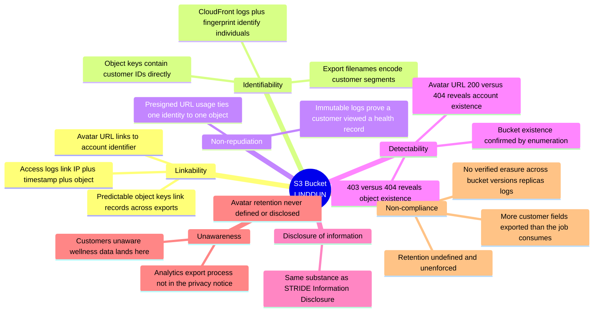

[← 06 STRIDE](06-stride.md) · [Contents](README.md) · [08 Attack Trees & CAPEC →](08-attack-trees-capec.md)

# 07 · LINDDUN — Privacy Threat Modeling

---

## 7.1 Why STRIDE Isn't Enough

> 📘 **Theory.** STRIDE protects the **system**: its confidentiality, integrity, availability, authorization. It does not ask whether the system's *processing of personal data* is itself a problem. You can pass every STRIDE check and still be violating privacy — and in some cases the violation comes from **the organization's own behavior**, with no attacker involved at all.
>
> LINDDUN was developed at the DistriNet Research Group, KU Leuven, by Mina Deng, Kim Wuyts, Riccardo Scandariato, Wouter Joosen, and Bart Preneel.

---

## 7.2 The Seven Categories

| Letter | Threat | Targets the property | Plain-language |
|---|---|---|---|
| **L** | Linkability | Unlinkability | Two items of data can be linked, even without identifying who |
| **I** | Identifiability | Anonymity / pseudonymity | An individual can be singled out |
| **N** | Non-repudiation | Plausible deniability | Someone **cannot deny** an action — here, a threat |
| **D** | Detectability | Undetectability / unobservability | You can tell an item *exists*, even without reading it |
| **D** | Disclosure of information | Confidentiality | Unauthorized access to content |
| **U** | Unawareness | Content awareness | The data subject doesn't know what's being collected or why |
| **N** | Non-compliance | Policy & consent compliance | Processing doesn't meet law, rule, or stated policy |

### The properties, defined

> 📘 **Unlinkability** — a relationship between two or more actions, identities, or data items cannot be established from available information. **Anonymity** — the actor's identity cannot be established. **Pseudonymity** — an actor uses an identifier that doesn't lead back to the natural person. **Plausible deniability** — an actor can deny having performed an action, and others can't confirm or deny it. **Undetectability/unobservability** — an attacker can't distinguish whether an item of interest exists; unobservability additionally means the subjects involved are anonymous to each other. **Content awareness** — users know what they're providing; only the minimum necessary information should be sought and used. **Policy and consent compliance** — the system knows its own privacy policy and what it stores, and informs the data owner about compliance before accessing data.

---

## 7.3 The Non-Repudiation Inversion

> 📘 **This is the concept most worth sitting with.** In STRIDE, Repudiation is bad: an attacker denying an action is a problem, so you want strong immutable logs. In LINDDUN, **Non-repudiation is the threat**: the same immutable log that stops an attacker denying something can prove that a *specific customer* accessed a specific sensitive record.
>
> Both are simultaneously correct. The resolution is almost never "log less" — it's **access governance over the logs themselves**, plus deliberate decisions about what identifiers enter them and for how long.

### 🏢 Applied

Our access logs would prove which customer downloaded which health-related order record. That's excellent for incident response and potentially harmful to the data subject if the logs are broadly readable inside the company. Resolution: log bucket in a separate account, access restricted to the incident-response role, retention explicitly defined, and customer identifiers minimized in object keys so they don't propagate into logs by accident.

---

## 7.4 Mapping to DFD Elements

> 📘 **Theory.** LINDDUN applies per DFD element, exactly like STRIDE per Element — the authors published a mapping of which privacy threats apply to which element types. The five-step method: build the DFD → map data flows, stores, processes, and external entities → determine whether each threat applies → build threat trees by iterating over model elements → examine from the threat-category perspective.

| DFD element | Typically susceptible to |
|---|---|
| External entity (data subject) | Identifiability, Unawareness |
| Process | Linkability, Identifiability, Non-repudiation, Detectability, Disclosure, Non-compliance |
| Data store | Linkability, Identifiability, Non-repudiation, Detectability, Disclosure, Non-compliance |
| Data flow | Linkability, Identifiability, Non-repudiation, Detectability, Disclosure |

---

## 7.5 🏢 LINDDUN Applied to Our Bucket

### The findings STRIDE structurally could not produce

| ID | Category | Finding | Why STRIDE misses it |
|---|---|---|---|
| **P-01** | Unawareness | Avatar prefix retention undefined; unclear whether the privacy notice covers it (finding S2) | No STRIDE letter covers "the data subject doesn't know" |
| **P-02** | Non-compliance | No verified deletion path across bucket + versions + replicas + **log entries containing customer identifiers**. GDPR Art. 17 applies to all copies | Not a security control failure — a governance failure |
| **P-03** | Non-compliance | Exports contain more customer fields than the analytics job consumes — a data-minimisation violation with no attacker | Purely organizational; STRIDE has no slot |
| **P-04** | Detectability | `403` vs `404` differences reveal whether an object (and therefore an account) exists | STRIDE would treat this as trivial info disclosure and deprioritize it |
| **P-05** | Linkability | Predictable key naming lets an observer correlate records across separate exports | Not disclosure — the *content* stays protected |
| **P-06** | Non-repudiation | Logs prove which customer accessed which health-adjacent record | STRIDE considers this a *desirable* property |
| **P-07** *(v8)* | Identifiability + Disclosure | The **erasure/access-request process itself** becomes an exfiltration channel: weak identity verification lets an attacker submit a DSAR impersonating a customer and receive that customer's PII | STRIDE sees "authorized request fulfilled," not "wrong person authorized"; the privacy *workflow* is the attack surface (ties F-16) |
| **P-08** *(v8)* | Non-compliance + Unawareness | The **autonomous agent** processes personal data for a purpose (summarization, and possibly model improvement or a cross-border LLM endpoint) never disclosed to or consented by the data subject | No STRIDE letter covers "the processing purpose isn't lawful/disclosed"; the data is handled *as designed* (ties F-18) |
| **P-09** *(v8)* | Linkability + Identifiability | A **trusted insider** correlates avatars + export records + access logs to re-identify individuals — entirely within standing access, no control bypassed | STRIDE's Info-Disclosure assumes an *unauthorized* reader; here the reader is authorized and the harm is the *correlation* (ties F-19) |

> 💡 **Bridge.** P-01, P-02, and P-03 are **governance gaps no bucket policy fixes**. They need a data-mapping exercise, a privacy-notice update, and a tested erasure path. If you run STRIDE alone on a system holding personal data, these are precisely the findings you will not have.

> 💡 **Bridge (v8) — the three new rows each invert a v8 *security* finding into its privacy twin.** F-16 is account takeover (a security failure); **P-07** is the same weak verification turning your *compliance obligation* (the DSAR) into the breach. F-18 is agent hijacking (security); **P-08** is the same agent, working perfectly, processing PII for an undisclosed purpose. F-19 is insider exfiltration (security); **P-09** is the same insider, authorized, *re-identifying* people the exports were supposed to keep merely linkable. This is exactly why [07 §7.8](07-linddun-privacy.md) insists LINDDUN runs as a **separate pass** — every one of these hides in the shadow of a security finding that a merged checklist would have marked "done."

---

## 7.6 Misuse Cases

> 📘 **Theory.** LINDDUN deliberately does *not* prescribe a risk-ranking scheme — you bring your own ([09](09-risk-scoring.md)). What it does prescribe is expressing findings as **misuse cases (MUCs)**: narrative stories comparable to each other, with a defined structure.

### 🏢 MUC-01: Policy and consent non-compliance (P-02)

| Field | Content |
|---|---|
| **Title** | MUC-01: Unfulfillable erasure request |
| **Summary** | Meridian cannot fully honor a customer's right-to-erasure request because copies of their personal data persist in object versions, replicas, and access-log entries that reference customer identifiers in object keys |
| **Assets, stakeholders, threats** | Customer PII. *The customer:* their data persists after they revoked consent. *The company:* regulatory exposure under GDPR Art. 17, reputational damage |
| **Primary misactor** | None — this is an organizational failure, not an attack |
| **Basic flow** | 1. Customer submits an erasure request. 2. Operations deletes the current object. 3. Noncurrent versions, cross-region replicas, and log entries containing the customer identifier remain |
| **Trigger** | Any erasure request; can always happen |
| **Preconditions** | Versioning enabled without a version-aware deletion procedure · customer identifiers embedded in object keys · retention undefined for logs |
| **Prevention capture points** | Version-aware deletion runbook, tested · minimize customer identifiers in object keys · defined and enforced log retention · documented data map covering every location personal data lands |
| **Prevention guarantee** | A tested deletion procedure substantially reduces the threat; residual risk remains for backups and any third-party copy, which must be separately enumerated |

> 📘 Note the preconditions come directly from the threat tree, and that requirements are extracted from the MUC as prevention capture points and prevention guarantees. LINDDUN steers mitigations toward **privacy-enhancing technologies** rather than purely legal or contractual devices — a contract saying "we won't misuse it" is weaker than a design where you never held the data.

---

## 7.7 Privacy Mitigations for Our Case

| Finding | Mitigation | Type |
|---|---|---|
| P-01 Unawareness | Data-mapping exercise; update privacy notice to cover avatar and export processing; define retention per prefix | Governance |
| P-02 Non-compliance | Version-aware erasure runbook, **tested**; enumerate every copy location; define log retention | Process + PET |
| P-03 Data minimization | Reduce exported fields to what the job consumes; review quarterly | PET |
| P-04 Detectability | Return uniform responses for missing and forbidden objects | Technical |
| P-05 Linkability | Use opaque, non-sequential object keys — no customer identifiers in paths | PET |
| P-06 Non-repudiation | Restrict log access to the IR role; separate account; minimize identifiers entering logs | Access governance |
| P-07 DSAR abuse *(v8)* | Scripted, out-of-band identity verification on erasure/access requests; log and rate-limit DSARs; treat the DSAR workflow as a sensitive interface | Process + Technical |
| P-08 Agent purpose *(v8)* | Document the agent's processing purpose in the privacy notice and a DPIA; confirm lawful basis; forbid PII egress to training or third-party model endpoints; minimize what the agent is fed | Governance + PET |
| P-09 Insider linkability *(v8)* | Least-privilege + need-to-know; opaque keys (P-05); UEBA on correlation-pattern access; data minimization so re-identification is structurally harder | Access governance + PET |

---

## 7.8 When to Run LINDDUN

**Always, if personal data is in scope.** It is not optional for GDPR/CCPA/HIPAA-adjacent systems, and it produces categories of finding that no security framework generates.

**Run it as a separate pass, not merged into STRIDE.** Merging causes teams to silently drop the LINDDUN-only findings, because when the checklist has six letters and one of them is "Information Disclosure," Unawareness has nowhere to live.

**Bring the DPO or privacy lead.** Several findings here (P-01, P-02, P-03) require someone with authority over the privacy notice and the data map — not an engineering decision.

**Consider LINDDUN GO** for a first session: a lightweight, card-based elicitation format that doesn't require privacy expertise to start ([15 §15.6](15-methodology-comparison.md)).

---

[← 06 STRIDE](06-stride.md) · [Contents](README.md) · [08 Attack Trees & CAPEC →](08-attack-trees-capec.md)
