[← 07 LINDDUN](07-linddun-privacy.md) · [Contents](README.md) · [09 Risk Scoring →](09-risk-scoring.md)

# 08 · Attack Trees, the Attack Forest & CAPEC

---

## 8.1 Attack Trees

> 📘 **Theory.** Introduced by Bruce Schneier (1999); used in computer science for over two decades. The **root** is the attacker's goal — a negative outcome for you, a positive one for them. Intermediate and leaf nodes are ways to achieve the parent's goal. This is the primary model type for **attacker-centric** threat modeling.
>
> Each node should carry: difficulty of the action · cost · special knowledge or conditions required · anything else bearing on success or failure.
>
> **Construction:** identify a target/goal → identify actions to achieve it → rinse and repeat.

> 📘 **Two things a good tree needs:** complete knowledge of how something can be compromised — favoring *"what is possible"* over *"what is practical"* — and an understanding of the motivations, skills, and resources available to different attacker types.

> 📘 **Practical guidance:**
> - **Don't filter for feasibility while enumerating.** Analysis comes later. At this stage an exhaustive list of possibilities beats a partial list of feasibilities.
> - **Lopsided trees are fine.** Not all actions need equal decomposition depth.
> - **Dangling nodes are fine.** You won't identify every scenario.
> - **The tree is done when no additional substeps are needed to complete an action** — i.e., when a leaf maps to a single control.
> - **Brainstorm as a group.** This is where technical and security knowledge combine.
> - **Your risk appetite tells you when to stop.** How much time this deserves is a business question ([02](02-business-context.md)).

---

## 8.2 The Attack Forest

> 📘 **Theory.** An attack **forest** is a set of trees against one system, one per materially distinct attacker goal. The test: **if fully mitigating Goal A would leave Goal B untouched, they need separate trees.**
>
> A forest isn't inherently more rigorous — it's the right shape only when the goal count is genuinely plural. Don't build four trees for a one-goal system.

### 🏢 Our goals — four outcomes, five means *(v8)*

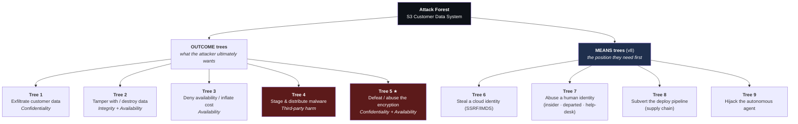

**The original four still pass the test:** encryption stops Tree 1 and does nothing for Tree 2; versioning stops Tree 2 and does nothing for Tree 4; scanning stops Tree 4 and does nothing for Tree 1. **Tree 5 also passes it against Tree 1** — you can fully close anonymous read (Tree 1) and still lose everything to a broad KMS key policy or a crypto-shred (Tree 5), because Tree 5's controls (key-policy scoping, `ViaService`, multi-person key deletion) are disjoint from Tree 1's (Block Public Access, `ListBucket` deny).

> 📘 **A distinction v7 didn't need: outcome vs. means.** §8.2's test — *"if fully mitigating Goal A leaves Goal B untouched, they need separate trees"* — is about **materially distinct goals**. The five new trees split into one genuine new *outcome* (Tree 5, defeating the crypto) and four **means/capability trees** (Trees 6–9): ways an attacker acquires the *position* from which the outcome trees become trivial. Are means trees legitimate members of a forest? Yes, when each maps to a **different defensive owner and control set** — which is the operational form of the same test. Tree 6 is owned by application + platform engineering (IMDSv2, egress control); Tree 7 by IAM + IT/HR (JML, help-desk verification); Tree 8 by the platform/DevSecOps team (module pinning, provenance); Tree 9 by whoever owns the agent (Least Agency). They resist being collapsed into one another exactly the way the outcome trees do. Drawing them separately is what stops "an attacker gets a credential somehow" from being a single hand-waved leaf on Tree 1 — which is precisely what it was in v7.

---

## 8.3 Tree 1 — Exfiltrate Customer Data

```mermaid
flowchart TD
    G["<b>GOAL</b><br/>Read customer data<br/>without authorization"]
    G --> A1["1 · Direct anonymous read"]
    G --> A2["2 · Bypass CloudFront"]
    G --> A3["3 · Compromise a credential"]
    G --> A4["4 · Exploit configuration drift"]

    A1 --> A11["1.1 Guess/enumerate bucket name<br/><i>cost: none · skill: none</i>"]
    A1 --> A12["1.2 Find name in leaked source/IaC/CI logs<br/><i>cost: low · skill: low</i>"]
    A1 --> A13["1.3 Find via scanner services indexing<br/>public buckets<br/><i>cost: none · skill: none · passive</i>"]
    A1 --> A14["1.4 Use public ListBucket to enumerate<br/>every key, then GET each<br/><i>cost: none · skill: none</i>"]

    A2 --> A21["2.1 Bucket policy still allows public GET<br/>despite OAC<br/><i>skill: low</i>"]
    A2 --> A22["2.2 Obtain/replay a leaked presigned URL<br/><i>skill: low · needs the leak</i>"]

    A3 --> A31["3.1 Steal IAM creds via SSRF or leaked keys<br/><i>skill: medium</i>"]
    A3 --> A32["3.2 Compromise the CI/CD deploy role<br/><i>skill: high · highest payoff</i>"]
    A3 --> A33["3.3 Insider or unrevoked departed-employee access<br/><i>skill: none · needs position</i>"]

    A4 --> A41["4.1 Manual console change bypasses IaC<br/><i>skill: none · needs access</i>"]
    A4 --> A42["4.2 Uncoordinated pipeline reverts the fix<br/><i>accidental</i>"]

    style G fill:#8b1a1a,color:#fff
    style A13 fill:#5c1a1a,color:#fff
    style A14 fill:#5c1a1a,color:#fff
```

> 💡 **Bridge.** Read the cost/skill annotations on branch 1. Leaves 1.1, 1.3, and 1.4 all say **cost: none, skill: none**. There is no attacker sophistication requirement anywhere on that branch — which is exactly why F-01's DREAD Exploitability scores 10/10 ([15 §DREAD](15-methodology-comparison.md)) and why it's release-blocking. Annotating leaves isn't bookkeeping; it's what makes the tree *argue* for a priority.

---

## 8.4 Tree 2 — Tamper With / Destroy Data

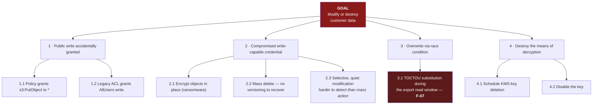

Note **B2.3** — selective quiet modification is more dangerous than mass deletion and gets far less attention, because there's no dramatic moment that triggers investigation.

---

## 8.5 Tree 3 — Denial of Service / Cost Inflation

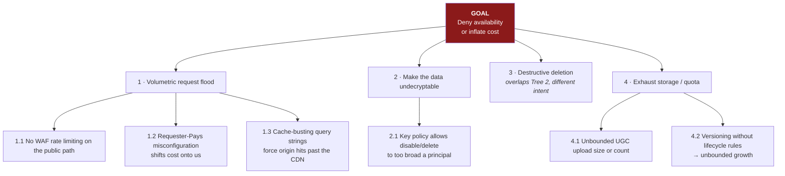

**C1.3** is worth internalizing: a CDN in front of a bucket is not automatically a rate-limit control. Cache-busting parameters can force origin hits, and if the origin is billed per request, the CDN becomes an amplifier rather than a shield.

---

## 8.6 Tree 4 — Malware Staging & Distribution

Discovered mid-session ([03 §3.4](03-session-facilitation.md)), not from any catalog.

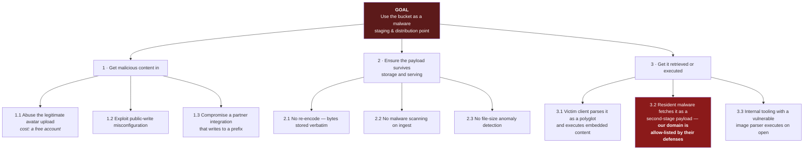

> 💡 **Bridge.** **D3.2 is the crux, and it's counterintuitive.** The attacker's gain isn't the file — it's *your reputation*. A payload hosted on your CDN passes network defenses that would block an unknown host. This is why the mitigation must include **isolating UGC into its own bucket and domain**: it's not just blast-radius containment, it's denying the attacker the reputational borrowing that makes the attack worth doing.

**Grounding:** CWE-434 (Unrestricted Upload of File with Dangerous Type) · CWE-829 (Inclusion of Functionality from Untrusted Control Sphere) · ATT&CK **T1027.003** (Obfuscated Files or Information: Steganography) · ATT&CK **T1105** (Ingress Tool Transfer). Real-world precedent exists in malware families that retrieve second-stage components hidden inside PNG images on legitimate infrastructure.

---

## 8.6a Tree 5 — Defeat / Abuse the Encryption Layer ★ *(v8)*

The tree the guide was asked to grow. Every other tree treats encryption as a *mitigation*; this one treats the **KMS control plane as a target in its own right**. It is an outcome tree because its controls are disjoint from Tree 1's: you can perfectly close anonymous read and still lose the plaintext here. Grounded on the L3-D key-access plane ([04 §4.16c](04-dfd-library.md)).

```mermaid
flowchart TD
    G5["<b>GOAL</b><br/>Read plaintext despite SSE,<br/>or make data undecryptable"]
    G5 --> H1["1 · Obtain decrypt authority<br/><i>read the plaintext</i>"]
    G5 --> H2["2 · Redirect / downgrade encryption<br/><i>own future writes</i>"]
    G5 --> H3["3 · Destroy decryptability<br/><i>crypto-shred</i>"]
    G5 --> H4["4 · Ransomware by re-encryption"]
    G5 --> H5["5 · Persist covertly on the key"]

    H1 --> H11["1.1 Key policy grants Decrypt too broadly,<br/>or to acct :root → delegates to IAM<br/><i>skill: low · ENC-3</i>"]
    H1 --> H12["1.2 No kms:ViaService → call kms:Decrypt<br/>DIRECTLY on a ciphertext blob, bypass S3<br/><i>skill: medium · ENC-4</i>"]
    H1 --> H13["1.3 Cross-account grant → decrypt exfiltrated<br/>objects from the partner account<br/><i>skill: low · ENC-3 · F-14</i>"]
    H1 --> H14["1.4 Assume a role already on the key policy<br/><i>via Tree 6 / Tree 7</i>"]

    H2 --> H21["2.1 UpdateAlias repoints the enc alias to<br/>an attacker key → new writes readable by them<br/><i>skill: medium · ENC-5</i>"]
    H2 --> H22["2.2 Write with weak/no SSE — no write-time<br/>enforcement of aws:kms + expected key ARN<br/><i>skill: low · ENC-5</i>"]

    H3 --> H31["3.1 ScheduleKeyDeletion (min 7-day window)"]
    H3 --> H32["3.2 DisableKey — instant, reversible by owner"]
    H3 --> H33["3.3 Delete IMPORTED key material —<br/>instant, irreversible<br/><i>ENC-7</i>"]

    H4 --> H41["4.1 CopyObject w/ SSE-C attacker key →<br/>AWS holds ciphertext it CANNOT recover<br/><i>ENC-6 · ATT&CK T1486</i>"]

    H5 --> H51["5.1 CreateGrant → durable decrypt that<br/>survives a key-POLICY review<br/><i>ENC-8</i>"]
    H5 --> H52["5.2 PutKeyPolicy → grant self Decrypt<br/><i>ENC-8 · E7</i>"]

    style G5 fill:#8b1a1a,color:#fff
    style H11 fill:#5c1a1a,color:#fff
    style H12 fill:#5c1a1a,color:#fff
    style H41 fill:#5c1a1a,color:#fff
```

> 💡 **Bridge — the two counterintuitive leaves.** **1.2** is the one security teams miss: they scope the *bucket* policy and assume the data is safe, but a principal with `kms:Decrypt` and no `ViaService` restriction can hand a ciphertext blob straight to the KMS API and never touch S3 — so the object read never appears in S3 access logs at all. **4.1** is the modern S3 ransomware primitive: with SSE-C the *attacker* supplies the key on every request and AWS never stores it, so re-encrypting your objects with a key only they hold is a one-command, unrecoverable extortion — versioning and Object Lock are the only things that blunt it, which is why F-11 and this leaf share a mitigation.

---

## 8.6b Tree 6 — Steal a Cloud Identity (SSRF / IMDS) *(v8)*

A **means** tree: the position from which Trees 1, 2 and 5 become trivial. Grounded on the compute/IMDS plane ([04 §4.16b](04-dfd-library.md)); adds the SSRF surface, which is **A01:2025** in the current OWASP list (not A10 — [11 §11.2](11-compliance-mapping.md)).

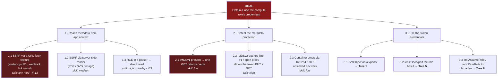

**The control is one line:** IMDSv2 required + metadata hop limit = 1 defeats branch 2 almost entirely — a single leaf-to-control mapping, which §8.1 says is the signal a branch is done.

---

## 8.6c Tree 7 — Abuse a Human Identity (insider · departed · help-desk) *(v8)*

A **means** tree owned by IAM + IT/HR, not by the platform team. Note how many leaves carry *skill: none* — the defining feature of human-identity abuse is that the means and opportunity already exist; only motive changes.

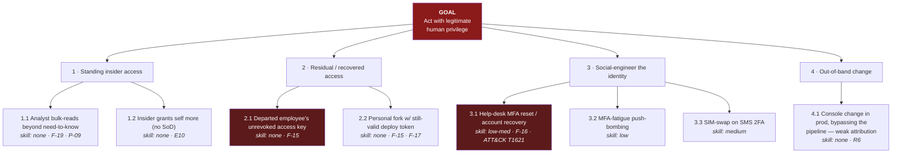

> 💡 **Bridge.** Branch 2 collapses to nearly zero the moment IAM users and long-lived keys are replaced with federated, short-lived credentials (finding S6's fix, [12](12-identity-iam-entra.md)) — the *departed employee* has nothing to keep. Branch 3 is why the help-desk needs a scripted identity-verification procedure: the strongest MFA in the world is worthless if a support agent will reset it for a confident caller.

---

## 8.6d Tree 8 — Subvert the Deploy Pipeline (supply chain) *(v8)*

A **means** tree that ends where F-09 begins: the deploy role. The attacker never touches AWS directly — they get *your* trusted pipeline to carry the payload across the boundary with a legitimate CloudTrail signature.

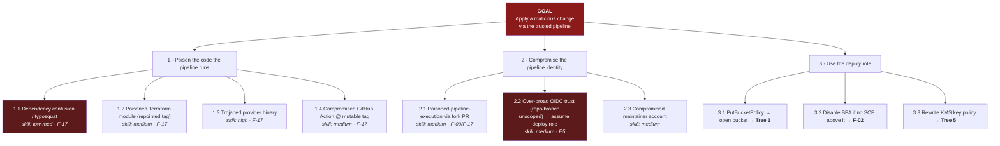

**The SCP backstop is what caps this whole tree:** an org-level `Deny` on `s3:PutBucketPublicAccessBlock` and on editing the bucket/key policy sits *above* layer 3, so even a fully compromised deploy role can't reach leaf 3.2 or 3.3 ([04 §4.14](04-dfd-library.md)).

---

## 8.6e Tree 9 — Hijack the Autonomous Agent *(v8)*

A **means** tree unique to 2020s architectures. The agent (actor A-6) is the first component in this system that *makes decisions* on content untrusted users control — so the classic "untrusted input" problem becomes "untrusted **instructions**."

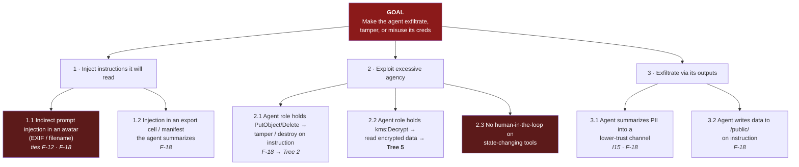

> 💡 **Bridge — F-12 and Tree 9 are the same file, a worse reader.** F-12's polyglot avatar needs a downstream human to open it; here the agent "opens" it every run, *inside* the trust boundary, holding real credentials. The whole tree collapses under one principle — **Least Agency** (LA): read-only role scoped to exactly the needed prefixes (kills branch 2), a human gate on every state-changing tool (kills 2.3, 3.2), and treat every byte the agent reads as hostile instructions, not just hostile data (the only real answer to branch 1).

**Grounding for Trees 6–9:** CWE-918 (SSRF) · CWE-441 (Unintended Proxy/Confused Deputy) · CWE-1357 (Reliance on Insufficiently Trustworthy Component) · CWE-266/269 (Privilege management) · CWE-640 (Weak account-recovery) · CWE-77 (Command/instruction injection, the agent analogue) · ATT&CK **T1552.005** (Cloud Instance Metadata API), **T1621** (MFA Request Generation), **T1195** (Supply Chain Compromise), **T1078.004** (Valid Accounts: Cloud).

---

## 8.7 CAPEC — Grounding Trees in Documented Attacks

> 📘 **Theory.** CAPEC (Common Attack Pattern Enumeration and Classification) was released in 2007 by the US Department of Homeland Security and is actively maintained. It catalogs **common attack patterns**: the methods attackers actually use. The premise is that most attacks follow patterns, so understanding the patterns lets you build the right defenses.

### Anatomy of a CAPEC entry

| Field | What it gives you |
|---|---|
| **Description / Extended description** | What the pattern is |
| **Weakness** | The associated CWE the attack exploits |
| **Likelihood / Typical severity** | Baseline ratings |
| **Relationships** | Parent and child patterns — how it generalizes and specializes |
| **Execution flow** | **Explore → Experiment → Exploit** step-by-step |
| **Prerequisites** | What must be true for it to work |
| **Skills required** | Attacker capability level |
| **Resources required** | What the attacker needs |
| **Indicators** | What defenders would observe |
| **Consequences** | Impact mapped to C/I/A and access control |
| **Mitigations** | How to defend |
| **Example instances** | Real cases, often with CVE references |

> 📘 **The Explore/Experiment/Exploit structure is the borrowable part:**
> - **Explore** — how to find a system to attack (find the weakness)
> - **Experiment** — determine how to exploit a system that has the weakness
> - **Exploit** — conduct the actual attack

### 🏢 An execution flow for our top finding

**Pattern: Anonymous retrieval of data from a misconfigured object store**

| Phase | Steps | Techniques |
|---|---|---|
| **Explore** | Identify candidate bucket names | Query internet-wide scanner services that index public buckets · brute-force common naming conventions (`<company>-prod-backups`, `<company>-customer-data`) · search public code repos, CI logs, and IaC for bucket ARNs · read error messages from the application that leak paths |
| **Experiment** | Determine access level | Issue an unauthenticated `ListBucket` — success reveals the full key index · issue `GetObject` on a sampled key · test whether `PutObject` also succeeds (escalates to Tree 2) · compare `403` vs `404` to map existence without read access |
| **Exploit** | Retrieve at scale | Enumerate all keys · bulk-download · prioritize by filename pattern (`*customer*`, `*export*`, `*.csv`) · exfiltrate before any rate-based detection could fire — noting there is no authentication event to alert on |

**Prerequisites:** the bucket exists with a public read grant; the bucket name is discoverable.
**Skills required:** **Low** — a browser or a single CLI command.
**Resources required:** **None.**
**Indicators:** a spike in anonymous `GetObject` requests · sequential key access patterns · unusual source geography — *all of which require CloudTrail data events to be visible at all* (finding LOG-1).
**Consequences:** Confidentiality — read data at scale. Compliance — mandatory breach notification.
**Related weaknesses:** CWE-284 (Improper Access Control) · CWE-668 (Exposure of Resource to Wrong Sphere).

> 💡 **Bridge.** Writing the execution flow does something a bare finding doesn't: the **Indicators** row generates detection requirements directly, and the **Experiment** row tells your red team exactly what to test. One structure, three consumers.

---

## 8.8 The CWE → CAPEC → ATT&CK Chain

> 📘 **Theory.** Three layers of the same MITRE ecosystem, not competing alternatives.

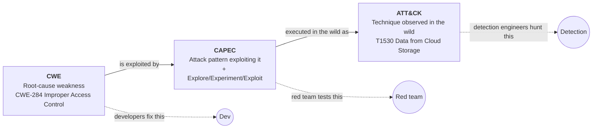

**Three audiences, three IDs, one finding.** Cite all three and each reader gets what they need: *why it's possible* (CWE), *how it'd be attacked* (CAPEC), *what to hunt for in logs* (ATT&CK).

---

## 8.9 Using a Catalog Without Becoming Its Prisoner

> 📘 **The rearview-mirror anti-pattern.** A methodology built exclusively on a threat library — especially one derived from statistical analysis of *your own* past incidents — trains the team to look only at what has already happened. Technologies change; new attack vectors appear constantly.
>
> Libraries have real value as **educational devices**, as a reference point for unforgivable issues, and as **starting points for deriving further attack vectors**. Treat a catalog entry as the root of a new branch, not as a checkbox. The value is in *how* the catalog is used.

### 🏢 CAPEC applicability review (PASTA Stage 4 style)

| CAPEC | Pattern | Applicable? | Reasoning |
|---|---|---|---|
| CAPEC-116 | Excavation | **Yes** | Public ListBucket makes systematic retrieval trivial |
| CAPEC-150 | Collect data from common resource locations | **Yes** | Predictable bucket and key naming |
| CAPEC-1 | Accessing functionality not properly constrained by ACLs | **Yes** | Legacy ACL evaluation path still active |
| CAPEC-66 | SQL injection | **No** | No SQL interpreter in this scope |
| CAPEC-549 | Local execution of code | **Partial** | Only via the UGC parsing path (Tree 4, D3.3) |
| **CAPEC-664** | Server Side Request Forgery | **Yes** *(v8)* | Any URL-fetch feature reaches IMDS → Tree 6 / F-13 |
| **CAPEC-122** | Privilege Abuse | **Yes** *(v8)* | Over-broad KMS key policy and deploy-role scope — Trees 5 & 8 |
| **CAPEC-233** | Privilege Escalation | **Yes** *(v8)* | `kms:PutKeyPolicy`/`CreateGrant` self-grant (E6/E7); `iam:PassRole` chains (E8) |
| **CAPEC-437** | Supply Chain (+ CAPEC-538 Open-Source Library Manipulation) | **Yes** *(v8)* | Poisoned module/provider/Action/dependency — Tree 8 / F-17 |
| **CAPEC-151** | Identity Spoofing | **Yes** *(v8)* | Help-desk-mediated MFA reset / recovery — Tree 7 / F-16 |
| **CAPEC-549** *(cross-account variant)* | Confused-deputy via missing `ExternalId` | **Yes** *(v8)* | Partner `AssumeRole` — CWE-441 / F-14 |
| **Indirect prompt injection** | *(no stable CAPEC yet)* | **Yes — catalog gap** *(v8)* | Grounded via **OWASP LLM Top 10** (LLM01 Prompt Injection, LLM06 Excessive Agency) — Tree 9 / F-18 |

> 💡 **Bridge.** Recording the **"No"** rows matters as much as the "Yes" rows. It documents that you considered and excluded them — which is what makes the next review able to focus on what changed rather than starting over.

> 📘 **The last row is §8.9's own thesis, live.** Indirect prompt injection has *no stable CAPEC entry* because the catalogs lag the technology — exactly the **rearview-mirror** limit this section warns about. The response isn't to skip the threat because no catalog blesses it; it's to ground it in the closest living reference (OWASP's LLM Top 10) and treat the catalog gap as a signal that this is a *deriving-a-new-branch* moment, not a checkbox moment. Roughly a third of this guide's real findings (F-07, F-12, and now F-18) never appeared in any catalog first.

---

## 8.10 Attack Chains — Threading the Forest (the APT lens) *(v8)*

> 📘 **Theory.** A tree decomposes *one* goal. A real advanced adversary — actor **A-11**, nation-state / APT — doesn't respect that partition: they **chain leaves across trees**, where each step's *output* is the next step's *precondition*. An attack chain (a.k.a. kill chain / attack path) is the artifact that shows this. It matters because **the sum is worse than any single finding**: no individual leaf here is rated Critical on its own, yet the chain achieves total, persistent, unattributable compromise. This is the "step back and look at the whole system" that §6.3's Warning 2 demands, made concrete.

### 🏢 Chain AC-1 — "Patient theft of the whole estate"

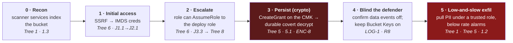

| # | Step | ATT&CK tactic / technique | Individual severity | The control that **breaks the chain here** |
|---|---|---|---|---|
| 0 | Passive discovery | Reconnaissance · T1596 | Low | Bucket not public; opaque naming (F-03/P-05) |
| 1 | SSRF → instance credentials | Credential Access · **T1552.005** | Medium (F-13) | IMDSv2 + hop-limit 1; egress control |
| 2 | Assume the deploy role | Priv-Esc / Lateral · **T1078.004** | High (F-09) | Scoped role `Resource`; no `PassRole`/`AssumeRole` on the compute role |
| 3 | Grant durable decrypt on the CMK | Persistence · T1098 | High (ENC-8) | Deny `kms:CreateGrant`/`PutKeyPolicy` outside break-glass; alarm on both |
| 4 | Confirm no object-level audit | Defense Evasion · T1562.008 | *multiplier* (LOG-1) | CloudTrail data events + GuardDuty S3; per-object decrypt visibility |
| 5 | Slow, credentialed exfiltration | Exfiltration · **T1530** | Critical (aggregate) | Least privilege on the reader/role; anomaly detection on volume & geography |

> 💡 **Bridge — why the chain is the finding.** Read the "individual severity" column: **not one step is Critical by itself**, and step 0 is rated Low. Score them in isolation and a triage process could rationally defer every one. The chain is what turns five deferrable findings into an existential one — and it also shows that **you do not need to fix all five to win**. Breaking *any single link* collapses the whole path. The cheapest link to break is step 1 (IMDSv2 is one setting), and the highest-leverage is step 4 (LOG-1), because a defender who can *see* step 5 can respond even if steps 1–3 succeeded. This is the argument for defense-in-depth stated as arithmetic rather than as a slogan.

> 📘 **How to use chains without drowning.** Don't enumerate every path — that's combinatorially hopeless. Build a chain only for your **most-capable modeled adversary** against your **crown jewels** (here: A-11 vs. the PII exports), and only deep enough to expose the *cheapest link to break*. One or two chains per system is plenty; their job is to justify the defense-in-depth investments that per-finding scoring systematically under-prices. Chain AC-1 becomes **F-20** in the register — a meta-finding whose treatment is "ensure at least two independent links carry a release-blocking control."

---

[← 07 LINDDUN](07-linddun-privacy.md) · [Contents](README.md) · [09 Risk Scoring →](09-risk-scoring.md)
