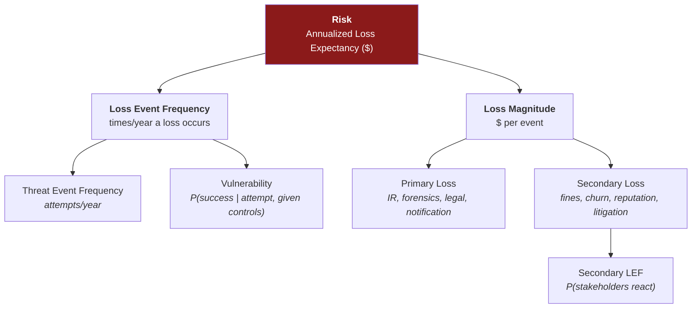
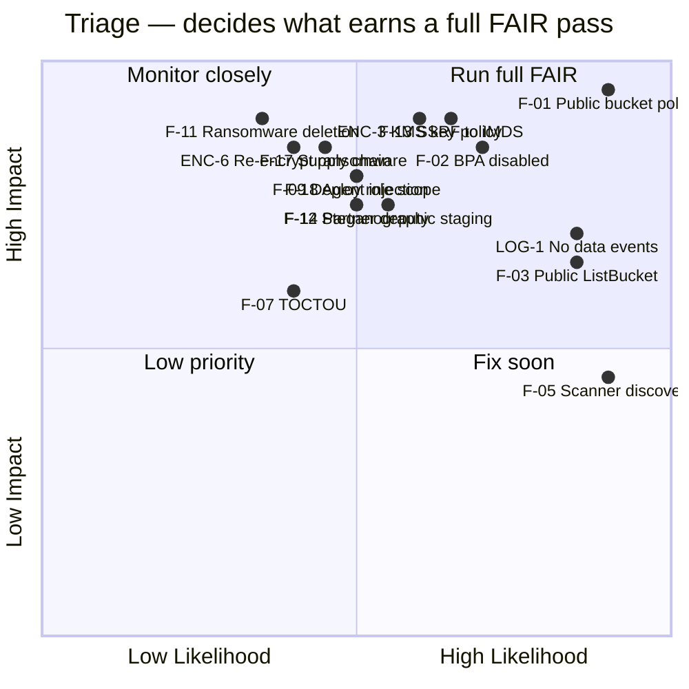
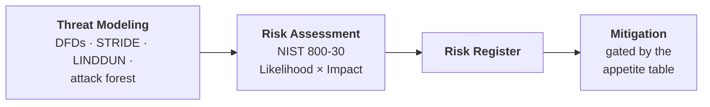

[← 08 Attack Trees & CAPEC](08-attack-trees-capec.md) · [Contents](README.md) · [10 Security Requirements →](10-security-requirements.md)

# 09 · Risk Scoring & Formal Risk Assessment

---

## 9.1 The Distinction That Matters Most

> 📕 **Correction.** **Severity** and **risk** are different measurements answering different questions. Conflating them is the most common analytical error in this discipline.

| | Severity | Risk |
|---|---|---|
| **Definition** | Damage potential + how easily a vulnerability is exploited | Likelihood of threat-event initiation × likelihood of success × impact, against asset value |
| **Measured by** | CVSS | DREAD (coarse), FAIR (quantitative) |
| **Can tell you** | How bad it is technically, on a comparable scale | Whether to spend money on it |
| **Cannot tell you** | *When or if* anyone will try · what the asset is **worth** · what the fix **costs** | Precise numbers — risk resists exact quantification |

> 📘 **The consequence:** relying on raw severity is a good way to *communicate about a defect* and a poor way to *manage risk*. You need both, for different audiences.

---

## 9.2 CVSS — Severity

> 📘 **Theory.** From FIRST. Produces 0.0–10.0 from eight base metrics, combining an **exploitability subscore** (likelihood of successful exploitation) and an **impact subscore**.
>
> | Metric | Meaning |
> |---|---|
> | **AV** Attack Vector | Network / Adjacent / Local / Physical |
> | **AC** Attack Complexity | Low / High |
> | **PR** Privileges Required | None / Low / High |
> | **UI** User Interaction | None / Required |
> | **S** Scope | Unchanged / Changed |
> | **C / I / A** | Confidentiality / Integrity / Availability impact |
>
> Use the **Environmental** metric group to adjust for *your* deployment — e.g. Modified Confidentiality Requirement = High for a PII store — rather than accepting a generic vendor score.

### 🏢 Applied

> 📘 One threat can have **multiple exploitation paths with different vectors.** Score the paths, not just the threat.

| Finding | Exploitation path | Vector | Score |
|---|---|---|---|
| F-01 | Unauthenticated internet read of PII | `CVSS:3.1/AV:N/AC:L/PR:N/UI:N/S:U/C:H/I:N/A:N` | **7.5 High** |
| F-01 (path 2) | ...with public ListBucket enabling full enumeration | `CVSS:3.1/AV:N/AC:L/PR:N/UI:N/S:C/C:H/I:N/A:N` | **8.6 High** |
| F-07 | Write-capable principal substitutes content post-validation | `CVSS:3.1/AV:N/AC:H/PR:L/UI:N/S:U/C:N/I:H/A:N` | **5.3 Medium** |
| F-09 | Compromised CI/CD credential rewrites bucket policy | `CVSS:3.1/AV:N/AC:H/PR:H/UI:N/S:C/C:H/I:H/A:H` | **8.0 High** |
| F-12 | Authenticated customer uploads polyglot; served to third parties | `CVSS:3.1/AV:N/AC:L/PR:L/UI:R/S:C/C:L/I:L/A:N` | **6.5 Medium** |
| **ENC-3** | Principal with broad KMS `Decrypt` reads PII despite a locked bucket policy | `CVSS:3.1/AV:N/AC:L/PR:L/UI:N/S:C/C:H/I:N/A:N` | **8.1 High** |
| **F-13** | SSRF → IMDS → `GetObject` with the stolen instance role | `CVSS:3.1/AV:N/AC:L/PR:N/UI:N/S:C/C:H/I:L/A:N` | **8.6 High** |
| **F-13 (path 2)** | ...but IMDSv2 + hop-limit-1 in place; needs an SSRF that can also `PUT` the token | `CVSS:3.1/AV:N/AC:H/PR:N/UI:N/S:C/C:H/I:L/A:N` | **7.6 High** |
| **ENC-6** | Write-capable principal re-encrypts objects under an attacker-held SSE-C key | `CVSS:3.1/AV:N/AC:L/PR:L/UI:N/S:U/C:N/I:H/A:H` | **7.1 High** |
| **F-17** | Poisoned dependency/module executes with the deploy role | `CVSS:3.1/AV:N/AC:H/PR:N/UI:N/S:C/C:H/I:H/A:H` | **8.2 High** |

The **F-13 two-row entry** is §9.2's "score the paths, not the threat" rule made concrete: the *same* finding scores 8.6 or 7.6 depending purely on whether IMDSv2 is enforced — which is exactly the environmental delta the control buys, and precisely the kind of thing a single number attached to "SSRF" would erase.

---

## 9.3 DREAD — Legacy Risk

Covered in depth in [15 §DREAD](15-methodology-comparison.md), including the scoring anchors and a worked example scoring F-01 at 49/50. Summary: five categories 0–10, largely retired by Microsoft for subjectivity, still useful as a **triage** discussion prompt. Do not use it to justify budget.

---

## 9.4 FAIR — Quantitative Risk

> 📘 **Theory.** Factor Analysis of Information Risk (Jack Jones; maintained as Open FAIR by The Open Group). Referenced by NIST IR 8286 as an example of quantitative risk analysis.
>
> **Core equation:** `Risk ($) = Loss Event Frequency × Loss Magnitude`

> 📘 **The estimation rule people get wrong first:** every input is a **calibrated three-point range** (min / most likely / max, typically at 90% confidence) — never a single value. Ranges feed a **Monte Carlo simulation** producing a **Loss Exceedance Curve**: *"X% chance annual loss exceeds $Y."* That curve is the artifact you bring to the business, not one number.

### Why not just High/Medium/Low

The CFO mandate in [02](02-business-context.md) is the business reason. The analytical reasons:

- **Labels aren't arithmetic.** Two "Mediums" don't sum to a "High," and you can't subtract a control's effect from a label.
- **Labels can't be compared to control cost.** "Is an $80K WAF worth it against a High?" is not a well-formed question. "Against a $2.1M expected annual loss" is.
- **Labels don't survive rater disagreement.** Same problem as DREAD.
- **Labels don't aggregate.** "Six Highs and fourteen Mediums" tells a board nothing about total exposure.
- **Labels hide where the uncertainty is.** Small-but-certain and huge-but-rare can land on the same label and need completely different strategies.

### 🏢 Worked example: F-01

| Factor | Estimate (min – likely – max) | Reasoning |
|---|---|---|
| **Threat Event Frequency** | 50 – 200 – 500 attempts/yr | Public buckets are continuously indexed by scanner services and opportunistic bots. This is background radiation, not a targeted campaign |
| **Vulnerability** *(current controls)* | 60% – 85% – 95% | With no Block Public Access, no Config rule, and no remediation, most attempts that find the bucket succeed |
| **Vulnerability** *(post-remediation)* | 1% – 4% – 10% | Residual detection/remediation window only |
| **Loss Event Frequency** | derived | ~30 – 170 – 475 events/yr currently |
| **Primary Loss / event** | $150K – $320K – $600K | IR retainer, legal counsel, notification mailing, call-center surge, engineering remediation |
| **Secondary Loss / event** | $500K – $2.5M – $10M+ | GDPR fines scale with global revenue; per-record state notification costs; churn; brand damage; class-action exposure |
| **Secondary LEF** | 40% – 65% – 85% | Probability regulators/media/customers actually act, given the regulated-data assumption |

**Result:** ALE ≈ **$180K (10th pct) · $1.1M (most likely) · $6M+ (90th pct)**.

Against [02 §2.5](02-business-context.md), the 90th-percentile figure clears the **Critical** tier ($1M single-threat) → release-blocking, CFO+CISO+Board sign-off required to accept.

> 💡 **Bridge — the number that actually persuades.** The interesting output isn't the ALE. It's the **delta**: current-state Vulnerability of ~85% versus post-remediation ~4%. That delta, multiplied by Loss Magnitude, is the *value of the controls* — and it is the only form in which "should we do this work?" becomes an answerable business question.

### Anti-patterns

- **False precision** — presenting "$1.1M" as certain instead of as a range. A point estimate without its interval is *more* misleading than a label, not less.
- **Uncalibrated estimation** — humans are systematically overconfident at range estimation without training. Calibrate first (Hubbard & Seiersen).
- **Skipping Secondary Loss** — teams anchor on the visible IR cost and underweight fines, churn, and reputation, which usually dominate for regulated PII.
- **Running FAIR on everything** — expensive analyst time for no decision improvement. Triage first, quantify the Quadrant-1 items only.
- **Treating the ALE as the decision** — the number *informs*; a named risk owner still decides.

### 🏢 Second worked example: ENC-6 re-encryption ransomware — *a different loss shape* *(v8)*

FAIR earns its keep when two findings land in the **same tier** but need **opposite strategies**. ENC-6 and F-01 are both Critical; their curves could not be less alike.

| Factor | Estimate (min – likely – max) | Reasoning |
|---|---|---|
| **Threat Event Frequency** | 1 – 3 – 8 /yr | Automated S3 ransomware campaigns exist, but this *requires a write-capable credential first* (via F-13/F-09/F-15) — not background radiation, not rare |
| **Vulnerability** *(current)* | 50% – 75% – 90% | Versioning OFF, Object Lock absent, SSE-C not denied → a write-capable attacker succeeds and there is no clean recovery |
| **Vulnerability** *(post)* | 2% – 5% – 15% | Versioning + Object Lock make recovery possible without paying; denying SSE-C removes the primitive entirely |
| **Loss Event Frequency** | derived | ~0.5 – 2 – 7 /yr currently |
| **Primary Loss / event** | $80K – $250K – $700K | IR, forensics, restore effort, warehouse/analytics downtime |
| **Secondary Loss / event** | $200K – $900K – $4M | Extortion payment *if no recovery* · regulatory exposure from unavailability of regulated data · the **integrity doubt** — *which* records were altered, not merely encrypted? |
| **Secondary LEF** | 30% – 55% – 75% | Probability the loss escalates past internal recovery |

**Result:** ALE ≈ **$120K (10th) · $600K (likely) · $1.8M (90th)** → **Critical**.

> 💡 **Bridge — same tier, opposite strategy.** F-01 is high-frequency, confidentiality, secondary-loss-dominated (fines, churn). ENC-6 is low-frequency, availability-plus-integrity, with a **bimodal** secondary loss — you either recover cheaply *or* you pay and still doubt your data. The label "Critical" hides this completely. The curve doesn't: F-01 demands **prevention** (close the door — it *will* be tried), while ENC-6 demands **resilience** (versioning + Object Lock so you never have to pay). The control strategy falls out of the *shape*, which is the entire argument for quantifying rather than labeling.

---

## 9.5 Triage Before Quantification

> 📘 Use a coarse method to decide *what deserves* full FAIR treatment.

> 💡 **Bridge (v8).** The new findings cluster tellingly. **ENC-3 and F-13 land next to F-01 in Quadrant 1** — same impact, comparable likelihood — because they reach the *same* PII by a different door (the key plane, a stolen role). **ENC-6, F-17 and F-18 sit in "fix soon"** (high impact, moderate likelihood): they need a specific precondition (write access, a poisoned dependency, an injected file) but the consequence is severe. None of the v8 findings land in Quadrant 3 — which is itself a signal that the expansion found *real* surface, not noise.

---

## 9.6 Formal Risk Assessment — NIST SP 800-30

> 📘 **Theory.** Threat modeling is a design-level, engineering-owned activity producing diagrams and findings. A formal **risk assessment** is the organizational, audit-facing process that consumes that output and produces a **Risk Register** — the artifact auditors, insurers, and boards actually review. NIST SP 800-30 Rev. 1 is the standard process. It doesn't replace STRIDE or attack trees; it **structures their output**.

**The four steps:** **Prepare** (scope, assumptions, risk model — our [02](02-business-context.md)) → **Conduct** (identify threat sources/events, vulnerabilities and predisposing conditions, determine likelihood and impact, determine risk) → **Communicate** (the register) → **Maintain** (ties to [14](14-continuous-threat-modeling.md) — assessments go stale exactly like threat models).

### Likelihood & impact scales

| Level | Likelihood | Impact |
|---|---|---|
| Very Low | Highly unlikely | Negligible |
| Low | Unlikely but possible | Limited, recoverable in normal operations |
| Moderate | Plausible within the period | Serious, requires incident response |
| High | Likely, expected to occur | Severe, affects business viability short-term |
| Very High | Near-certain given current exposure | Catastrophic, existential-tier |

---

## 9.7 🏢 The Risk Register

| ID | Asset | Threat (framework) | Root cause | Existing controls | Likelihood | Impact | Inherent risk | ALE 90th | Residual (post-control) | Owner | Treatment |
|---|---|---|---|---|---|---|---|---|---|---|---|
| **F-01** | Customer PII | Public policy grants GetObject (STRIDE-I) | CWE-284, CWE-668 | None | Very High | Very High | **Very High** | $6M+ | Low | Head of Cloud Security | **Mitigate — release-blocking** |
| **F-02** | Bucket config | Block Public Access disabled (STRIDE-I/T) | CWE-284 | Account default only | High | Very High | **High** | ~$4M | Low | Head of Cloud Security | **Mitigate — release-blocking** |
| **F-03** | Object keys | Public ListBucket enumeration (STRIDE-I) | CWE-284 | None | High | Moderate | **Moderate-High** | ~$1.2M | Low | Application Eng Lead | **Mitigate — release-blocking** |
| **F-07** | Export integrity | TOCTOU substitution (STRIDE-T) | CWE-367 | None | Moderate | High | **Moderate-High** | ~$400K | Low | Platform Eng Lead | Mitigate — 30 days |
| **F-09** | IAM roles | Deploy-role over-permission (STRIDE-E) | CWE-269 | Partial; **scope unverified (S3)** | Moderate | High | **Moderate-High** | ~$900K | Moderate | Platform Eng Lead | Mitigate — 30 days, verify first |
| **F-11** | Data integrity | Ransomware / mass deletion (STRIDE-T) | CWE-284 | **Versioning OFF (S4)** | Low, trending up | Very High | **Moderate-High** | ~$2.1M | Low | Head of Cloud Security | **Mitigate — release-blocking** |
| **F-12** | UGC objects | Steganographic staging (STRIDE-T) | CWE-434, CWE-829 | **No scanning (S1)** | Moderate | High | **Moderate-High** | ~$1.4M | Low | Application Eng Lead | **Mitigate — release-blocking** |
| **LOG-1** | Audit trail | No data-event logging (STRIDE-R) | CWE-778 | Partial | Moderate | High *(force multiplier)* | **High** | n/a — enabling factor | Low | Head of Cloud Security | **Mitigate — release-blocking** |
| **P-01** | Data subjects | Unawareness (LINDDUN-U) | Governance gap | None | Moderate | Moderate | **Moderate** | Not FAIR-modeled | Low | DPO | Mitigate — 1 quarter |
| **P-02** | Erasure capability | Non-compliance (LINDDUN-N) | Governance gap | Partial | Moderate | High | **Moderate-High** | In F-01 Secondary Loss | Moderate | DPO | Mitigate — 1 quarter |
| **ENC-3** | Customer PII (via crypto) | Broad KMS key policy / `:root` delegation (STRIDE-I) | CWE-732 | AWS-managed key — no policy control (ENC-2) | High | Very High | **High** | ~$3M | Low | Head of Cloud Security | **Mitigate — release-blocking** |
| **F-13** | Compute role creds | SSRF → IMDS credential theft (STRIDE-I) | CWE-918 | IMDS version unverified | High | Very High | **High** | ~$2.5M | Low | App + Platform Eng | **Mitigate — release-blocking** |
| **ENC-6** | Data availability + integrity | Re-encryption ransomware, SSE-C (STRIDE-T) | CWE-284 / T1486 | **Versioning OFF (S4)** | Moderate, rising | Very High | **Moderate-High** | ~$1.8M | Low | Head of Cloud Security | **Mitigate — release-blocking** |
| **F-17** | Deploy pipeline | Supply-chain compromise (STRIDE-T/E) | CWE-1357 | Partial; no digest pinning | Moderate | Very High | **Moderate-High** | ~$1.6M | Moderate | Platform Eng | **Mitigate — release-blocking** |
| **ENC-7** | Data availability | KMS crypto-shred (STRIDE-D) | CWE-284 | No multi-person control | Low | Very High | **Moderate-High** | ~$1.5M | Low | Head of Cloud Security | **Mitigate — release-blocking** |
| **F-18** | PII + integrity | Agent excessive agency + injection (STRIDE-T/I) | OWASP LLM01/06 | None (pilot) | Moderate | High | **Moderate-High** | ~$1.2M | Low | Application Eng Lead | **Mitigate — release-blocking** |
| **F-14** | Customer PII | Partner confused deputy (STRIDE-S/I) | CWE-441 | Trust policy unverified | Moderate | High | **Moderate-High** | ~$1.1M | Low | Head of Cloud Security | **Mitigate — release-blocking** |

*High-tier v8 findings (F-09, F-15, F-16, F-19, ENC-4, ENC-5, ENC-8, F-07) and the APT chain meta-finding F-20 are carried in full in [A · Findings Register](A-findings-register.md); only the Critical-tier rows are promoted here to keep the board view legible.*

> 📘 **Register best practices.** One row per **distinct finding**, not per framework letter. Always name a **role** as risk owner, never "the security team." Carry qualitative and quantitative figures side by side during a transition — don't force a hard cutover.
>
> **Anti-patterns:** building the register *before* the threat model (produces ungrounded rows) · letting it go stale (the top reason audits fail) · including only STRIDE findings and silently dropping the LINDDUN rows.

---

## 9.8 Reporting to Different Audiences

> 📘 **Theory.** The same finding needs three framings. "You have a TOCTOU in the analytics reader" is concise and useless to a product owner. A CVSS vector will confuse a risk professional looking for impact × likelihood. Write a small business case in plain language, then attach the technical identifiers for those who want them.

| Audience | Wants | Give them |
|---|---|---|
| Developers / QA | Maximum technical detail | CWE, CVSS vector, reproduction steps, the fix |
| Management | A running (ideally declining) count | Register summary by tier, trend over time |
| Product owners / PMs | Emerging patterns | "Most findings are authorization-related — we should standardize an authz pattern" |
| Risk professionals | Impact × likelihood | NIST 800-30 ratings + FAIR ALE range |
| Board / CFO | Dollars and decisions | ALE against the appetite tiers; cost of controls vs. risk reduced |

**Automate the production of these views** by storing findings in a queryable form with pattern metadata — and keep all of it behind strict access control ([README](README.md) classification note).

---

[← 08 Attack Trees & CAPEC](08-attack-trees-capec.md) · [Contents](README.md) · [10 Security Requirements →](10-security-requirements.md)
