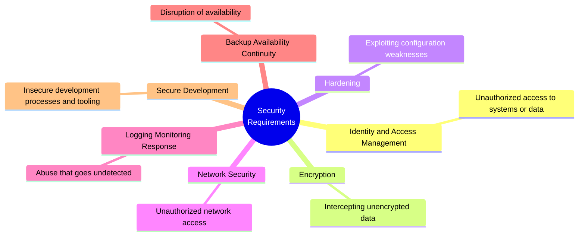

[← 09 Risk Scoring](09-risk-scoring.md) · [Contents](README.md) · [11 Compliance Mapping →](11-compliance-mapping.md)

# 10 · Security Requirements — The Jargon-Free Framework

**If you adopt one thing from this guide for a DevOps team, make it this file.**

---

## 10.1 The Problem This Solves

> 📘 **Theory.** Threat modeling invents terminology that alienates the exact people who must act on its output. Developers, platform engineers, product owners, and management do not think in "repudiation" and "trust boundaries." They think in access control, encryption, patching, logging, and backups.
>
> The fix: **categorize threats and countermeasures into recognizable topics, and drop the jargon.** You lose nothing analytically and gain enormously in adoption.

### The translation table

| Threat-modeling jargon | Say this instead |
|---|---|
| Spoofing, Tampering, Repudiation, Information Disclosure, Elevation of Privilege | unauthorized access · unauthorized modification · lack of logging · unauthorized disclosure of (personal) data · gaining unauthorized administrator access |
| Trust zones / trust boundaries | the internet · the public network · the internal network · the management network |
| Countermeasures / mitigations | **security requirements** |
| Data store | database · bucket · API · file share |
| Threat library | common threats · common security requirements |

> 💡 **Bridge — when to use which vocabulary.** Use STRIDE vocabulary *inside* the session, with the people doing the analysis: it's a better thinking tool precisely because it's abstract. Use this vocabulary in the *output* that leaves the room. Same findings, two registers. This is not dumbing down — it's writing for the reader, which [03](03-session-facilitation.md) treats as a facilitation skill.

---

## 10.2 The Seven Topics

Each topic pairs a **threat statement in plain language** with a **security requirement** — which is the form a developer can actually implement and a auditor can actually test.

---

## 10.3 Identity & Access Management

**Threats related to gaining unauthorized access to systems or data, or performing unauthorized actions.**

### Generic (memorize these)

| Threat | Security Requirement |
|---|---|
| Unauthorized access from a compromised password | Use MFA when accessing all parts of the system |
| Unauthorized access from compromised credentials | Use SSO where possible |
| Privileged access gained by abusing complicated access rights | Use RBAC with a clear overview of roles, rights per role, and users per role |
| People who should no longer have access still do | Perform periodic access reviews for all users, admins, and privileged users |
| Unauthorized privileged access via service accounts | Manage non-personal accounts, high-privilege accounts, and service accounts deliberately |
| Users abuse rights they never needed | Apply least privilege |
| Users abuse sensitive functions | Apply segregation of duties for privileged or highly sensitive actions |

### 🏢 Applied to our bucket

| # | Threat (plain language) | Security Requirement | Status |
|---|---|---|---|
| IAM-1 | Anyone on the internet can read customer files just by knowing the bucket name | Deny anonymous access; enable Block Public Access at account **and** bucket level | ❌ **P0** |
| IAM-2 | Anyone can list every file in the bucket, turning guesswork into an index | Explicitly deny `s3:ListBucket` to anonymous principals even where reads are intentionally public | ❌ **P0** |
| IAM-3 | There are no roles at all — AWS is accessed as root | Implement RBAC via IAM Identity Center federated to Entra ID ([12](12-identity-iam-entra.md)) | ❌ **P0** |
| IAM-4 | The CI/CD credential may be able to modify *any* bucket policy in the account | Scope the deploy role to this bucket's ARN; verify the policy JSON (finding S3) | ⚠️ **unverified** |
| IAM-5 | The same person can both change the bucket policy and approve the change | Segregation of duties: PIM-gated admin role separate from read and audit roles | ❌ P1 |
| IAM-6 | Nobody reviews who still has access | Quarterly access review for all roles touching this bucket | ❌ P1 |
| IAM-7 | An admin can also read the audit logs that record their actions | Audit role has `GetBucketPolicy`/`ListBucket` but **not** `GetObject`; log bucket in a separate account | ❌ P1 |

---

## 10.4 Encryption

**Threats related to gaining or intercepting unencrypted business, technical, or personal data.**

### Generic

| Threat | Security Requirement |
|---|---|
| Data intercepted in transit | Encrypt all data in transit |
| Data read directly from storage | Encrypt all data at rest |
| Keys mismanaged or unrotatable | Manage security and encryption keys with proven systems and processes |
| Cloud provider or another tenant can access your data | **Use customer-managed keys when hosting data in public cloud** |

### 🏢 Applied

| # | Threat (plain language) | Security Requirement | Status |
|---|---|---|---|
| ENC-1 | A request could arrive over plain HTTP | Bucket policy `Deny` when `aws:SecureTransport` is false — *enforced*, not merely conventional | ⚠️ verify |
| ENC-2 | We cannot control who is allowed to decrypt, because we don't own the key policy | Migrate from AWS-managed key to a **customer-managed key (CMK)** — prerequisite for everything below (finding S5) | ❌ **P0** |
| ENC-3 | The same key protects public assets and regulated data | Separate CMK per sensitivity tier so revoking one doesn't force re-keying everything | ❌ P1 |
| ENC-4 | The key could be used by principals outside our intent | Key policy conditions: `kms:ViaService`, `aws:SourceAccount` | ❌ P1 |
| ENC-5 | Keys can't be rotated without breaking existing objects | Enable CMK automatic rotation (90–2,560 days configurable) — note rotation does **not** re-encrypt and does **not** change the key ARN | ❌ P1 |

> 💡 **Bridge.** ENC-2 is the quiet blocker. Four other requirements in this table are *impossible* until it lands. Dependency ordering like this is invisible in a flat findings list and obvious in a topic-organized one — a practical argument for this format.

---

## 10.5 Hardening

**Threats related to exploiting configuration weaknesses.**

### Generic

| Threat | Security Requirement |
|---|---|
| Misconfigurations abused for access or disruption | Harden all technical components |
| Unnecessary services, pages, or ports abused | Remove services enabled by default or during development |
| Sensitive pages or services reachable externally | Reduce exposure of services, pages, admin panels |
| Outdated software abused | Apply security patches |
| Exposed secrets or tokens used for access | Manage secrets and tokens in a vault |
| Production data lost or leaked in dev/test | Use separate Dev/Test/Acceptance/Prod environments; don't use production data outside prod |

### 🏢 Applied

| # | Threat (plain language) | Security Requirement | Status |
|---|---|---|---|
| HRD-1 | Legacy ACLs offer an access path around the bucket policy | Set Object Ownership to bucket-owner-enforced — **disables** ACLs rather than overriding them | ❌ **P0** |
| HRD-2 | Public assets, user uploads, and customer PII share one bucket | Separate into distinct buckets, ideally distinct accounts ([04 §4.10](04-dfd-library.md)) | ❌ **P0** |
| HRD-3 | A config change in the console bypasses all review | SCP denying bucket-policy writes outside the deploy role; console write access removed in prod | ❌ P1 |
| HRD-4 | Config could drift back to a known-bad state silently | AWS Config rules: public-read-prohibited, public-write-prohibited, SSE-enabled, account-level BPA | ❌ **P0** |
| HRD-5 | Test/staging pulls real customer exports | Scrub or synthesize non-production data | ⚠️ verify |
| HRD-6 | Long-lived access keys exist somewhere | Inventory and eliminate; OIDC federation for machines, SSO for humans | ⚠️ verify |

---

## 10.6 Network Security

**Threats related to gaining unauthorized network access.**

### Generic

| Threat | Security Requirement |
|---|---|
| Critical components reachable from external networks | Segment internal parts of the solution at network level |
| Services and ports maliciously accessed externally | Firewall between trusted and untrusted zones |

### 🏢 Applied

| # | Threat (plain language) | Security Requirement | Status |
|---|---|---|---|
| NET-1 | Attackers can reach the bucket directly, skipping the CDN and its protections | Bucket policy condition tying access to the CloudFront distribution ARN (`aws:SourceArn`) — OAC alone does **not** close the origin | ❌ **P0** |
| NET-2 | Anonymous requests can be sent at unlimited rate | WAF rate-limiting rules on the public path | ❌ P1 |
| NET-3 | Internal services reach the bucket over the public internet | VPC endpoints for S3 so back-channel traffic stays internal | ❌ P1 |

---

## 10.7 Security Logging, Monitoring & Response

**Threats related to abuse that goes undetected, or is detected but never acted on.**

> 📘 **Note the 2025 sharpening:** the industry framing has moved from *"we logged it"* to *"we detected it and acted on it."* Logging without alerting does not help at the moment you need it. OWASP renamed this category **Security Logging & Alerting Failures** for exactly this reason.

### Generic

| Threat | Security Requirement |
|---|---|
| Infrastructure-level security events not identified | Log technical events at infrastructure level |
| Application-level security events not identified | Log important events at application level |
| Events logged but never analyzed | Active monitoring of critical events |
| Events analyzed but never acted on | Defined SOC/response measures for critical events |

### 🏢 Applied

| # | Threat (plain language) | Security Requirement | Status |
|---|---|---|---|
| LOG-1 | Object reads leave no trail, so a mass download is invisible | Enable **CloudTrail data events** for this bucket (off by default; costs money; worth it here) | ❌ **P0** |
| LOG-2 | An attacker who compromises the writer can erase the evidence | Server access logs to a separate, locked-down bucket — ideally a separate account | ❌ **P0** |
| LOG-3 | A policy change to make the bucket public would go unnoticed | EventBridge alarm on `PutBucketPolicy`, `PutBucketAcl`, `PutBucketPublicAccessBlock`, `DeleteBucketPolicy` → page on-call | ❌ **P0** |
| LOG-4 | Nobody would notice anomalous access patterns | GuardDuty S3 Protection enabled and routed to on-call | ❌ P1 |
| LOG-5 | We don't know what sensitive data is actually in there | Macie for automated classification and newly-public-bucket alerting | ❌ P1 |
| LOG-6 | Our logs themselves contain personal data with undefined retention | Define log retention; confirm what customer identifiers appear in object keys and therefore in logs | ⚠️ P1 |

---

## 10.8 Backup, Availability & Continuity

**Threats related to disrupting availability of systems or data.**

### Generic

| Threat | Security Requirement |
|---|---|
| Data lost in a cyber event | Periodic backups |
| Data lost to ransomware | **Air-gapped** backups specifically for the ransomware case |
| Cannot actually recover | Regular recovery tests using backup data |
| Processes cannot recover | Regular business continuity exercises against a simulated attack |
| Single point of failure taken down | Redundancy for high-availability systems |

### 🏢 Applied

| # | Threat (plain language) | Security Requirement | Status |
|---|---|---|---|
| BAK-1 | An overwrite or delete is unrecoverable | Enable **versioning** (finding S4) | ❌ **P0** |
| BAK-2 | An attacker with write access encrypts or deletes everything | **Object Lock** in Compliance mode for regulated data — WORM, overridable by nobody including root | ❌ P1 |
| BAK-3 | Deleting the KMS key destroys the data permanently | Multi-person control on key deletion; monitor `ScheduleKeyDeletion` | ❌ P1 |
| BAK-4 | We've never tested that we can restore | Scheduled restore test with documented RTO/RPO | ❌ P1 |
| BAK-5 | Storage cost grows without bound once versioning is on | Lifecycle rules for noncurrent versions — **balanced against the incident-response investigation window**, not purely cost-optimized | ❌ P2 |

> 💡 **Bridge.** BAK-5 is a genuine tension, not a checkbox. A cost-optimization rule written by someone who wasn't in the threat-modeling session can silently destroy your forensic evidence. Retain noncurrent versions ~90 days before transition or expiry, and write down *why* that number.

---

## 10.9 Secure Development

**Threats related to insecure development processes and tooling.**

### Generic

| Threat | Security Requirement |
|---|---|
| Weaknesses originating in the code base | Code scanning on new or committed code |
| Malicious code added by an insider | Four-eyes principle on commits |
| System abused via dependencies or libraries | Trusted dependencies only, scanned for known vulnerabilities |
| Vulnerabilities abused in production | Pen testing for new applications and major changes |

### 🏢 Applied

| # | Threat (plain language) | Security Requirement | Status |
|---|---|---|---|
| DEV-1 | A Terraform change can make the bucket public with no security check | IaC scanning in the pipeline, blocking on public-access findings | ❌ **P0** |
| DEV-2 | One person can author and apply an infrastructure change | Four-eyes review required on IaC touching bucket policy or IAM | ❌ P1 |
| DEV-3 | The image-processing library that will handle uploads is unvetted | SCA on the dependency; fuzz the parser (this is the [01 §1.7](01-foundations.md) handoff — threat modeling can't find the bug, only route it) | ❌ P1 |
| DEV-4 | No independent validation the controls actually work | Pen test scoped to this bucket after remediation; game-day the auto-remediation | ❌ P1 |

---

## 10.10 The Consolidated Requirements Register

| Topic | P0 (release-blocking) | P1 | P2/verify | Total |
|---|---|---|---|---|
| Identity & Access Management | 3 | 3 | 1 | 7 |
| Encryption | 1 | 3 | 1 | 5 |
| Hardening | 3 | 1 | 2 | 6 |
| Network Security | 1 | 2 | 0 | 3 |
| Logging, Monitoring & Response | 3 | 2 | 1 | 6 |
| Backup, Availability & Continuity | 1 | 3 | 1 | 5 |
| Secure Development | 1 | 3 | 0 | 4 |
| **Total** | **13** | **17** | **6** | **36** |

**Thirteen P0 requirements.** Priority gating is defined against the dollar tiers in [02 · Business Context](02-business-context.md), not against these labels — see [09 · Risk Scoring](09-risk-scoring.md) for how a requirement earns P0 status.

---

## 10.11 Why This Format Works

1. **Developers recognize the topics.** "Encryption" and "Hardening" need no translation; "Repudiation" does.
2. **It maps cleanly to control frameworks.** These seven topics align closely with CIS Controls and NIST CSF functions — see [11](11-compliance-mapping.md).
3. **It surfaces dependencies.** ENC-2 blocking four other requirements is visible here and invisible in a flat list.
4. **It's reusable.** The generic tables are the same for every system you model. Only the "Applied" column changes — which makes your second threat model dramatically faster than your first.
5. **It gives you a starting library** without becoming a rearview-mirror checklist, provided you keep asking "what *else* applies to us?" after working through it — the discussion posture from [14](14-continuous-threat-modeling.md).

---

[← 09 Risk Scoring](09-risk-scoring.md) · [Contents](README.md) · [11 Compliance Mapping →](11-compliance-mapping.md)
