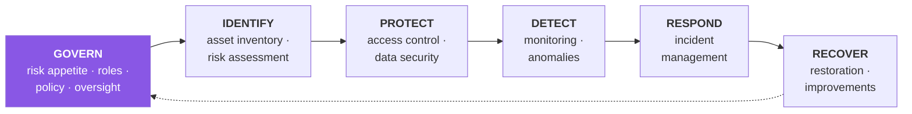

[← 10 Security Requirements](10-security-requirements.md) · [Contents](README.md) · [12 Identity: IAM & Entra ID →](12-identity-iam-entra.md)

# 11 · Compliance & Framework Mapping

---

## 11.1 Build This *After* the Threat Model

> 📘 **Theory.** Compliance mapping is the translation layer that lets legal, audit, and the board verify your findings against obligations they're accountable for. Build it **after** the risk register — mapping controls to regulations *before* you know what's broken produces a checklist with no security teeth.

> 📘 **Anti-pattern: compliance-driven security.** Implementing exactly what a checklist requires and nothing the threat model surfaced. Our F-12 (steganographic staging) has no direct GDPR line item, yet it's a Critical-tier risk. **Compliance mapping is a lens on top of the register, never a replacement for it.**

---

## 11.2 OWASP Top 10 — 2025

> 📘 **Theory.** The 2025 revision is a meaningful shift, and the numbering matters when talking to developers and auditors.

| Rank | Category |
|---|---|
| **A01:2025** | Broken Access Control *(SSRF consolidated in)* |
| **A02:2025** | **Security Misconfiguration** *(moved up to #2)* |
| **A03:2025** | Software Supply Chain Failures *(expanded from "vulnerable components")* |
| **A04:2025** | Cryptographic Failures |
| **A05:2025** | Injection |
| **A06:2025** | Insecure Design |
| **A07:2025** | Authentication Failures |
| **A08:2025** | Software or Data Integrity Failures |
| **A09:2025** | Security Logging & **Alerting** Failures |
| **A10:2025** | **Mishandling of Exceptional Conditions** *(new)* |

### The six shifts, and why they matter here

1. **Symptoms → root causes.** The list pushes you from *"why did we leak data?"* to *"why did our access control allow a leak at all?"* This is exactly the fishbone posture from [05](05-other-model-types.md).
2. **Infrastructure-as-code is the new battleground (A02).** Behavior now lives across code, YAML, Terraform, CI definitions, feature flags, console settings, and secret stores. A bad merge to a manifest can quietly undo months of application security work. **This is our entire scenario.**
3. **The supply chain is part of the app (A03 + A08).** A03 is *"the pipeline got compromised"*; A08 is *"we accepted an artifact or data blob without verifying it."*
4. **Resilience beats perfection (A10).** Security isn't only what the system does when everything is normal — it's what it does when everything is on fire. Fail closed, not open.
5. **Identity is the perimeter (A01 + A07).** Network location is no longer a strong signal. Machine identity — service accounts, API keys, workload credentials — is where it gets messy.
6. **DevSecOps must cover infrastructure, pipelines, and failure behavior**, not just code quality.

### 🏢 Our findings mapped

| Finding | OWASP 2025 | Note |
|---|---|---|
| F-01 Public bucket policy | **A01** Broken Access Control | Still #1 for a reason |
| F-02 Block Public Access disabled | **A02** Security Misconfiguration | The canonical A02 case |
| F-03 Public ListBucket | **A01** | Authorization failure, not just disclosure |
| F-07 TOCTOU on export read | **A08** Software or Data Integrity Failures | We accepted data without verifying it was untampered |
| F-09 Deploy-role over-permission | **A01** + **A03** | Access control *and* pipeline compromise leverage |
| F-11 No versioning / ransomware | **A08** | Integrity boundary |
| F-12 Unscanned UGC | **A03** + **A08** | Untrusted content treated as valid |
| LOG-1 No data events | **A09** Security Logging & Alerting Failures | Note: logging alone isn't enough — alerting is the bar |
| DEV-1 No IaC scanning | **A02** + **A06** | Insecure design *and* misconfiguration |
| **F-13** SSRF → IMDS *(v8)* | **A01** *(SSRF consolidated in)* | Machine-identity theft via the compute tier the model finally drew — this is where "SSRF" lives in the 2025 list |
| **F-14** Partner confused deputy *(v8)* | **A01** + **A03** | Cross-account access control + third-party leverage |
| **ENC-3 / ENC-4 / ENC-5** KMS key-plane *(v8)* | **A04** Cryptographic Failures | The *control over* the crypto — who can decrypt, via what service — not the algorithm |
| **ENC-6 / ENC-7** KMS ransomware / crypto-shred *(v8)* | **A04** + **A08** | Integrity and availability of the encryption layer itself |
| **F-17** Supply-chain deploy *(v8)* | **A03** Software Supply Chain | Poisoned module/dependency executes with deploy rights |
| **F-16** Help-desk ATO *(v8)* | **A07** Authentication Failures | Recovery-flow bypass of otherwise-strong MFA |
| **F-15** Departed-employee access *(v8)* | **A01** + **A07** | Deprovisioning gap — identity is the perimeter |
| **F-18** Agent injection + agency *(v8)* | **A06** Insecure Design | + OWASP **LLM Top 10** (LLM01/LLM06); no classic CWE fits cleanly |
| **F-19** Insider bulk access *(v8)* | **A01** | Authorization / need-to-know, not a bypass |
| *(partially found, v8)* | **A10** Mishandling of Exceptional Conditions | ENC-5 / L3-D cover KMS **fail-open**; the rest of §11.6 remains open |

> 💡 **Bridge.** Threat modeling turns OWASP from a checklist into a design tool. Instead of waiting for a pen test to find A01 gaps, you surface them in design when they're cheapest. Treat OWASP as the **vocabulary** for threats you're actively hunting in the session.

---

## 11.3 CIS Controls

> 📘 **Theory.** The CIS Critical Security Controls are a prioritized set of 18 safeguards, organized into Implementation Groups (IG1/IG2/IG3) by organizational maturity. Their strength is prescriptiveness — most map close to 1:1 onto a testable configuration check.

### 🏢 Relevant controls

| CIS Control | Relevance to our case | Status |
|---|---|---|
| **1 · Inventory of Enterprise Assets** | Do we know every bucket in the estate? | ❌ unknown |
| **2 · Inventory of Software Assets** | The image-parsing dependency in the UGC pipeline | ❌ |
| **3 · Data Protection** | Classification per prefix · encryption at rest and in transit · retention · disposal | ❌ **P0** |
| **4 · Secure Configuration** | Block Public Access · ACLs disabled · TLS enforced · hardened baseline | ❌ **P0** |
| **5 · Account Management** | No accounts exist beyond root (S6) | ❌ **P0** |
| **6 · Access Control Management** | RBAC, least privilege, MFA, access reviews | ❌ **P0** |
| **8 · Audit Log Management** | CloudTrail data events · log retention · protected log store | ❌ **P0** |
| **10 · Malware Defenses** | Scanning UGC on ingest | ❌ |
| **11 · Data Recovery** | Versioning · Object Lock · tested restore | ❌ |
| **13 · Network Monitoring & Defense** | GuardDuty · anomaly alerting | ❌ |
| **14 · Security Awareness** | The session itself ([03](03-session-facilitation.md)) counts | ⚠️ partial |
| **16 · Application Software Security** | IaC scanning · four-eyes review · pen testing | ❌ |
| **17 · Incident Response** | Runbook for "bucket found public" | ❌ |
| **18 · Penetration Testing** | Validate the controls actually work | ❌ |

---

## 11.4 NIST Cybersecurity Framework

> 📘 **Theory.** CSF organizes outcomes into functions. CSF 2.0 added **Govern** as a sixth function alongside the original five — a recognition that governance, not technology, is where most programs actually fail.

| Function | Our work that lands here |
|---|---|
| **Govern** | Risk appetite table ([02](02-business-context.md)) · risk owners in the register · document classification |
| **Identify** | DFDs ([04](04-dfd-library.md)) · asset inventory with per-asset requirements · risk assessment ([09](09-risk-scoring.md)) |
| **Protect** | Access control, encryption, hardening requirements ([10](10-security-requirements.md)) · identity design ([12](12-identity-iam-entra.md)) |
| **Detect** | CloudTrail data events · GuardDuty · Macie · Config rules · EventBridge alarms |
| **Respond** | "Bucket found public" runbook · automated remediation |
| **Recover** | Versioning · Object Lock · tested restore · post-incident model update ([14](14-continuous-threat-modeling.md)) |

---

## 11.5 The Consolidated Mapping

| Control / Finding | GDPR | CCPA/CPRA | PCI-DSS v4 | HIPAA | SOC 2 | ISO 27001:2022 | NIST CSF | CIS | OWASP 2025 |
|---|---|---|---|---|---|---|---|---|---|
| Block Public Access / least privilege | Art. 32 | §1798.150 | Req. 7 | §164.312(a)(1) | CC6.1 | A.5.15, A.8.3 | PR.AA | 4, 6 | A01, A02 |
| Deny anonymous ListBucket | Art. 32 | — | Req. 7 | §164.312(a)(1) | CC6.1 | A.8.3 | PR.AA | 6 | A01 |
| SSE-KMS with CMK | Art. 32(1)(a) | — | Req. 3 | §164.312(a)(2)(iv) | CC6.7 | A.8.24 | PR.DS | 3 | A04 |
| KMS key-policy scoping (`ViaService`, per-tier CMK, grant hygiene) *(v8)* | Art. 32 | — | Req. 3.5–3.6 | §164.312(a)(2)(iv) | CC6.1, CC6.7 | A.8.24 | PR.AA, PR.DS | 3 | **A01, A04** |
| IMDSv2 + egress control (anti-SSRF) *(v8)* | Art. 32 | — | Req. 6 | §164.312(a)(1) | CC6.6 | A.8.9, A.8.20 | PR.AA | 4 | **A01** |
| Supply chain: pin by digest · SLSA provenance *(v8)* | — | — | Req. 6.3.2 | — | CC8.1 | A.8.28, A.8.30 | GV.SC, ID.RA | 16 | **A03** |
| Agent Least Agency + human-in-the-loop *(v8)* | Art. 22, 32 | — | — | — | CC6.1 | A.8.16 | PR.AA, GV.OV | — | **A06** + LLM Top 10 |
| TLS enforced by policy | Art. 32 | — | Req. 4 | §164.312(e)(1) | CC6.7 | A.8.24 | PR.DS | 3 | A04 |
| CloudTrail data events + alerting | Art. 30, 33 | — | Req. 10 | §164.312(b) | CC7.2 | A.8.15 | DE.CM | 8 | **A09** |
| Versioning / Object Lock | — | — | Req. 3/10 *(indirect)* | §164.312(c)(1) | CC7.1 | A.8.13 | PR.DS, RC.RP | 11 | A08 |
| Malware scanning on upload | — | — | **Req. 5** | — | CC6.8 | A.8.7 | DE.CM | 10 | A03, A08 |
| Retention & verified erasure | **Art. 17, 5(1)(e)** | **§1798.105** | — | Retention policy | CC6.5 | A.5.33/34 | PR.DS, GV.PO | 3 | — |
| Separation of duties / RBAC | Art. 32(4) | — | Req. 7.2, 8 | §164.308(a)(4) | CC6.2, CC6.3 | A.5.16–18 | PR.AA | 5, 6 | A01, A07 |
| CI/CD workload identity (no static keys) | — | — | Req. 8.3 | §164.312(d) | CC6.6 | A.8.5 | PR.AA | 5 | **A03** |
| IaC scanning in pipeline | — | — | Req. 6 | — | CC8.1 | A.8.28 | ID.RA | 16 | **A02, A06** |
| Breach notification runbook | **Art. 33 (72h), 34** | Civ. Code §1798.82 | Req. 12.10 | Breach Notification Rule | CC7.4 | A.5.24–27 | RS.CO | 17 | — |
| Conditional/pinned reads (F-07 fix) | — | — | — | §164.312(c)(1) | CC7.1 | A.8.13 | PR.DS | 3 | **A08** |

*ISO 27001:2022 superseded the 2013 Annex A structure — verify the version before an audit. PCI-DSS v4 requirements continue phasing in.*

---

## 11.6 The Gap Worth Naming

> 💡 **Bridge — an honest finding about our own model.** OWASP **A10:2025 Mishandling of Exceptional Conditions** is new. As of **v8 we have one *partial* finding against it** — ENC-5's fail-open dimension (writes accepted with weaker or no encryption when enforcement is absent, [A](A-findings-register.md)) — but the category is otherwise still a gap, which is almost certainly under-analysis rather than a clean bill of health.
>
> Questions we should have asked in [03](03-session-facilitation.md) and didn't:
> - If the KMS key is momentarily unavailable, does the reader **fail closed** or serve unencrypted? ✅ *(v8: partially — ENC-5 forces SSE-KMS on write; the reader's runtime behavior on a KMS `Decrypt` throttle or timeout is still unconfirmed)*
> - If Block Public Access evaluation errors, what's the default?
> - If the malware scanner times out on an upload, is the file quarantined or released?
> - Does the analytics reader retry on failure with backoff and jitter, or hammer S3 and create a self-inflicted DoS?
> - Do our error responses leak bucket names, paths, or internal structure?
>
> **The framing to carry into your next session:** *"If your authorization service vanished right now, would the system stay shut, or would it try to be polite and let everyone in?"* If the answer is the second one, that's a design decision, not a checklist item.

**Action:** add an A10 pass to the next CTM cycle ([14](14-continuous-threat-modeling.md)) with the questions above added to the subject list.

---

## 11.7 Regulatory Pressure to Threat Model

> 📘 **Theory.** EU regulations — NIS2, DORA, the Cyber Resilience Act, and the AI Act — increasingly *require* threat modeling or security-by-design for products and services, while providing limited official definitions of what qualifies. That ambiguity is a reason to document your methodology explicitly ([15](15-methodology-comparison.md)) and keep the traceability log ([B](B-traceability-log.md)): when the definition firms up, you want evidence of what you did and why.

---

[← 10 Security Requirements](10-security-requirements.md) · [Contents](README.md) · [12 Identity: IAM & Entra ID →](12-identity-iam-entra.md)
