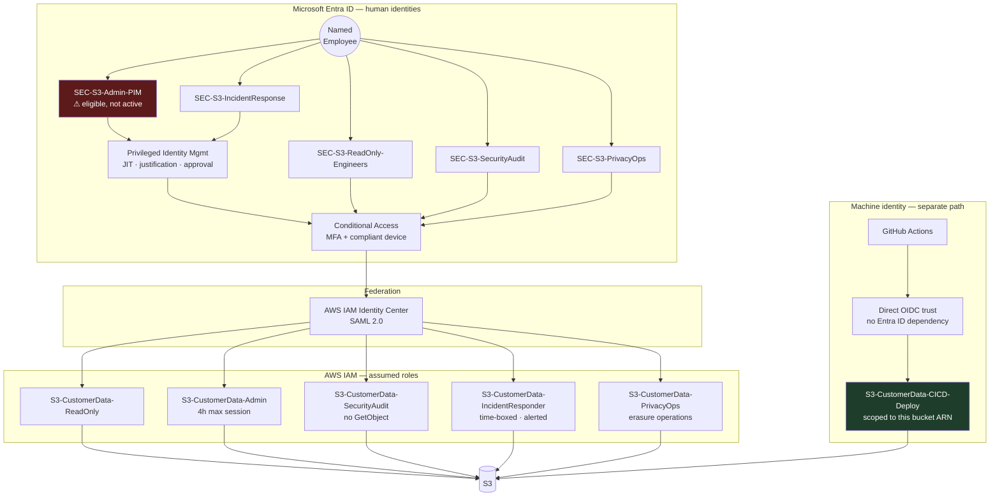
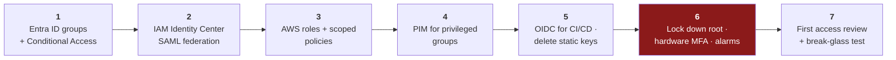

[← 11 Compliance Mapping](11-compliance-mapping.md) · [Contents](README.md) · [13 Hardening Deep Dive →](13-hardening-deep-dive.md)

# 12 · Deriving Identity — AWS IAM + Microsoft Entra ID

---

## 12.1 Starting From Zero

Session finding **S6**: AWS is **root-user-only** — no IAM users, roles, or groups beyond defaults. Entra ID is a fresh tenant with only the default Global Administrator.

> 📘 **Theory.** This is the best possible moment to design identity, and teams routinely waste it. Retrofitting least privilege onto a sprawling flat IAM structure is dramatically more expensive than deriving it correctly before the first credential is issued. **"We don't have IAM set up yet" is a reason to design it now, not to defer it.**

---

## 12.2 Design Principle

> 📘 Every role and group below is derived **directly from a risk-register owner** ([09 §9.7](09-risk-scoring.md)) or from an actor on the L0/L3 diagrams ([04](04-dfd-library.md)) — not invented generically. Access tier scales with the financial exposure in [02 §2.5](02-business-context.md): higher exposure → more restricted, more monitored, more time-boxed.

---

## 12.3 The Architecture

---

## 12.4 The Decision Worth Arguing About

> 💡 **Bridge.** **CI/CD deliberately does not route through Entra ID.** Human access goes Entra ID → Conditional Access/PIM → IAM Identity Center → AWS role. Machine access uses **direct OIDC federation** between GitHub Actions and AWS STS.
>
> **Why:** a shorter trust chain; no dependency on Entra ID being available and correctly configured for a deploy to succeed; and it avoids the anti-pattern of provisioning a machine as if it were a human ("service account" users are where long-lived secrets breed).
>
> **The alternative:** if your organization has standardized on Entra ID Workload Identity Federation for *all* workload identity, that's legitimate — you trade a dependency in your deploy critical path for centralized workload-identity governance.
>
> **Either way, name it as an explicit decision in your own docs.** Don't let it default silently.

---

## 12.5 Roles & Groups

| Entra ID group | AWS role | Permissions | Access model | Register row |
|---|---|---|---|---|
| `SEC-S3-ReadOnly-Engineers` | `S3-CustomerData-ReadOnly` | `s3:GetObject` on specific prefix. **No `ListBucket`** | Standing · MFA · compliant device | Mitigates the internal analogue of F-03 |
| `SEC-S3-Admin-PIM` | `S3-CustomerData-Admin` | Full object + bucket-policy lifecycle | **PIM-eligible only** · JIT activation · justification **+ approver** · 4h max · 90-day access review | Mitigates F-09 by separating from read/audit |
| `SEC-S3-SecurityAudit` | `S3-CustomerData-SecurityAudit` | `GetBucketPolicy`, `GetBucketAcl`, `GetBucketPublicAccessBlock`, `ListBucket`. **No `GetObject`** | Standing · MFA | LOG-1, and satisfies separation-of-duties for PCI Req. 7.2 / SOC 2 CC6.2 |
| `SEC-S3-IncidentResponse` | `S3-CustomerData-IncidentResponder` | Full access, every action real-time alerted | PIM · active-incident only · auto-expires | Supports game-day validation ([14](14-continuous-threat-modeling.md)) |
| `SEC-S3-PrivacyOps` | `S3-CustomerData-PrivacyOps` | Version-aware delete on specific keys; **no bulk read** | PIM · logged · dual approval | P-02 erasure operations ([07](07-linddun-privacy.md)) |
| *(machine)* | `S3-CustomerData-CICD-Deploy` | `PutBucketPolicy`, `PutBucketPublicAccessBlock`, Terraform actions — **this bucket ARN only** | OIDC-federated · no standing credential | **Resolves S3** — the fix isn't "verify the wildcard," it's "replace it with this row" |

> 💡 **Bridge — the audit role is the subtle one.** `SecurityAudit` can see *the configuration* but not *the data*. That's what lets someone verify the bucket policy is correct without becoming another person who can read 3M customer records. Separation of duties isn't bureaucracy here; it's a direct reduction in the number of identities whose compromise means a breach.

---

## 12.6 Naming Dimensions

> 📘 Four dimensions combined into a consistent pattern: **`<Environment>-<System>-<Function>-<AccessModel>`**

| Dimension | Values | Why it matters |
|---|---|---|
| **Environment** | PROD, STAGING, DEV | Prevents a dev-scoped credential resolving against prod by name collision |
| **System** | S3CustomerData, S3PublicAssets, S3UserContent | Mirrors the architectural separation from [04 §4.10](04-dfd-library.md) — the naming should reflect the architecture, not paper over it |
| **Function** | ReadOnly, Admin, SecurityAudit, IncidentResponder, PrivacyOps, CICDDeploy | Maps 1:1 to register ownership |
| **Access model** | Standing, PIM, WorkloadOIDC | Makes the access *pattern* visible in the name, not buried in a policy someone must go look up |

Examples: `PROD-S3CustomerData-Admin-PIM` · `PROD-S3UserContent-CICDDeploy-WorkloadOIDC` · `STAGING-S3CustomerData-ReadOnly-Standing`

---

## 12.7 Conditional Access & PIM Configuration

| Control | Setting | Rationale |
|---|---|---|
| MFA | Required for all groups | IAM-1 |
| Device compliance | Required for Admin and IncidentResponse | Raises the bar on the highest-value paths |
| Sign-in risk | Block high-risk sign-ins | Detects credential stuffing |
| Session lifetime | 4h Admin · 8h ReadOnly | Limits the exploitation window |
| PIM activation | **Approver required**, not just justification | See below |
| PIM max duration | 4h Admin · 2h IncidentResponse | — |
| Access review | 90 days, all groups | IAM-6 |
| Break-glass account | Excluded from CA · hardware MFA · monitored · credentials split | Standard practice — you must be able to get in when Entra ID is the thing that's broken |

> 📘 **PIM without an approval step is just a slower standing grant.** Self-service activation with a timer changes almost nothing about who can do what. Require justification *and* an approver.

---

## 12.8 Anti-Patterns

| Anti-pattern | Why it hurts |
|---|---|
| **CI/CD as an Entra ID "service account" user** | A human-identity pattern misapplied to a machine; ends in long-lived secrets — exactly attack-tree leaves A3.1/A3.2 ([08](08-attack-trees-capec.md)) |
| **One group mapped to multiple AWS roles** | Silently recreates the over-permissioned pattern the exercise was meant to eliminate |
| **A bespoke group per engineer** | Unmanageable; defeats the point of role-derived access |
| **Standing admin access "for convenience"** | Convenience becomes permanent — the OWASP A02 pattern |
| **No break-glass path** | You will eventually need one, and inventing it under incident pressure goes badly |
| **Permissions granted to unblock a deploy, never shrunk back** | The most common origin of over-permissioned service accounts anywhere |

---

## 12.9 Rollout Order

**Step 6 is last for a reason** — do not remove root access until federated access is proven working, or you will lock yourself out of the account. Sequence matters more than speed here.

---

## 12.10 Enough Is Enough

Done when every register row with a human owner has a corresponding Entra ID group whose access model matches its appetite tier, and the one machine identity is federated directly rather than through a human-identity pattern. You do **not** need per-engineer groups — group-based, role-derived access is the point.

---

[← 11 Compliance Mapping](11-compliance-mapping.md) · [Contents](README.md) · [13 Hardening Deep Dive →](13-hardening-deep-dive.md)
