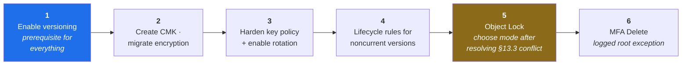

[← 12 Identity](12-identity-iam-entra.md) · [Contents](README.md) · [14 Continuous Threat Modeling →](14-continuous-threat-modeling.md)

# 13 · Hardening Deep Dive — Versioning & KMS

---

## 13.1 The Control-Leveling Ladder

> 📘 **Theory.** [04](04-dfd-library.md) applied leveling to the *system diagram*. The same instinct applies to a **single control** — and this is the legitimate case for going deeper than L3: you own the configuration and need to harden it correctly.

| Level | What lives here | Who needs it |
|---|---|---|
| **A · Policy / requirement** | "Protect against accidental or malicious deletion" | Business, auditors |
| **B · Platform feature** | S3 Versioning + Object Lock | Architects |
| **C · Configuration parameter** | MFA Delete · Governance vs. Compliance mode · retention period | The implementer |
| **D · Operational edge case** | Object Lock's interaction with lifecycle cost; MFA Delete requires root | Whoever operates it — and this level is where the expensive lessons live |

**The pattern is transferable.** Level A is business language, B is where a first-pass threat model stops, C is where someone can actually configure it correctly, and D is what you only learn by operating the control or by someone in the room saying *"wait, doesn't that also mean…"*

---

## 13.2 S3 Versioning

**Current state:** OFF (finding S4).

### Level B — what it does
Keeps every version of every object. An overwrite or delete becomes recoverable rather than terminal. It is the prerequisite for Object Lock and for the pinned-`versionId` fix to F-07.

### Level C — configuration

| Parameter | Detail |
|---|---|
| **Enable** | Straightforward, but note: once enabled it can only be **suspended**, never returned to "never versioned" |
| **MFA Delete** | Configurable **only via CLI/API using the bucket owner's root credentials with an MFA device**. Not available in the console, not delegable to an IAM role |
| **Noncurrent version lifecycle** | Transition or expiry rules for old versions |

> 💡 **Bridge — the root-credential tension.** Your own best practice says never use root ([12 §12.9](12-identity-iam-entra.md)). MFA Delete configuration is one of the few remaining legitimate reasons to touch it. Handle it as a **deliberate, logged, break-glass-style exception with a written justification** — not as a routine operation, and not as a reason to skip the control.

### Level D — operational edge cases

- **Cost grows without bound** without noncurrent-version expiration rules. Every overwrite accumulates billed storage indefinitely.
- **The forensic tension.** A cost-optimization lifecycle rule written by someone who wasn't in the threat-modeling session can silently destroy your incident-response evidence. Retain noncurrent versions ~90 days before transition or expiry, and **write down why that number**.
- **Delete markers aren't deletions.** A "deleted" object in a versioned bucket still exists and still costs money — and still counts as a copy for GDPR erasure purposes (see P-02 in [07](07-linddun-privacy.md)).

---

## 13.3 S3 Object Lock

### Level B
Write-Once-Read-Many (WORM) protection. The strongest available answer to Tree 2's ransomware branch ([08](08-attack-trees-capec.md)).

### Level C — the two modes

| Mode | Who can override | Use when |
|---|---|---|
| **Governance** | A principal holding `s3:BypassGovernanceRetention` | You want protection with an emergency override path |
| **Compliance** | **Nobody. Including the root account.** | Regulated data where true immutability is required — and you accept losing every override |

### Level D — the constraints that surprise people

- **Enabling on an existing bucket** has been possible since **November 2023** via `put-object-lock-configuration`. This previously required creating a new bucket. *Verify against current AWS documentation — this is exactly the kind of platform capability that shifts.*
- **Versioning is mandatory** — Object Lock enables it automatically if it's off.
- **Neither can be undone.** Once Object Lock is on, it cannot be disabled, and versioning cannot subsequently be suspended.
- **Object Lock buckets cannot be server-access-log destinations.** Easy to miss, and a real architectural constraint if your log bucket and data bucket were ever the same bucket.
- **Compliance mode and erasure requests conflict.** If you put customer PII under Compliance-mode Object Lock with a long retention, you have made GDPR Art. 17 erasure *impossible* for that data until retention expires. Model this deliberately — pick retention periods that reconcile your ransomware-resilience goal with your erasure obligation, or scope Compliance mode to data classes where a legal retention requirement already overrides erasure rights.

> 💡 **Bridge.** That last point is a genuine collision between two requirements in this very guide: BAK-2 in [10](10-security-requirements.md) argues for Compliance mode; P-02 in [07](07-linddun-privacy.md) argues for verified erasure. Neither is wrong. Surfacing the conflict is the value of running both STRIDE and LINDDUN — a security-only model would have implemented Compliance mode and discovered the problem when the first erasure request arrived.

---

## 13.4 KMS

**Current state:** AWS-managed key (finding S5).

### Level B — AWS-managed vs. customer-managed

| | AWS-managed key | Customer-managed key (CMK) |
|---|---|---|
| Rotation | Automatic, yearly, not configurable | Configurable + on-demand |
| **Key policy** | **You cannot write one** | Full control |
| Cost | No monthly charge | Monthly charge per key |
| Cross-account use | Not possible | Possible |
| Deletion control | Managed by AWS | Yours, with a waiting period |

> 💡 **Bridge.** The key-policy row is decisive for this threat model. On an AWS-managed key you are stuck with whatever principals AWS grants via the service integration — you cannot apply `kms:ViaService`, cannot restrict by source account, cannot separate keys by sensitivity tier. **Migrating to a CMK (ENC-2) is the prerequisite for four other requirements in [10](10-security-requirements.md).**

### Level C — rotation

- Automatic rotation period for CMKs is **configurable between 90 and 2,560 days** (up to ~7 years), plus **on-demand rotation** (up to 10 lifetime on-demand rotations) independent of the schedule. This flexibility arrived in **April 2024**; older documentation assumes a fixed annual rotation with no customization.
- **Rotation does not change the key ID or ARN**, and **does not require re-encrypting existing objects** — KMS retains prior key material to decrypt data encrypted under it. This resolves the common "will rotation break my old data?" fear.

### Level C — key policy hardening

| Technique | Purpose |
|---|---|
| Explicit principal scoping | No wildcards in the key policy |
| `kms:ViaService` condition | Restrict key use to the S3 service specifically |
| `aws:SourceAccount` condition | Prevent confused-deputy across accounts |
| Separate CMK per sensitivity tier | One compromise or revocation doesn't force re-keying everything |
| **KMS grants** for short-lived delegation | Individually revocable, no policy-deploy cycle — matters for incident-response speed |

### Level D — what rotation does *not* protect against

> 📘 **Rotation limits the useful life of a *stolen key*. It does nothing against an attacker who currently holds valid IAM permissions to use the key.** That's an authorization and detection problem, not a rotation problem.
>
> This control is commonly overrated. "We rotate our keys" is not a substitute for scoping who may use them — and in a compliance conversation the two are frequently conflated.

### Level D — other edges

- **Key deletion is the availability attack.** `ScheduleKeyDeletion` with the minimum waiting period is a permanent-data-loss button. Require multi-person control and alarm on the API call (Tree 3, C2.1).
- **Multi-Region Keys.** If replication crosses regions you need MRKs with a replica per region, or independently managed per-region CMKs. The failure mode only appears when you actually try to decrypt a replicated object in the second region — i.e. during a disaster, which is the worst time to discover it.
- **S3 Bucket Keys** reduce per-object KMS API calls and cost by using a bucket-level data key. They still enforce the same key policy. Worth knowing this is a **cost optimization, not a security downgrade**, so it doesn't get flagged as a finding during review.

---

## 13.5 Sequencing

Order matters: versioning gates Object Lock; CMK gates key-policy hardening; the erasure-vs-immutability decision gates the Object Lock mode.

---

## 13.6 The Transferable Lesson

The A→B→C→D ladder applies to **any** control you're hardening, not just these two. When you next evaluate a control, ask deliberately:

- **A** — what business requirement does this serve?
- **B** — which platform feature implements it?
- **C** — what parameters does an implementer have to get right?
- **D** — what will we only discover after operating it for six months, or when it collides with another requirement?

Level D is where threat modeling earns its keep, and it is almost always found by conversation rather than documentation.

---

## 13.7 KMS Exploit → Control Mapping *(v8)*

> 📘 §13.4 described the controls; this maps each **v8 cryptographic finding** to the exact mechanism that closes it, so the ENC series in [A](A-findings-register.md) and Tree 5 in [08 §8.6a](08-attack-trees-capec.md) trace to a specific configuration line rather than a vague "harden KMS." The right-hand column is the A→B→C→D ladder level from §13.1.

| Finding / Tree 5 leaf | Exploit in one line | Control (exact mechanism) | Level |
|---|---|---|---|
| **ENC-1** | Cleartext transit | Bucket policy `Deny` on `aws:SecureTransport=false`; require `aws:TlsVersion >= 1.2` | C |
| **ENC-2** | No key policy possible on `aws/s3` | Migrate to a **CMK per sensitivity tier** | B *(unlocks all below)* |
| **ENC-3** · H1.1 | Broad or `:root` decrypt grant | Key policy: **named principals**; drop `:root` delegation or pair it with strict IAM permission boundaries; separate CMK per tier | C |
| **ENC-4** · H1.2 | Direct KMS decrypt bypasses S3 | `kms:ViaService = s3.<region>.amazonaws.com` + `aws:SourceAccount`; required **EncryptionContext** | C |
| **ENC-5** · H2.2 | Write under weak / attacker key | Bucket policy `Deny` writes lacking `aws:kms` + the expected `…aws-kms-key-id`; bucket default encryption = the CMK | C |
| **S6** · H2.1 | Alias repointed to an attacker key | `Deny kms:UpdateAlias` outside break-glass; alarm on it | C/D |
| **ENC-6** · H4.1 | SSE-C re-encryption ransomware | Bucket policy `Deny` the SSE-C header; `Deny` any non-sanctioned key ARN; **versioning + Object Lock** for recovery | B+C |
| **ENC-7** · H3 | Crypto-shred (delete/disable the key) | Key-policy **+ SCP** `Deny` on `ScheduleKeyDeletion`/`DisableKey`; long window; alarm; avoid imported material for this data | C/D |
| **ENC-8** · H5 | Grant / policy persistence | `Deny CreateGrant`/`PutKeyPolicy` outside break-glass; periodic `ListGrants` reconciliation; alarm on `CreateGrant` | C/D |
| **R8** | Bucket Keys hide per-object decrypt | Accept as a cost trade-off, **but** keep management-event logging + GuardDuty; don't rely on per-object KMS events for forensics | D |

> 💡 **Bridge — the two-plane rule.** Almost every row is a **key-policy condition or an SCP**, not an S3 setting. That is the whole lesson of [04 §4.16c](04-dfd-library.md): the encryption you added is a *second access-control plane*, hardened in its own policy language. A team that "hardened S3" and never opened the key policy has bolted one door and left the other open.

> 📕 **Correction / Level D — crypto-shred is not a clean erasure.** It is tempting to satisfy P-02 (GDPR erasure) by *crypto-shredding*: delete the key, render every copy unreadable at once. Two edges make this dangerous. **(1)** A **shared** CMK encrypts many subjects' data, so deleting it to erase one person destroys everyone's — crypto-shred is only a lawful erasure tool with **per-subject or per-tenant keys**. **(2)** It collides with **Compliance-mode Object Lock** exactly as §13.3 warns: you cannot delete key material for data under a WORM retention you also cannot override. Scope and sequence keys deliberately, or crypto-shred becomes either a broken erasure promise or a self-inflicted ENC-7.

---

[← 12 Identity](12-identity-iam-entra.md) · [Contents](README.md) · [14 Continuous Threat Modeling →](14-continuous-threat-modeling.md)
