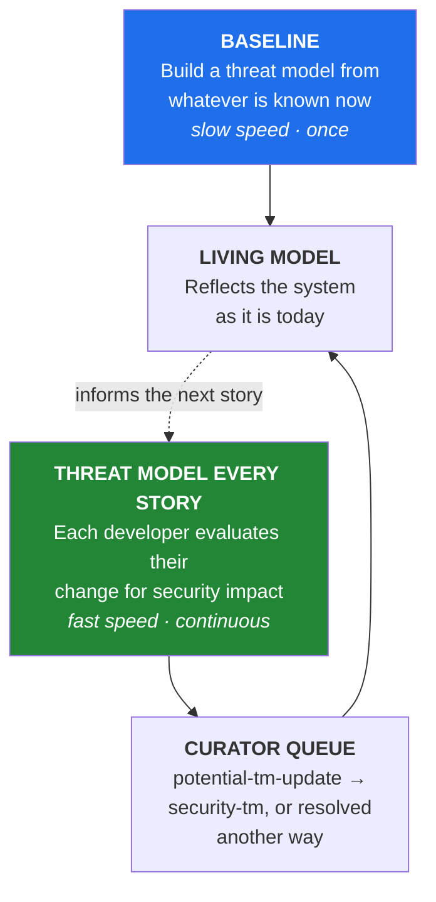
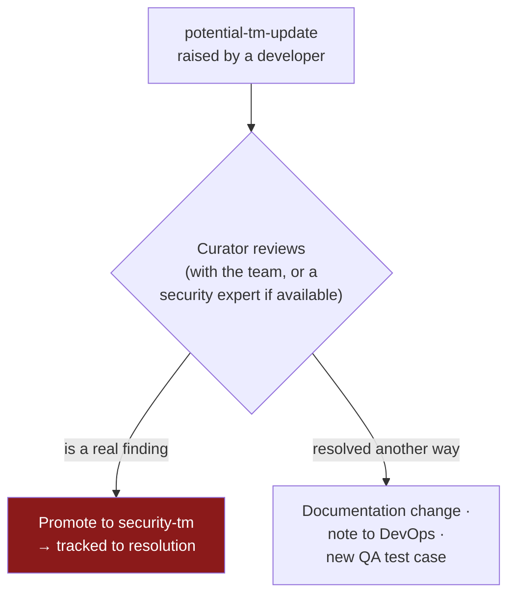
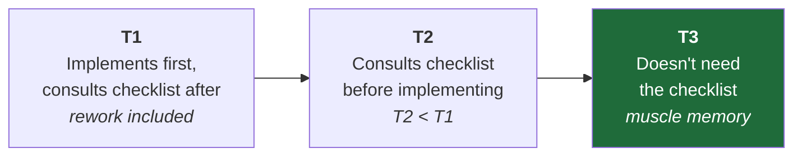

[← 13 Hardening Deep Dive](13-hardening-deep-dive.md) · [Contents](README.md) · [15 Methodology Comparison →](15-methodology-comparison.md)

# 14 · Continuous Threat Modeling

**The operational layer. Without this, everything else is a document that ages.**

---

## 14.1 The Problem

> 📘 **Theory.** *Developers live at the speed of deployment. Architects set the speed of progress. Security people run at the speed of their caution.* A point-in-time threat model falls behind immediately in any environment shipping many times a day.

**CTM's guiding principles:**

| Principle | Implication |
|---|---|
| The product team knows its system better than any outside expert | The method must **elicit**, not substitute |
| A team can't stop work to threat model | It must be lightweight and continuous |
| An individualized learning curve replaces training | Quality grows with experience, not with course completion |
| The model must reflect the system's **present** state | Not the state at design time |
| Today's threat model must be better than yesterday's | Evolutionary, not "catch them all" |
| Findings must match the system | Useful over comprehensive |

---

## 14.2 The Dual-Speed Mechanism

> 📘 **The key insight.** Of the hundreds of changes a day that DevOps enables, only a small number are **security-notable events** that modify the attack surface, security posture, or secure configuration. Those are most effectively caught **at the moment they are designed** — which is the story, feature, or fix. Wait several sprints and security-significant details are simply lost.

---

## 14.3 The Curator

> 📘 **Theory.** Appoint one or a few **curators**. The role is more process-minder than technical, but the curator must know who is responsible for what and communicate clearly — and needs **dedicated time**, not "as available."

**The two ticket labels:**

| Label | Meaning |
|---|---|
| `security-tm` | A verified **finding** that needs resolution; tracked to completion |
| `potential-tm-update` | A change in design, implementation, deployment, or documentation that *may* matter to the threat model |

**The curator's decision** on each `potential-tm-update`:

> 💡 **Bridge.** The second branch is where this methodology quietly earns its value. Most changes aren't findings — they're things that should update a runbook, alter a deployment assumption, or generate a test. Routing them somewhere useful instead of discarding them is what turns threat modeling from an event into a practice. **With time, patterns emerge in the queue and the decisions get faster.**

### IriusRisk as the living-model system

One IriusRisk project holds named snapshots of the vulnerable and hardened architecture. The curator snapshots before replacing obsolete components, imports the next architecture, answers questionnaires from reviewed OpenTofu/Terragrunt evidence, and compares versions. Generated threats and controls are reconciled through [`iriusrisk/traceability.yaml`](iriusrisk/traceability.yaml); they do not replace manual findings. A Floci `GAP` remains `unknown/pending`, never evidence that a control is implemented. See [18](18-iriusrisk-s3-lab.md).

### 🏢 Meridian's setup

| Element | Assignment |
|---|---|
| Curator | Diego Fernandez (Platform Eng Lead) — dedicated time budgeted |
| Labels | `security-tm`, `potential-tm-update` in the existing Jira project |
| Baseline | This guide, files [04](04-dfd-library.md) through [09](09-risk-scoring.md) |
| Devil's advocate (when Priya unavailable) | Sam Lin |
| Storage | Versioned, access-controlled repo — **classified sensitive** |
| Review triggers | Any story with a security-notable event · quarterly minimum · post-incident · new data class · relevant AWS/CVE bulletin |

---

## 14.4 Baselining

> 📘 **Theory: the steps.** Define the scope (full system, or just a design change?) · identify all important assets · draw the diagram(s) including the personas who use the system · draw the data flows with protocols and authentication annotated · **mark where the important data lives, transits, and is transformed**.
>
> **Definition of done for the baseline:** the team agrees the diagram correctly represents the system's pieces and interactions to a level satisfying their understanding of the relationships.

> 📘 **Standardize the format across all teams.** A consistent report format means: security engineers can context-switch between products quickly · reviews can be handed between people · people moving between teams stay productive · and you can data-mine the threat models across the organization for patterns.

**The DFD checklist** is in [04 §4.17](04-dfd-library.md).

**The findings format** — four required fields:

| Field | Why |
|---|---|
| **Unique identifier** | Tracked through its whole life cycle |
| **Full attack scenario in prose** | Findings get interpreted differently by different people. Prose reveals whether two people mean the same issue, or two issues are hiding under one ID |
| **Severity** | CVSS is viable and comparable, though imperfect. What matters most is that **all threat modeling in the organization uses the same method**, so prioritization and discussion share a standard |
| **Mitigation** | The proposed solution; with the ticket, this becomes the record of the final conclusion |

See [A · Findings Register](A-findings-register.md) for worked examples.

---

## 14.5 Baseline Analysis: Leading Questions, Not a Checklist

> 📘 **Theory — this is the heart of it.** "Think like a hacker" is comparable to pushing an inexperienced cook into a kitchen and telling them to think like a Michelin-starred chef. It asks for a mindset shift, not just knowledge, and many people can't make it on demand.
>
> CTM replaces it with **"have we done the right thing?"** — a subject list of security domains, each with a couple of **leading questions** to open discussion. The team is emphatically **not** meant to answer each question and move on. The framing shifts from *"what could be a spoofing problem here?"* to *"regarding authentication — now that you've considered where people have historically had problems, what **else** could apply to us?"*
>
> **This is the hardest part of adoption.** Teams keep trying to treat it as a checklist, and it isn't one.

### 🏢 The subject list, adapted to our system

| Subject | Leading questions for *this* system |
|---|---|
| **Authentication & authorization** | How does CloudFront prove identity to S3, and could anything else present that identity? Is anonymous access genuinely required on the public prefix, or is it habit? |
| **Access control** | Is bucket access role-based at all today (S6 says no)? Is PII access limited to principals who actually need it? Are decisions current at the time access happens? |
| **Trust boundaries** | Can we point at every place trust changes? Does each have an authorization decision attached? |
| **Auditing** | Are CloudTrail *data* events on, or only management events? Are logs somewhere the same compromised credential can't reach? Are we writing customer identifiers into logs with a different retention than the data? |
| **Cryptography** | We're on an AWS-managed key — what do we give up by not controlling the key policy? Can keys be rotated without re-encrypting? |
| **Defense of secrets** | What credentials can write to this bucket? Where does each live? Any long-lived access keys anywhere? Any secrets in environment variables during build? |
| **Injection / untrusted input** | Avatar uploads are untrusted input we store and serve verbatim — what parses them downstream, and does that parser assume well-formed content? |
| **Data at rest & in transit** | Is TLS *enforced by policy* or merely used by convention? |
| **Data retention** | Retention on the avatar prefix (undefined, S2)? On the log bucket? On noncurrent versions once versioning is on? |
| **Data minimization & privacy** | Do the exports contain more customer fields than the analytics job consumes? |
| **Resiliency** | Can one tenant of the public prefix make cost the failure mode? Is there rate limiting anywhere? Does the system call for help when probed? |
| **Denial of service** | Can one uploader fill storage and stop others working? |
| **Configuration management** | Is bucket config reproducible from IaC alone? Would we detect divergence? |
| **Third-party components** | Which vendors or partners write to any prefix? Did any of them get a threat model? |
| **Hardening** | Are legacy ACLs *disabled*, or merely overridden by Block Public Access? |
| **Cloud services** | Root access hardened? MFA everywhere? A key-rotation plan that exists **and has been executed once**? Is back-channel traffic routed internally rather than over the public internet? |
| **Dev/stage/prod** | Is staging sourced from production data? If so, is it scrubbed? Are code reviews performed per commit by a qualified person? |
| **APIs** | Right mode of authentication and authorization? Have we considered impersonation? |

**Three outcomes** from working the list: findings based on the design · **learning opportunities** where the team can't go deeper · and certainty that the basics of secure design were evaluated across the scope.

> 📘 **The reviewer's posture.** If a security expert is available, they should **elevate** the team's work rather than **question** it — pointing to further inquiry, not saying "you forgot this." Think Socratic method: leading toward realization through dialogue stimulates critical thinking and exposes wrong assumptions better than listing possibilities one by one. Weak areas ("what do they mean by key length?") aren't failures — they're a training signal.

---

## 14.6 Definition of Done

> 📘 A CTM threat model is complete when:
> - All relevant diagrams are in the document
> - Background information and findings are documented in the agreed format, in the team's tracking system
> - A **versioned copy is stored in a central, access-controlled location** shared by product and security
>
> If no security expert is available for review, designate a security-minded team member as **devil's advocate**, whose job is to poke holes in every security assumption and every claimed mitigation.

---

## 14.7 The Secure Developer Checklist

> 📘 **Theory.** Checklists in aviation and surgery specify a **target state** independent of prior state ("fuel shutoff valve — on"). Software has too many possible states for that, so CTM uses **If-This-Then-That**: the developer recognizes the "if this" and follows the "then that."
>
> Four deliberate design choices:
> 1. **Concise guidance language** — enough to start looking into the issue, not so much it overwhelms
> 2. **Short enough to print** — it should fit on a page and sit beside the keyboard
> 3. **Repetition is intentional** — each "if this" is self-contained so there's no jumping around the document
> 4. **"Make sure" is deliberate** — how do you *make sure* of something? By becoming acquainted with it. If you can't make sure, you have doubts, and doubts mean research, a colleague, or an expert. It's an incentive to communicate.
>
> **The goal is that the checklist becomes unnecessary.** Developers build muscle memory, start consulting it *before* implementing rather than after, and eventually don't need it. That's the win.

### 🏢 The S3 Secure Developer Checklist

| If you did *this*… | …then do *that* |
|---|---|
| **…added a new bucket or prefix** | Make sure Block Public Access is on at account **and** bucket level. Make sure the bucket policy names explicit principals — never `"Principal": "*"` without a matching `Condition`. Make sure Object Ownership is bucket-owner-enforced so ACLs are **disabled**, not merely overridden. Make sure the data classification for this prefix is written down, and that it doesn't mix classifications. Make sure the name doesn't leak what's inside. |
| **…changed a bucket policy, ACL, or Block Public Access setting** | Make sure the change went through IaC, not the console. Make sure the `Deny` on non-TLS (`aws:SecureTransport: false`) survives the change. Make sure a CloudTrail alarm exists for this API call. Tag the ticket `potential-tm-update`. |
| **…granted any principal write access** | Make sure it's the minimum verb set — `PutObject` is not `s3:*`. Make sure the resource ARN is the specific bucket or prefix, never a wildcard. Make sure versioning is on so an overwrite is recoverable. Make sure you can name who is accountable if this credential leaks. |
| **…accepted user-uploaded files** | Make sure something scans them before they're servable. Make sure you **re-encode** rather than passthrough-store where the format allows. Make sure validation is on magic bytes, not extension or client-supplied content type. Make sure the upload target is a **different bucket** from anything holding customer data. Make sure a size ceiling is enforced server-side. Make sure you told QA so they can fuzz the parser. |
| **…read an object your code will act on** | Make sure validation happens at time of **use**, not once up front. Make sure you pin a `versionId` or use a conditional read if there's any gap. Make sure you handle the case where the object changed between list and get. |
| **…generated a presigned URL** | Make sure the TTL is minutes, not days. Make sure it's scoped to one object and one action. Make sure it's generated server-side and never logged. Make sure you've considered that the legitimate recipient can forward it. |
| **…touched KMS keys or encryption config** | Make sure it's a customer-managed key if you need any control over the key policy. Make sure `kms:ViaService` and `aws:SourceAccount` conditions are present. Make sure rotation is enabled — and make sure you understand rotation does **not** protect against a principal who currently holds valid permissions. Make sure key deletion requires more than one person. |
| **…added or changed logging** | Make sure the destination is a bucket a compromised writer to *this* bucket cannot reach. Make sure you're not writing customer identifiers into logs with a different retention than the data. Make sure CloudTrail **data** events — not just management events — are on for sensitive buckets. Make sure something **alerts**; a log nobody reads is not a control. |
| **…added a CloudFront distribution or origin** | Make sure OAC is configured **and** the bucket policy denies direct access with an `aws:SourceArn` condition — OAC alone does not close the origin. Make sure WAF rate limiting exists on anonymous paths. Make sure nothing authenticated is cached. Make sure cache-busting query strings can't force unbounded origin hits. |
| **…added a partner or cross-account integration** | Make sure the principal is a specific role ARN with an `ExternalId`, never an account wildcard. Make sure they write to their own prefix and can't read others. Make sure the component gets its own threat model — you inherit its risks. Tag the ticket `potential-tm-update`. |
| **…created something that fails** | Make sure it fails **closed**. Make sure retries use backoff with jitter and an upper bound, so a downstream blip doesn't become a self-inflicted DoS. Make sure error messages return a correlation ID to the user and keep the detail internal. Make sure a partial failure can't leave broken state behind. |

> 💡 **Bridge.** That last row is our answer to the [11 §11.6](11-compliance-mapping.md) gap — OWASP A10:2025 (Mishandling of Exceptional Conditions). We found no A10 findings in the model, which almost certainly means we didn't look. Putting it on the developer checklist means the *next* story that touches failure handling will surface them.

---

## 14.8 The Time Curve

> 📘 The delta between T1 and T2 is the measurable efficacy of the practice. T2 keeps shrinking — but expect it to bounce as technology changes and developers are pulled in new directions. That's normal, not failure.

---

## 14.9 Findings From the Field

> 📘 **What organizations running CTM at scale report:**
> - **Adoption varies with culture.** Independent, research-oriented teams embrace the do-it-yourself framing. More regimented teams feel a lack of guidance and need expert intervention — which is hard to replace for them.
> - **The central security team's day-to-day load drops**, but the **review queue** becomes the new workload and must be managed. Review guidelines have to be agreed with the product teams.
> - **A standard report format materially reduces effort**, because reviewers can hand work to each other with minimal ramp-up.
> - **Teams report satisfaction with the evolutionary character** — discussing threats at the right moment means fewer issues languishing in the backlog.
> - **Missed flaws generate less blame** and more of an educational posture: *take the win, or learn.*

---

## 14.10 Answering "Did I Miss Something?"

> 📘 **Theory.** Pen tests, bug bounties, and real incidents will find design-level issues your threat model missed. **Probably you did miss something, and that's fine.**
>
> There is a distinct difference between the **threat model** and its **findings**. The model is a living document that changes with the system abstraction; findings discovered later are an *opportunity to improve it*. Feed them back: they tell you where to look harder next time.
>
> Revisit the practice every few months to identify areas needing **less** attention (the org has learned them) and areas needing **more** (newly discovered, or previously deemed out of scope / accepted as security debt).
>
> **Take the hit, learn, and go back to the beginning.**

---

[← 13 Hardening Deep Dive](13-hardening-deep-dive.md) · [Contents](README.md) · [15 Methodology Comparison →](15-methodology-comparison.md)
