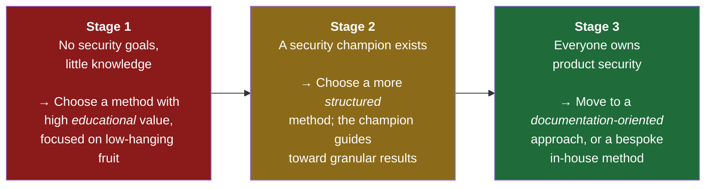
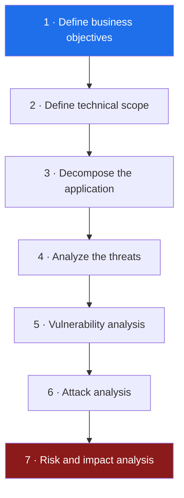
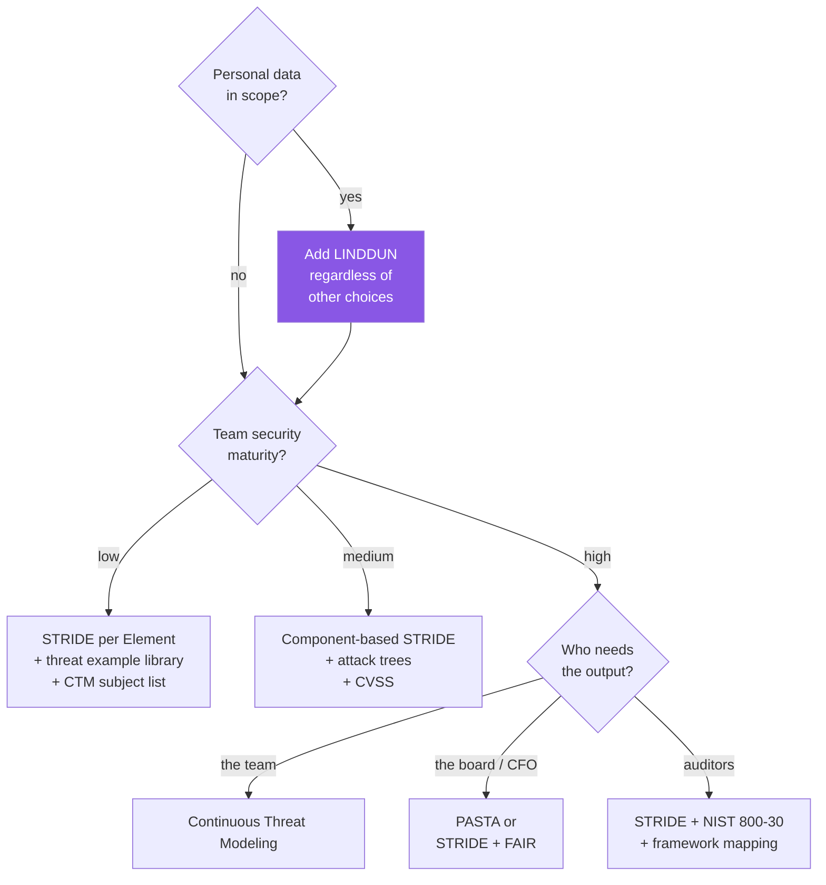

[← 14 Continuous Threat Modeling](14-continuous-threat-modeling.md) · [Contents](README.md) · [16 Tooling & Automation →](16-tooling-automation.md)

# 15 · Methodology Comparison

---

## 15.1 There Is No Best Methodology

> 📘 **Theory.** A methodology that succeeds at one organization fails at another for reasons that have nothing to do with its technical merit: team culture, available expertise, development methodology, project stage, and compliance context all matter more than the framework's design.
>
> Ask two threat modeling experts which methodology they prefer and you'll get three answers.

**Team maturity is the biggest single factor:**

Pick the method that moves you to the *next* stage, not the one with the best reputation.

---

## 15.2 The Grading Rubric

> 📘 **Theory.** Seven parameters, scored 0–5, from Tarandach & Coles. These are informed opinion, not survey data — but the *parameters* are the durable contribution.

| Parameter | The question it asks |
|---|---|
| **Accessible** | Can development teams use it independently, without deep security expertise? |
| **Scalable** | Can it apply across many teams and products? Does it bottleneck on specialists? |
| **Educational** | Does it teach, or does it audit? Does the team end up knowing more? |
| **Useful** | Are the findings valid and applicable? Does it match the intent? |
| **Agile** | Does it drain team velocity? Does it tolerate change mid-model? |
| **Representative** | Does the abstraction match the implementation? |
| **Unconstrained** | After the known suspects, does it permit further exploration? |

---

## 15.3 The Methodologies

### STRIDE

Six threat categories mapped to violated security properties. See [06](06-stride.md).

| Parameter | Score | Why |
|---|---|---|
| Accessible | 2 | Teams can execute it with varying success depending on prior security knowledge |
| Scalable | 3 | Usable by many teams, but efficacy varies wildly team to team |
| Educational | 3 | Good learning opportunity — but mostly only if a security practitioner is present |
| Useful | 4 | Well-suited to software systems; findings are relevant to what the team sees as current threats |
| Agile | 2 | Works best with many people in one room sharing assumptions; seen as a resource drain by some orgs |
| Representative | 2 | Fires well against a truthful snapshot; struggles to follow ongoing development |
| **Unconstrained** | **5** | Works on *impacts*, so no constraint on threat source or system view — explore freely |

**STRIDE per Element** shifts this: Scalable 3→4, Agile 2→3, Representative 2→3, but Unconstrained 5→3. You trade exploration for tractability. **STRIDE per Interaction** grades equivalently to per Element.

---

### PASTA — Process for Attack Simulation and Threat Analysis

> 📘 Risk-centric, seven stages, by Tony UcedaVélez and Marco Morana (2012). Stages 1, 2, and 7 anchor in business context; stages 3–6 are for architects, developers, and appsec.

**PASTA redefines some terms** — worth knowing if you read PASTA material:

| Term | Meaning in PASTA |
|---|---|
| Asset | A resource with intrinsic *business* value — including **the reputation of the business** |
| Threat | Anything that can unfavorably impact an asset |
| Weakness/vulnerability | What an attack leverages — a technical issue *or* a poor business process |
| Use case / Abuse case | Expected behavior / manipulation of that behavior for ulterior motives |
| Attack vector | An interface through which an attack traverses |
| Attack surface | The set of all possible attack vectors, logical and physical |
| Impact | The direct or indirect **financial value** of the damage |

#### 🏢 PASTA applied to our bucket (abbreviated)

**Stage 1 — Business objectives.** Covered in [02](02-business-context.md). Output is a business impact analysis and risk profile. Requires product owners, business owners, sometimes C-level.

**Stage 2 — Technical scope.**
- Cloud: AWS · S3, CloudFront, WAF, KMS, CloudTrail, IAM
- Actors: anonymous internet users · authenticated customers · internal analysts · CI/CD pipeline · partners
- Data sources: customer app writes, avatar uploads, analytics export job
- Data sinks: S3 prefixes, CloudTrail, log bucket
- Protocols: HTTPS/TLS 1.2+, SigV4
- Third-party infrastructure: GitHub Actions, one partner integration
- Secure design complete? **No** — 13 P0 requirements open ([10](10-security-requirements.md))

**Stage 3 — Decompose.** Use cases enumerated, DFDs built ([04](04-dfd-library.md)), trust boundaries placed: internet · AWS edge · AWS account · CI/CD.

**Stage 4 — Analyze threats.** High-level threat table:

| Threat title | Description | Impact | Components | Countermeasures |
|---|---|---|---|---|
| Unauthorized outsider access to customer PII | Bucket exposed to internet without authentication | **High** — the primary threat | S3 customer-data prefix, bucket policy | Block Public Access · deny ListBucket · bucket separation · Config rules |
| Unauthorized insider access | Root-only AWS access means every operator has full data access | **High** | Entire account | RBAC via Entra ID + PIM · audit role without GetObject ([12](12-identity-iam-entra.md)) |
| Malicious content staged and served from a trusted domain | UGC stored and served without scanning | **Medium-High** — third-party harm | `/avatars/` prefix, CloudFront | Scan · re-encode · isolate bucket · CSP |
| Integrity substitution during batch read | TOCTOU between validation and read | **Medium** | Analytics Reader | Conditional reads · pinned versionId |

*Internal threat intelligence* (past incidents → learnings → is it covered?) and *external threat intelligence* feed this stage. Then **update threat libraries** — iterate CAPEC and mark applicability:

| CAPEC ID | Pattern | Applicable here? |
|---|---|---|
| CAPEC-116 | Excavation (systematically retrieving data) | **Yes** — public ListBucket makes this trivial |
| CAPEC-150 | Collect data from common resource locations | **Yes** — predictable bucket/key naming |
| CAPEC-1 | Accessing functionality not properly constrained by ACLs | **Yes** — legacy ACL path still evaluated |
| CAPEC-66 | SQL injection | **No** — no SQL interpreter in scope |
| CAPEC-549 | Local execution of code | **Partial** — only via the UGC parsing path |

**Stage 5 — Vulnerability analysis.** Weak design patterns visible from the DFD: only one meaningful trust layer between internet and PII; three data classifications in one bucket; no integrity verification anywhere.

**Stage 6 — Attack analysis.**

| Attack scenario | Internal/External | Requirements for the attacker |
|---|---|---|
| Opportunistic scanner finds and downloads the bucket | External | None — bucket name only |
| Registered customer uploads a steganographic payload | External | A free account |
| Insider with root access reads PII | Internal | Existing employment |
| Attacker compromises GitHub Actions and rewrites the policy | External | Compromise of the CI/CD platform or a maintainer account |

**Stage 7 — Risk and impact analysis.** Per threat: calculate risk, identify countermeasures, calculate residual, recommend strategy. This is [09](09-risk-scoring.md) and [A](A-findings-register.md).

| Parameter | Score | Why |
|---|---|---|
| Accessible | 1 | Needs many roles engaged and a large time investment |
| Scalable | 3 | Much of the framework is reusable across instances |
| Educational | 1 | Relies on a dedicated "threat modeler" role; the team receives conclusions rather than building them |
| Useful | 4 | A well-executed PASTA gives views from many angles, with viable attacks and useful risk acceptance |
| Agile | 1 | Not lightweight; assumes design details are known up front |
| Representative | 2 | Excellent if development is genuinely waterfall; poor otherwise |
| Unconstrained | 2 | Leans heavily on CAPEC/CVE/CWE; limited consideration of system-specific novel threats |

---

### Trike

> 📘 Framework for security auditing from a risk-management perspective (Saitta, Larcom, Eddington, 2005). Unusual in three ways: it aims to generate threats **semi-automatically** without brainstorming; it takes the **defender's** point of view rather than the attacker's; and it categorizes *all* threats as either **denial of service** or **elevation of privilege**.

**How it works:** build a requirements model as an **actor-asset-action matrix** — rows are actors, columns are assets, each cell holds the four CRUD actions, each marked *allowed*, *disallowed*, or *allowed with rules*. Then: one DoS threat per intended action; invert the intended-action set and subtract disallowed actions to yield the EoP threats. That set is claimed complete.

**Its best contribution** is the DFD stopping rule: **decompose until no processes cross trust boundaries.**

| Parameter | Score | Why |
|---|---|---|
| Accessible | 1 | Sound ideas, but poorly documented; tooling is partial and dated |
| Scalable | 5 | Reusable as-is across the organization |
| Educational | 3 | Enumerating actors, assets, and rules generates good discussion |
| Useful | 2 | Too many dangling points; interesting intellectually, limited in practice |
| Agile | 2 | Assumes the system is fully known at modeling time |
| Representative | 5 | Analyzes fully formed systems |
| Unconstrained | 2 | Attack-tree-bound |

#### 🏢 A Trike-style matrix for our bucket

| Actor ↓ / Asset → | Public assets | UGC/avatars | Customer PII | Bucket policy |
|---|---|---|---|---|
| Anonymous user | R | R | **R ⚠ should be none** | none |
| Authenticated customer | R | C, R *(own only)* | none | none |
| Internal analyst | R | none | R | none |
| CI/CD deploy role | none | none | none | **C, R, U, D** |
| Admin (PIM) | CRUD | CRUD | CRUD *(logged)* | CRUD |

The ⚠ cell **is** finding F-01. Building the matrix finds it mechanically — no creativity required. That's Trike's actual selling point.

---

### LINDDUN

Privacy threat modeling. Full treatment in [07](07-linddun-privacy.md). Grades equivalently to STRIDE per Element, since it applies the same way.

---

### TARA — Threat Assessment and Remediation Analysis

> 📘 Developed at MITRE (Jackson Wynn et al., 2011), used by US Army, Navy, and Air Force. Distinctive premise: **assume the attacker has already bypassed perimeter controls.** How does the system survive and keep functioning with the adversary inside? Focused on the acquisition phase — assessing systems built elsewhere.

Two phases: **Cyber Threat Susceptibility Assessment** (rank attack vectors by risk → vulnerability matrix) then **Cyber Risk Remediation Analysis** (rank countermeasures by effectiveness and cost → solution effectiveness table).

**Its 12-factor scoring model** is worth borrowing even if you never use TARA, because several factors appear nowhere else: proximity required · locality of effects · **recovery time** · **restoration cost** · impact split across C, I, and A separately · prior use evidence in threat databases · required skills · required resources · **stealth** (how detectable the technique is) · **attribution** (does residual evidence identify the attacker).

| Parameter | Score | Why |
|---|---|---|
| Accessible | 5 | Presupposes a dedicated modeling team; fully accessible *to them* |
| Scalable | 5 | Process reusable as-is |
| Educational | 2 | Team receives a to-do list; the catalog itself has training value |
| Useful | 2 | Operates on fully formed systems; poorly placed to influence design |
| Agile | 1 | Not lightweight |
| Representative | 5 | Analyzes complete systems |
| Unconstrained | 2 | Catalog-bound, and catalogs update slowly from past-observed events |

> 💡 **Bridge — borrow the stealth and restoration-cost factors.** For our bucket: public `GetObject` reads are near-**undetectable** without CloudTrail data events, and **attribution** is impossible because there's no identity. Those two factors alone justify LOG-1 and LOG-2 in [10](10-security-requirements.md) more persuasively than "logging is a best practice."

---

### DREAD

> 📘 Five categories scored 0–10, averaged or summed. **D**amage · **R**eproducibility · **E**xploitability · **A**ffected users · **D**iscoverability. Microsoft's partner to STRIDE — STRIDE finds, DREAD ranks.
>
> **Status: largely retired.** Microsoft discontinued it because the ratings proved too subjective. Included here because you'll encounter it, and because the *dimensions* remain a useful discussion prompt.

Common scoring anchors:

| Category | Anchors |
|---|---|
| Damage | 0 none · 5 information disclosure · 8 non-sensitive individual data · 9 non-sensitive admin data · 10 destruction/loss of availability |
| Reproducibility | 0 nearly impossible · 5 complex · 7.5 easy · 10 very easy |
| Exploitability | 2.5 advanced skills · 5 available tools · 9 application proxies · 10 browser only |
| Affected users | 0 none · 2.5 individuals · 6 few · 8 admin users · 10 all users |
| Discoverability | 0 hard · 5 discoverable via open requests · 8 publicly known · 10 trivially visible |

Summed bands: 1–10 Low · 11–24 Medium · 25–39 High · 40–50 Critical.

#### 🏢 DREAD on F-01 (public bucket policy)

| Category | Score | Reasoning |
|---|---|---|
| Damage | 9 | Sensitive personal and regulated data disclosed |
| Reproducibility | 10 | Trivially repeatable — issue a GET |
| Exploitability | 10 | Browser only. No tools, no skills |
| Affected users | 10 | All ~3M customers |
| Discoverability | 10 | Internet-wide scanners index public buckets continuously |
| **Total** | **49 / 50** | **Critical** |

> 💡 **Bridge — and the caveat that matters.** 49/50 is nearly the maximum. That's *directionally* correct and useful for triage. But two analysts scoring the same finding can land several points apart, and the number carries a false air of precision. Use it to sort; use FAIR ([09](09-risk-scoring.md)) to decide budget.

---

### Attack Trees

One of the oldest techniques (Schneier, 1999). Root = attacker goal; branches = ways to achieve it. Full treatment in [08](08-attack-trees-capec.md). Rarely used alone now — most often embedded inside STRIDE, PASTA, or CVSS-based work.

---

### Specialized: SPARTA and INCLUDES NO DIRT

**SPARTA** (KU Leuven) — continuous threat elicitation with a tool. Notable for two things: it recognizes a threat as mitigated **if any declared security solution covers it**, wherever that solution sits (so an architect can play "what if" with systemic vs. focused mitigations); and it runs **FAIR with Monte Carlo simulation on every risk factor**, with customizable attacker personas from script-kiddie to nation-state.

**INCLUDES NO DIRT** — combines STRIDE and LINDDUN and adds compliance categories, aimed at clinical/healthcare environments. Adds Clinical error, Unlicensed activity, Overuse, Data error to the familiar letters. Accessible to non-specialists by design, but rigid outside healthcare.

---

## 15.4 The Comparison Table

| | Accessible | Scalable | Educational | Useful | Agile | Representative | Unconstrained |
|---|---|---|---|---|---|---|---|
| **STRIDE** | 2 | 3 | 3 | 4 | 2 | 2 | **5** |
| **STRIDE per Element** | 2 | 4 | 3 | 4 | 3 | 3 | 3 |
| **PASTA** | 1 | 3 | 1 | 4 | 1 | 2 | 2 |
| **Trike** | 1 | **5** | 3 | 2 | 2 | **5** | 2 |
| **TARA** | **5** | **5** | 2 | 2 | 1 | **5** | 2 |
| **CTM** *(see [14](14-continuous-threat-modeling.md))* | 4 | 4 | **5** | 4 | **5** | **5** | 4 |
| **This guide's hybrid** | 3 | 4 | 4 | 4 | 3 | 3 | 4 |

---

## 15.5 How to Choose

**Pragmatic advice:** pick one and try it. If it doesn't work, try another. Once you have experience, tailor or combine them — most mature practices end up with a house method. What matters is that your approach delivers the six requirements of a complete methodology in [01 §1.10](01-foundations.md).

---

## 15.6 Learning Through Games

> 📘 **Theory.** Gamification has a documented track record for teaching threat modeling to non-security people, by leveraging curiosity and competitiveness.

| Game | Implements | Idea |
|---|---|---|
| **Elevation of Privilege** (Shostack) | STRIDE | Card suits are the STRIDE categories; each card proposes a threat. If you can apply it to your system, it becomes a finding |
| **Elevation of Privilege and Privacy** (Vinkovits) | STRIDE + privacy | Adds a Privacy suit for actionable, high-privacy-risk cards |
| **OWASP Cornucopia** | — | Targets security *requirements* and user stories rather than threats; e-commerce oriented |
| **Security & Privacy Threat Discovery Cards** (U. Washington) | — | Four dimensions: Human Impact, Adversary's Motivations, Adversary's Resources, Adversary's Methods. More a directed discussion than a game |
| **LINDDUN GO** | LINDDUN | Lightweight privacy elicitation via threat-type cards; good for beginners |

Genuinely worth trying for a Stage-1 team — the educational return per hour is high.

---

[← 14 Continuous Threat Modeling](14-continuous-threat-modeling.md) · [Contents](README.md) · [16 Tooling & Automation →](16-tooling-automation.md)
