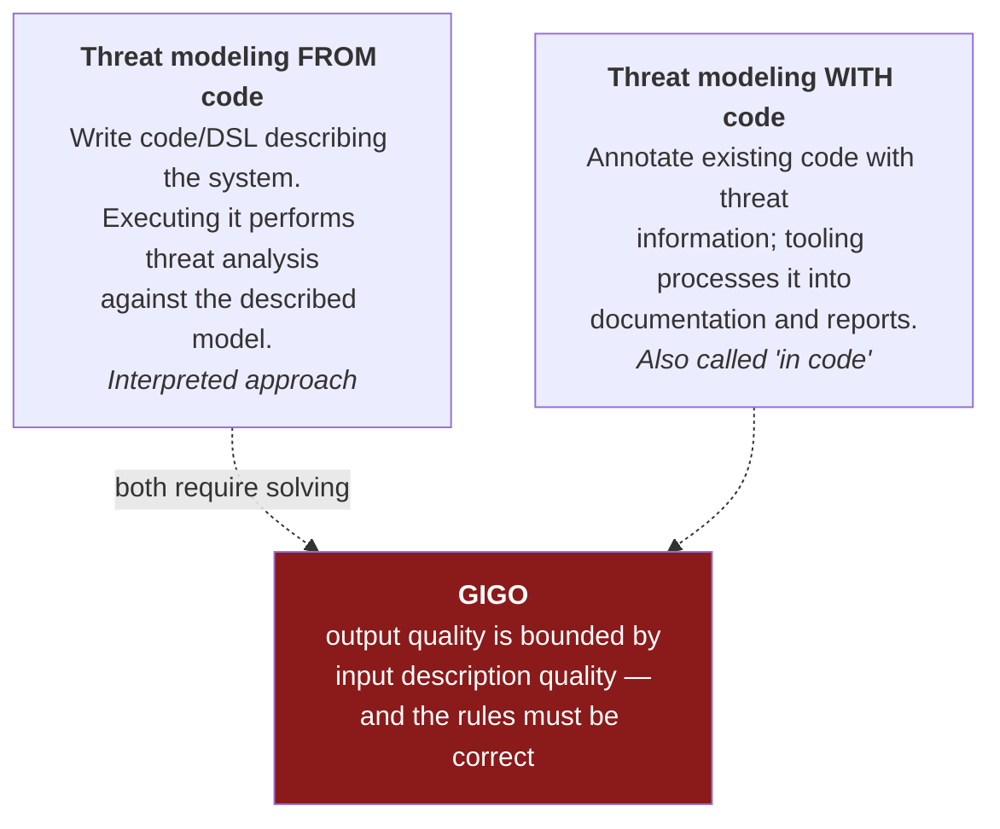
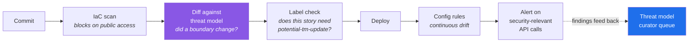

[← 15 Methodology Comparison](15-methodology-comparison.md) · [Contents](README.md) · [A · Findings Register →](A-findings-register.md)

# 16 · Tooling & Automation

---

## 16.1 Why Automate

> 📘 **Theory.** Manual threat modeling is hard for reasons that don't go away with effort:
> - It needs **rare, specialized talent** — training plus a healthy dose of pessimism about what could go wrong
> - There's **a lot to know**, and the surface keeps growing as technology changes
> - There are **many competing options** for methodology, tooling, and record-keeping
> - **Stakeholders are hard to convince**: everyone is busy; not everyone understands the system as specified vs. designed vs. implemented; few people have cross-knowledge of others' areas (the *three blind men and the elephant* problem); and occasionally someone is defensive or misleading
> - **Reading the code doesn't show the whole picture** — and if code exists, you may already have missed the chance to avoid design-level mistakes
> - **Building and maintaining the model takes real time**, and nothing is static

Automation addresses several of these. It cannot address all of them, and pretending otherwise is its own risk.

---

## 16.2 Two Paradigms

> 📘 **The hard part is not the automation.** It's expressing the system in a way a computer can understand **without actually building the system**. Pattern recognition — the thing a human brain does well and a program does badly — is exactly what threat modeling depends on.

---

## 16.3 The Tools

| Tool | Type | Notes |
|---|---|---|
| **pytm** | From code (Python DSL) | Describe elements, flows, boundaries in Python; generates DFDs, sequence diagrams, and a findings report from a template. Open source. Good fit for IaC-centric teams |
| **Threatspec** | With code (annotations) | Annotates code with threat info; generates documentation and diagrams. **Does not perform analysis or detection itself** |
| **Threagile** | From code (YAML) | Describe the model in YAML, get risk rules applied and reports out |
| **OWASP Threat Dragon** | Diagramming + rules | Free, open source, browser or desktop. Good starting point |
| **Microsoft Threat Modeling Tool** | Diagramming + rules | Implements STRIDE per Interaction. Windows, free |
| **IriusRisk / SD Elements / ThreatModeler / Tutamen** | Commercial platforms | Threat libraries, workflow, integration. ThreatModeler notably uses PFDs as its primary model type |
| **CAIRIS** | Research/usability-focused | Design + security + usability together |
| **Threat-Modeling.com tool** | Browser-based | Free; DFD + STRIDE-oriented workflow |

---

## 16.4 The Threatspec Trade-Off (a caution that generalizes)

> 📘 **Theory.** Annotation-based tools bring security to coders in a form they already know, let the org define a common threat lexicon, and auto-generate genuinely useful documentation with diagrams and code snippets. Two real downsides:
>
> **1. It requires code to exist.** If the code is written, the design is largely solidified — so you're producing security *documentation*, which is valuable but is not threat modeling. Effectively, threat modeling "shifts right," which is the wrong direction. *(Mitigated somewhat by newer support for annotating plain-text files without code.)*
>
> **2. It requires expert knowledge anyway.** Someone still has to tell the team what a threat is and how to describe it — reintroducing the security-expert bottleneck that automation was supposed to remove.

> 💡 **Bridge.** The generalizable lesson: **automation moves the bottleneck, it doesn't remove it.** Any tool that produces threats from a model has a rules engine, and the rules encode someone's expertise. Ask of any tool: *whose knowledge is in the rules, how current is it, and can we extend it?*

---

## 16.5 What to Automate vs. What Not To

| Automate | Keep human |
|---|---|
| Diagram rendering from a model definition | **Deciding what the model contains** |
| Applying a known threat library to known element types | **Recognizing that an undocumented feature exists** (our avatar upload) |
| Config/IaC drift detection | **Deciding what "correct" means** |
| Generating reports in a standard format | Writing the **attack scenario prose** |
| Tracking findings through their lifecycle | **Risk acceptance decisions** |
| Alerting on security-relevant API calls | Interpreting whether a change is security-notable |
| Regression: has a previously-fixed issue returned? | The **conversation** ([03](03-session-facilitation.md)) |

> 💡 **Bridge — our own evidence.** F-07, F-09, and F-12 all came from someone in a room. No rules engine would have generated them, because each depended on knowing something the model didn't yet contain. Automate the bookkeeping so people have more time for the part that isn't automatable.

---

## 16.6 The DevSecOps Toolchain

> 📘 **Theory.** You cannot solve the modern threat landscape with one scanner and a checklist. The layers that actually matter, mapped to what they catch:
>
> | Layer | Catches | Maps to |
> |---|---|---|
> | Static analysis / code rules | Injection patterns early | A05 |
> | Dependency scanning + SBOM | "What are we actually running?" | A03 |
> | **IaC scanning** (Terraform, K8s) | Misconfiguration **before it's applied** | **A02** |
> | Artifact signing + verification at deploy | Provenance enforced, not just documented | A03, A08 |
> | Runtime monitoring + real alerting workflows | Detection, not just logs | A09 |
> | Chaos / failure-mode testing | Behavior under stress | A10 |
> | **Threat modeling** | **Design flaws with no signature** | **A06** |

**Three principles for configuration security specifically:**
1. **Move validation earlier.** If a risky configuration can reach production, the *process* is part of the vulnerability.
2. **Enforce safe defaults.** If a setting is missing, the secure option should win.
3. **Reduce environment drift.** Much misconfiguration comes from dev differing from staging differing from prod, then a change shipping without a clear picture of what it does.

### 🏢 Applied

| Layer | Our status | Requirement |
|---|---|---|
| IaC scanning | ❌ none | DEV-1 — blocking on public-access findings |
| Config drift detection | ❌ none | HRD-4 — AWS Config rules |
| Dependency scanning / SBOM | ❌ none | DEV-3 — the image parser especially |
| Artifact signing | ❌ none | P2 for now |
| Runtime detection + alerting | ❌ none | LOG-1, LOG-3, LOG-4 |
| Failure-mode testing | ❌ none | The A10 gap ([11 §11.6](11-compliance-mapping.md)) |
| Threat modeling | ✅ this guide | Continue via [14](14-continuous-threat-modeling.md) |

---

## 16.7 Threat Modeling in the Pipeline

**Step S2 is the interesting one and the least commonly implemented.** If your model is stored as code (pytm, Threagile), you can diff it in CI: *did this change add a data flow crossing a trust boundary? Did it add a new data store? Did it grant a new permission?* Those questions can be asked mechanically, and a "yes" is what should trigger the `potential-tm-update` label rather than relying on a developer to remember.

---

## 16.8 Choosing a Tool

Ask in this order:

1. **Does it fit our existing workflow?** A tool requiring a separate portal nobody opens will not be used.
2. **Whose expertise is in the rules, and can we extend them?** ([§16.4](16-tooling-automation.md))
3. **Can the model live in version control?** If not, it will drift.
4. **Does it produce a standard report format?** That's what makes reviews transferable ([14 §14.4](14-continuous-threat-modeling.md)).
5. **Does it support the methodology we chose**, or is it quietly forcing a different one?
6. **What happens when we outgrow it?** Can you export the model?

> 📘 **Start manual.** Draw on a whiteboard, run one session, produce one baseline. You'll understand what you need from a tool far better after that than before — and you may find that a diagram in version control plus a standard markdown template covers most of it. This guide is, itself, that.

---

[← 15 Methodology Comparison](15-methodology-comparison.md) · [Contents](README.md) · [A · Findings Register →](A-findings-register.md)
